# Takuma-1 (Trinity Symbolic) · `TNS-1`

**Transformation Is All You Need — a white-box neuro-symbolic cognitive architecture.**

Technical specification of a white-box neuro-symbolic cognitive architecture developed
by **GOSIS VN**: an intuitionistic defeasible fuzzy Prolog kernel, a content-addressable
LMDB Merkle-DAG memory, 2D/2.5D/3D visual synthesis, active LiDAR robotics, and
sandboxed recursive self-improvement.

**Technical designation:** `TNS-1` (*Trinity Symbolic Systems*) · **Architecture
specification:** `U-NSCA v2 (P)` (`SPEC-UNSCA-V2-P-UNIFIED v1.0.9.3-FREEZE`)


-1D4ED8?style=flat-square)

-059669?style=flat-square)


[](https://www.rust-lang.org/)
[](https://isocpp.org/)
[](https://www.w3.org/TR/WGSL/)
[](https://en.wikipedia.org/wiki/Prolog)
[](https://smt-lib.org/)

-0284C7?style=flat-square)

[](LICENSE)

[🇬🇧 English](#english-en) ·
[🇯🇵 日本語](#japanese-ja) ·
[🇻🇳 Tiếng Việt](#vietnamese-vi) ·
[🇨🇳 中文](#chinese-zh) ·
[🗂️ Release package](#appendix-a-release-package-layout) ·
[📖 Citation](#appendix-b-citation) ·
[⚖️ License](#license)

---

> [!NOTE]
> English is the primary language of this document. Japanese, Vietnamese and Chinese
> translations follow the English section. Module names, symbols and technical terms
> stay in English in every section.

> [!WARNING]
> **Pre-implementation specification.** Latency, FPS, memory and throughput figures
> are **design targets**, not measured results. The release package in
> [Appendix A](#appendix-a-release-package-layout) is the planned layout.

> [!NOTE]
> **License.** The core runtime is released under the [MIT License](LICENSE).
> Third-party components keep their own licenses and are isolated — see
> [License](#license).

## Table of Contents

- [🇬🇧 English (EN)](#english-en)
- [🇯🇵 日本語 (JA)](#japanese-ja)
- [🇻🇳 Tiếng Việt (VI)](#vietnamese-vi)
- [🇨🇳 中文 (ZH)](#chinese-zh)
- [Appendix A — Release Package Layout](#appendix-a-release-package-layout)
- [Appendix B — Citation](#appendix-b-citation)
- [License](#license)

---

## English (EN)

🇬🇧 **English** — Takuma-1 (Trinity Symbolic) / `TNS-1`

> **Quick Jump:** [English](#english-en) · [日本語](#japanese-ja) · [Tiếng Việt](#vietnamese-vi) · [中文](#chinese-zh) · [↑ Top](#table-of-contents)

### 1. Abstract & Architectural Motivation

**Takuma-1 (Trinity Symbolic)** — designated technically as **TNS-1 (Trinity Symbolic Systems)** and developed by **GOSIS VN** — is a functionally disentangled, white-box neuro-symbolic cognitive architecture defined by the master engineering specification **U-NSCA v2 (P)** (`SPEC-UNSCA-V2-P-UNIFIED v1.0.9.3-FREEZE`, *GO for Phase 1A-Alpha Track 1*).

Rather than relying on a single monolithic neural network to store world knowledge, traverse multi-branch reasoning trees, and generate surface tokens simultaneously, **Takuma-1 (`TNS-1`)** operates under the paradigm ***Transformation Is All You Need*** to address four structural limitations of monolithic autoregressive transformers and pixel-space diffusion models:

| Structural Paradox | Limitation in Monolithic Architectures | Resolution in Takuma-1 (`TNS-1`) |
| :--- | :--- | :--- |
| **1. Non-Unifiability of Causal KV-Caches** | Under RoPE, converging reasoning branches with distinct prefixes or token offsets ($`t_1 \neq t_2`$) produce numerically distinct KV tensors ($`K_{B_1}(S) \neq K_{B_2}(S)`$), causing linear memory blowup across $`N \in [10^3, 10^4]`$ trajectories. | **Dual-Tier LMDB Merkle-DAG** (`Core_Axiom_LMDB` + `Ephemeral_Session_Arena`) with Mod TCLP constant lifting, iterative 1-WL + De Bruijn canonicalization, and 128-bit BLAKE3 sub-DAG deduplication in $`O(1)`$ (≈ 100 ns). |
| **2. Softmax Normalization Inertia** | Unit-simplex projection ($`\sum_v P(v \mid x) \equiv 1.0`$) collapses total evidence magnitude, conflating balanced conflict ($`[+50, +50]`$) with total ignorance ($`[-10, -10]`$) and degrading abstention accuracy. | **Atanassov Intuitionistic Fuzzy Logic** $`\langle \mu, \nu, \pi \rangle`$ ($`\mu + \nu + \pi = 1`$) with **Dissonance-First** (`Conflict_Aware_Refusal`) and **Dual Vacuity** (`Epistemic_Positive_Refusal` / abductive $`\Delta_i`$) routing gates. |
| **3. Linguistic–Logical Coupling & Alignment Tax** | Sharing forward-pass weights between logical deduction, syntax, and RLHF compliance guardrails incurs memory-bandwidth overhead and perturbs formal reasoning circuits. | **Decoupled Hub-and-Spoke Codec** (`mod-encoder` + `mod-slm`) with **PLSS** zero-copy `<PTR_ID_k>` splicing (0.00% factual drift) and a **6-Level Epistemic Priority Lattice** ($`\mathcal{L}_{\text{prio}} \in \lbrace 1,\dots,6 \rbrace`$). |
| **4. 2D Pixel-Grid & Monocular Scale Ambiguity** | Pixel diffusion lacks 3D Euclidean invariants; monocular projection $`\text{rank}(J_{\text{proj}}) = 2 < 3`$ is ill-posed under scale/illumination shifts, and dense multi-crop 4K GUI grounding violates low-latency SLAs. | **Dual-Path 2D/2.5D/3D Constructive Visual Engine** (`wgpu 30.0.1` + `vello 0.12.0` + `spade` + `faer`, >120 FPS, ≤ 2.45 ms/frame), **2-Tier 4K GUI Grounding** (OS A11y/DOM <1 ms), and **Active ToF LiDAR Robotics** (`HERO-LO`/`HP2-SLAM`, 500–1000 Hz). |

---

### 2. Core Design Philosophy & Four White-Box Safeguards

**Takuma-1 (`TNS-1`)** decomposes cognition into five orthogonal, formally verifiable planes and enforces four structural white-box containment invariants:

1. **Zero Latent Rules:** Knowledge acquired during offline dreaming (`RSI-1`) or online ingestion (`RSI-3`) never accumulates inside opaque neural weights. Every rule or physical law must crystallize into an inspectable 32-byte `AnnotatedPredicateNode` or closed-form SymEngine/SMT-LIB equation in `Core_Axiom_LMDB`.
2. **White-Box MDL Entropy Brake ($`\mathcal{H}_{\text{unverified}}`$) & Automated Pareto Eviction:** Tracks unverified structural complexity via:

   ```math
   \mathcal{H}_{\text{unverified}}
   = \sum_{v \in \mathcal{V}_{\text{auto}}} \bigl(\text{Depth}(v) + 1\bigr)\,\log_2\bigl(\lvert\text{Children}(v)\rvert + 2\bigr)
   \;\ge\; \lvert\mathcal{V}_{\text{auto}}\rvert\,\text{bits}
   ```

   When $`\mathcal{H}_{\text{unverified}} \ge \Theta_{\text{quota}}`$, Automated Pareto Eviction replaces lowest-utility macros while gating permanent commits behind 4-query SMT verification.
3. **Unified Host Trust Plane + Zero-Network Zone 4A Sandbox & 128-Byte C-ABI Airlock:** Trusted Hub components (`core/unsca-kernel`, single-owner `mod-lmdb` with `PROT_READ` mmap on Edge, `mod-encoder`, `mod-slm`, `mod-streamer-rt`, and the Host Orthogonal Judge) run on the Host. Untrusted execution runs strictly inside pure-CPU **Firecracker v1.18.0** MicroVMs (**Zone 4A**, `eth0` stripped, VMGenID + `virtio-rng` + UFFD warm pool 3–8 ms). Zone 4B (inline Blender) is permanently removed. All Zone 4A ↔ Host traffic crosses a fail-closed 128-byte C-ABI (`Host UnixStream <-> Guest AF_VSOCK`, zero Host `vhost_vsock`) with RFC 8032 Ed25519 `verify_strict` on the trusted Judge/Trainer → `mod-lmdb` plane.
4. **0.5 ms Surgical Abscission & Merkle-Root Time-Travel Rollback:** Every commit epoch $`e`$ records an immutable `Merkle_Root_Hash(e)` in `Epoch_Roots`, allowing sub-millisecond excision of a specific 128-bit `node_hash` or atomic rollback to `Merkle_Root_Hash(e - k)`.

---

### 3. System Architecture & Bidirectional Hourglass Topology

`TNS-1` executes end-to-end cognition across a closed **Bidirectional Hourglass** (*Inverted Triangle → White-Box Canonical Neck → Forward Triangle*) wired on a Rust 2024 **Hub-and-Spoke** workspace (`core/unsca-kernel` → `system/` → `modules/mod-*`).

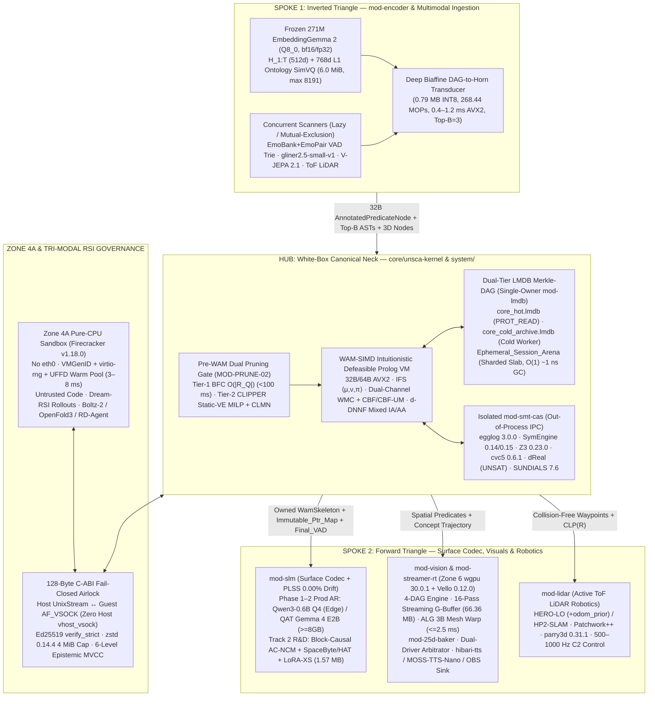

#### The Six Interoperable Subsystems

1. **Compiled Intuitionistic Defeasible Fuzzy Prolog Kernel (`core/unsca-kernel`):** Executes on a SIMD-aligned Warren Abstract Machine (`WAM-SIMD`) over Atanassov IFS triples $`\langle \mu, \nu, \pi \rangle`$, with separate conjunction ($`\otimes_{\text{AND}}`$) and Modus Ponens detachment ($`\odot_{\text{MP}}`$), phased execution (Phase 1A Stratified Horn/Datalog → Phase 1B native-Rust tabling + Mod TCLP polyhedral subsumption), `SpecTemp` isotropic 64-bit SimHash (`s_accum: [i32; 64]`), Dual-Channel WMC + Jøsang CBF/CBF-UM, `d-DNNF` Mixed IA/AA ($`M_{\max} \in \lbrace 32, 64 \rbrace`$), Tier-1 polynomial Bounded Forward-Chaining + Tier-2 `CLIPPER` static-VE MILP + `CLMN`, and offline asynchronous `EGG-SR` equation discovery constrained by Augmented Buckingham $`\Pi`$ and 4-query SMT verification (`z3 0.23.0` / `cvc5 0.6.1` / `dReal` UNSAT-only).
2. **Dual-Tier Content-Addressable LMDB Merkle-DAG (`modules/mod-lmdb`):** Combines persistent read-only memory-mapped `Core_Axiom_LMDB` (split into `core_hot.lmdb` and isolated cold-worker `core_cold_archive.lmdb` via `heed 0.23.1`, composite `(skeleton_hash, polyhedron_id)` prefix scans, SIMD AABB pre-filtering, async `DashMap` ref-counting) with a session-wide sharded-slab `Ephemeral_Session_Arena` ($`O(1) \approx 1\,\text{ns}`$ GC) and 128-bit BLAKE3 hashing over 1-WL + De Bruijn canonicalized ASTs.
3. **Decoupled Encoder (`mod-encoder`) & Pragmatic AR / Track-2 AC-NCM Surface Codec (`mod-slm`):** Pairs 100% frozen 271M text-only `EmbeddingGemma 2` (`Q8_0`, $`d_{\text{model}} = 512`$ via `llama.cpp` PR `#30054` $`H_{1:T}`$ patch or dual-output `ort` ONNX + 768d Level-1 Ontology SimVQ `MAX_NCM_CONCEPT_ID = 8191`) and a 0.79 MB Deep Biaffine head (Tier-1 closed-schema slot-filling; Tier-2 Roundtrip Verification + distilled `GenV+HN` anti-VPU) with Phase 1–2 production compact AR (`Qwen3-0.6B Q4` Edge / `QAT Gemma 4 E2B` Workstation-Server ≥ 8 GB RAM + Typed AST Pretty-Printer + PLSS `<PTR_ID_k>` splicing) and decoupled Track 2 R&D Block-Causal AC-NCM (`K_AC in {5,6}` SimVQ + SpaceByte/T-Free HAT + Activation-Aware LoRA-XS 1.57 MB, gated on OpenWebText PPL < 45).
4. **Dual-Path 2D/2.5D/3D Visual Synthesis, VTuber 2.5D & Active LiDAR Robotics (`mod-vision`, `mod-streamer-rt`, `mod-lidar`):** Achieves >120 FPS (≤ 2.45 ms/frame 2.5D Mesh Warp) via the 4-DAG Visual Tool Engine (`G_topo, G_stroke, G_shade, G_logic_vis`), `V-JEPA 2.1` + CIELAB (ΔE < 2.3 JND) + bounded Windfoil + `MI-GAN` (MIT), `mod-25d-baker` (1-view *Unleashed* vs. 6-view *Strict* + 52 ARKit blendshapes + `VirtualProxyRig3D`), live 2.5D runtime (`ALGORITHM 3B` + `mod-streamer-io` + Dual-Driver Arbitrator + `mod-broadcast-sink` zero-copy OBS + `hibari-tts`/`MOSS-TTS-Nano`/`Kokoro-82M`/`Paradee-8M`), native `wgpu 30.0.1` + `vello 0.12.0` 16-pass streaming G-Buffer (66.36 MB reused scratch), `spade 2.15.1` CDT + `faer 0.24.4` Polar $`\mathrm{SO}(2)`$ ARAP, `WAFT` + `RobMOT`, and `HERO-LO`/`HP2-SLAM` + `Patchwork++` + `parry3d 0.31.1` 500–1000 Hz robotics.
5. **White-Box MIT Sandboxed Runtime & Tri-Modal RSI (`modules/mod-rsi-sandbox`):** Isolates untrusted execution in pure-CPU Firecracker v1.18.0 (Zone 4A), coordinates `RSI-1` (Offline Dream-RSI + `E-Stitch`/`Propper`), `RSI-2` (Local Edge $`L_\infty`$-Bounded Zero-Sum BTL vs. Central 4-Gate Crystallization), and `RSI-3` (Online Licensed RSI + Orthogonal Host Judge + `f64` Decayed West Volatility $`\sigma^2_{\text{vol}}`$ + 6-Level Epistemic Governance) over a fail-closed 128-byte C-ABI airlock (`zstd 0.14.4` 4 MiB cap).
6. **Hybrid Micro-Batching Production Serving & Stage-Gate Pipeline:** Combines Zero-Batching symbolic `Ephemeral_Session_Arena` isolation (<5 μs/session) over shared `mmap(PROT_READ | MAP_SHARED)` with Ragged Dynamic Micro-Batching for shared-basis LoRA-XS neural spokes, Linux `cgroup v2` split memory hygiene, and an 11-month Stage-Gate roadmap with a zero-rewrite **Gemma 5** drop-in portal.

---

### 4. End-to-End Execution & Subsystem Pipelines

#### 4.1 End-to-End Multimodal Cognitive Pipeline (`POST /v1/cognitive/execute` — `ALG 4B & 5`)

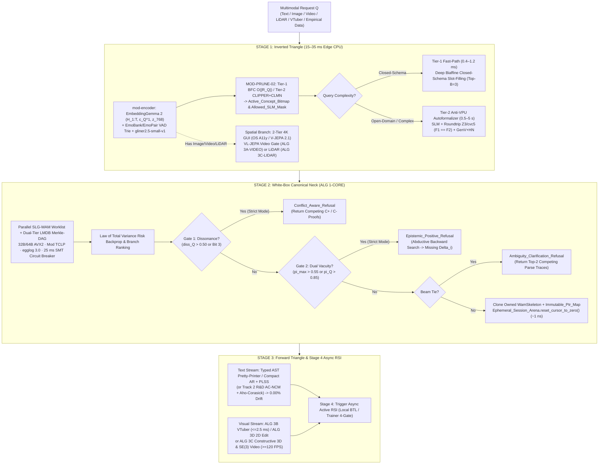

#### 4.2 Dual-Path Visual Synthesis (`ALG 3B / 3C / 3D`) & Active LiDAR Robotics (`ALG 3C-LIDAR`)

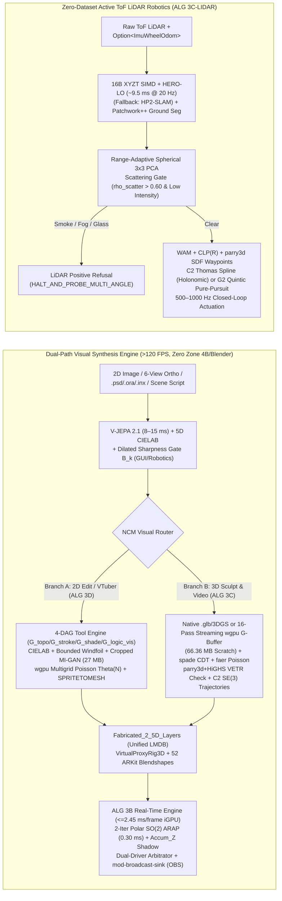

#### 4.3 Tri-Modal Recursive Self-Improvement (`Tri-Modal RSI`) & 128-Byte Airlock Pipeline

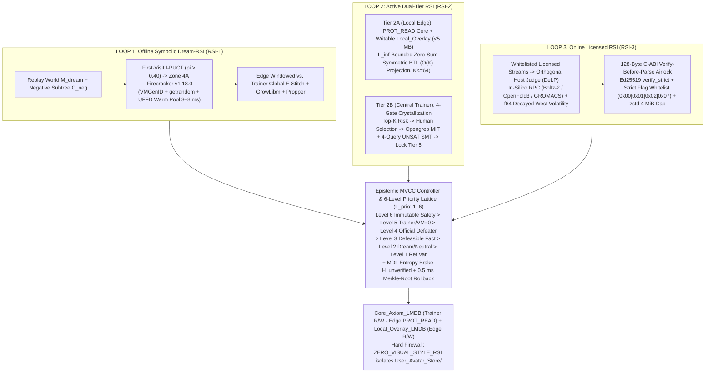

---

### 5. Edge Memory Budget (`cgroup v2`) & Target Specifications

#### 5.1 Edge Mode `cgroup v2` Split Memory Accounting (`anon <= 1,536 MiB`, `memory.high = 3,072 MiB`, `memory.max = 4,096 MiB`)

| Edge Mode Component | `anon` (MiB) | `file` (MiB) | Allocation Mechanism & Hardening Policy |
| :--- | ---: | ---: | :--- |
| **HUB (`WAM-SIMD` + Arena + `egglog`)** | 350 | 0 | Sharded slabs, `TableSlots`, `egglog` (≤ 10k e-nodes) |
| **`Qwen3-0.6B Q4` KV + Compute Scratch** | 159 | 0 | Locked `-c 2048 -ctk q8_0 -ctv q8_0 -fa on` (119 MiB KV + 40 MiB scratch) |
| **`mod-encoder` / `ort` / VAD Trie** | 220 | 40 | Frozen bf16/fp32 activations, L1 SimVQ, `gliner2.5-small-v1` (`disable_prepacking=1`, `cpu_mem_arena=false`); `canonical_ontology.bin` (40 MiB) |
| **`mod-streamer-rt` (Live 2.5D + TTS)** | 285 | 0 | `wgpu 30.0.1` + ARAP + face tracking + `hibari`/`MOSS-TTS-Nano` ONNX (100% concurrent) |
| **Runtime Stacks, Allocators & IPC** | 150 | 0 | Rayon worker stacks, `UnixStream` buffers, `io_uring` slots |
| **`EmbeddingGemma 2` (`Q8_0 .gguf`)** | 0 | 296 | Read-only `mmap` Page Cache (never `POSIX_FADV_DONTNEED`) |
| **`Qwen3-0.6B Q4` (`.gguf`)** | 0 | 500 | Read-only `mmap` Page Cache (never `POSIX_FADV_DONTNEED`) |
| **Compiled `.wamb` Bytecode** | 0 | 150 | `0_bootstrap_seed` + `1_logic_math_core` direct `mmap` |
| **`core_hot.lmdb` Hot Working Set** | 0 | 600 | `MADV_RANDOM`; `core_cold_archive.lmdb` isolated in cold worker `mm_struct` |
| **Edge Mode Total** | **1,164** | **1,586** | **Total `anon+file` ≈ 2,750 MiB** (≈ 372 MiB `anon` headroom; `mod-smt-cas` Z3 capped at 256 MB / ≤ 300 MiB cgroup) |

> **Hardware-Aligned Rust C-ABI Invariants (`const _: () = assert!(...)`):** `AnnotatedPredicateNode` = **32 B** (1 AVX2 YMM register) · `ArenaBranchStateHeader` = **48 B** · `WamBranchExecutionFrame` = **64 B** (1 L1 cache line) · `UnifiedDagNodeHeader` = **128 B** · `AirlockEpistemicFrame` = **128 B** (2 L1 cache lines).

#### 5.2 Target Product Specification Sheet

| Specification Metric | Standardized Target Value | Engineering Guarantee |
| :--- | :--- | :--- |
| **Minimum Core Storage** | `1.8 GB` (`0.4 GB` embedded + `25 MB` Day-0 Seed) | Compiled WAM-SIMD bytecode + Zstd `Core_Axiom_LMDB` + 1-WL BLAKE3 deduplication |
| **Extended Offloaded Banks** | `10 GB–50 GB` NVMe SSD (`4096 B` LBA `O_DIRECT`) | 3D Style PatchBanks + WGSL LUTs streamed on demand; LoRA-XS (1.57 MB) stays in RAM |
| **Per-User Isolation (Server)** | `< 5 us` per-session `Ephemeral_Session_Arena` | Multi-core Rayon over shared `PROT_READ` mmap; Firecracker Zone 4A for untrusted code |
| **Query Traversal SLA** | Tier-1: `P99 < 100 ms` (`8–45 ms` 8-core AVX2) · Tier-2: `0.5–5 s` | 32B/64B AVX2 + Tier-1 BFC $`O(\lvert R_Q\rvert)`$ + Mixed IA/AA d-DNNF + 25 ms SMT breaker |
| **Surface Text Throughput** | Phase 1–2 AR: `34–86 tok/s` · Track 2 AC-NCM target: `470–750 BPE-equiv tok/s` | `Qwen3-0.6B` (Edge) / `QAT Gemma 4 E2B` (≥ 8 GB) + PLSS; Track 2 gated on PPL < 45 |
| **Visual & Robotics Rate** | `120–408+ FPS` (≤ 2.45 ms/frame 1080p/2K) · Robotics: `500–1,000 Hz` | `faer` Cholesky + 2-iter Polar $`\mathrm{SO}(2)`$ ARAP (`0.30 ms`) + `Accum_Z` Porter-Duff + `parry3d` |
| **Closed-Domain Factual Drift** | **`0.00%`** on pointer-locked entities/numbers (`<PTR_ID_k>`) | `WamSkeleton` + Aho-Corasick `<PTR_ID_k>` verification + zero-copy PLSS splicing |
| **High-Ignorance / Conflict** | **`100%` deterministic** Conflict-Aware, Positive, or Ambiguity Refusal | Dissonance-first ($`\text{diss}_Q > 0.50`$) vs. Dual Vacuity ($`\pi_{\max} > 0.55 \lor \pi_Q > \theta_{\text{hard}}`$) |

---

### 6. Host Environment & Release Package

The release package directory layout is in [Appendix A](#appendix-a-release-package-layout).

**Host environment requirements (Linux `x86_64`, AVX2+FMA+AVX-VNNI):**

- **Kernel:** Ubuntu 24.04 / Linux Mint 22.x (`USN-9022-1`, `>= 6.8.0-149-generic`, `kernel.io_uring_disabled=0`) or LMDE 7 / Debian 13 (`>= 6.12.113-1`, patching `CVE-2026-99999`). Blacklist `vhost_vsock` on the Host to eliminate the `CVE-2026-53365` (*VsockDrop*) attack surface.
- **Toolchain:** Rust Edition 2024 via `rustup` (`MSRV 1.96`, `1.100` recommended; `[profile.release] panic = "unwind"` in the root `Cargo.toml` for the `spade 2.15.1` fallback).
- **Storage & KVM:** Unencrypted `ext4`/`xfs` (or full-disk LUKS; never `eCryptfs`) for `O_DIRECT`; add the user to the `kvm` group and raise `RLIMIT_MEMLOCK` if registering fixed `io_uring` buffers >8 MB.

---

### 7. Stage-Gate Roadmap & Evaluation Protocol

| Phase | Timeline | Scope & Exit Criteria |
| :--- | :--- | :--- |
| **Phase 1A-Alpha** | Weeks 1–6 | Pure symbolic core: Stratified Horn/Datalog on Rust + Atanassov IFS + `heed 0.23.1` Merkle-DAG + `egglog 3.0.0` + `z3`/`cvc5` + `Qwen3-0.6B` PLSS + Mandatory Hard Formal Probe Gate (`cargo check/clippy/proptest` 10k inputs/invariant). |
| **Phase 1A-Beta** | Weeks 7–12 | Neural loop closure: `EmbeddingGemma 2` $`H_{1:T}`$ patch + `SpecTemp` + Tier-1 Biaffine + Tier-2 Roundtrip/`GenV+HN`. Edge gated on **AbstentionBench** & **PlanBench**; Workstation/Server gated on **VeriBench** & **SWE-bench Verified**. |
| **Phase 1B (+ Track 3A)** | Weeks 13–20 | Native-Rust left-recursive tabling + Mod TCLP polyhedral subsumption + `d-DNNF` Mixed IA/AA ($`M_{\max} \in \lbrace 32,64 \rbrace`$) + Tier-2 `CLIPPER` static-VE. Parallel **Track 3A** (2.5D/VTuber Rust Engine) launches from Month 2. |
| **Phase 2** | Months 6–8 | 5-Family Commercial-Open Distillation (`Qwen3.8-27B` + `Qwen3.6-35B-A3B`, `MiMo-V2.6`, `GLM-5.3-Flash`, `DeepSeek-V4.1-Flash-1017`, `Gemma 4`) on Production AR + PLSS (0.00% `<PTR_ID_k>` drift). Decoupled **Track 2 AC-NCM R&D** gated on OpenWebText PPL < 45 & `<PTR_ID_k>` ≥ 99.9%. |
| **Phase 3** | Months 9–11 | Decoupled spoke integration (`mod-vision`, `mod-streamer-rt`, `mod-lidar`, `mod-rsi-sandbox` Firecracker v1.18.0 + `egg-stitch` → `egglog 3.0.0` port), `Harness^2` Round 2 tuning, and **Zero-Rewrite Gemma 5 Drop-In** (0 Rust lines changed via Major ABI pinning `0..4095`). |

**Five controlled benchmark suites & three mandatory ablations:**

1. *Combinatorial memory & sub-DAG deduplication:* `SWE-bench Verified`, `PlanBench`, `VeriBench` ($`N \in \lbrace 100, 500, 1000, 5000 \rbrace`$ branches).
2. *Epistemic positive refusal & anti-hallucination:* `AbstentionBench` (>35,000 items), `FalseQA` (TAR, FAR, VPU AUROC).
3. *Long-horizon 4K GUI & scientific workflows:* `ScreenSpot-Pro`, `OSWorld 2.0`, `OSWorld-Science`.
4. *Dual-path visual synthesis & active LiDAR:* `BlenderGym`/`BlenderBench`, synthetic blur disambiguation, smoke/glass LiDAR obstacle courses.
5. *Parallel AC-NCM throughput vs. factual fidelity:* dual-channel DDR5 CPU tok/s, OpenWebText PPL, `<PTR_ID_k>` exact match.

*Ablations:* (1) disable 1-WL + BLAKE3 deduplication and `Ephemeral_Session_Arena`; (2) replace IFS $`\langle \mu, \nu, \pi \rangle`$ and `lineage_bloom_mask` with scalar probabilities; (3) remove the Orthogonal Host Judge, 128B Airlock, West $`\sigma^2_{\text{vol}}`$ and `cvc5` verification.

---

### 8. Languages Used, License & Citation

**Languages and formats used:**

| Language / format | Role in the system |
| :--- | :--- |
| **Rust** (Edition 2024, `MSRV 1.96`) | Primary language: `core/unsca-kernel`, `system/`, `modules/mod-*` (WAM-SIMD, LMDB, encoder, SLM, vision, streamer, lidar, RSI sandbox) |
| **Prolog / Datalog** (intuitionistic, defeasible) | Reasoning-rule language of the kernel, compiled to `.wamb` bytecode |
| **WGSL** | GPU shaders for `wgpu` / `vello` (procedural materials, LUTs, G-Buffer) |
| **SMT-LIB 2.6** | Equation and constraint representation verified by `z3` / `cvc5` / `dReal` |
| **DeLP** | Auditing rules of the Host Judge (`judge_eafs_rules.delp`) |
| **C++** | `llama.cpp` PR `#30054` patch (`H_1:T`) and native libraries called via FFI (`cvc5`, `Z3`, `SymEngine`, `SUNDIALS`) |
| **Python** (third-party) | Offline tools running inside Zone 4A (`RD-Agent`, `aideml`, `Boltz-2`, `OpenFold3`); not part of the core runtime |

**License:**

- **Core runtime:** [MIT License](LICENSE) (`core/unsca-kernel`, `system/`, Rust spokes).
- **Third-party & legal isolation:** `cvc5` (`--poly` GMP/LibPoly, LGPLv3) and the `Opengrep` CLI (LGPL-2.1, MIT rules subset only) execute strictly out-of-process via IPC/CLI; `EmoBank`/`EmoPair` VAD trie data (CC BY-SA 4.0) is packaged separately from the MIT Rust binaries; `ZERO_VISUAL_STYLE_RSI` and `mod-c2pa-export` (`c2pa 0.92.2`) enforce artist IP isolation and support EU AI Act Article 50 (Content Credentials) compliance.

**Citation:** see [Appendix B](#appendix-b-citation).

---

## Japanese (JA)

🇯🇵 **日本語** — Takuma-1 (Trinity Symbolic) / `TNS-1`

> **言語クイックジャンプ:** [English](#english-en) · [日本語](#japanese-ja) · [Tiếng Việt](#vietnamese-vi) · [中文](#chinese-zh) · [↑ トップへ](#table-of-contents)

### 1. 概要とアーキテクチャ動機

**Takuma-1 (Trinity Symbolic)**（技術コード：**TNS-1 / Trinity Symbolic Systems**、開発：**GOSIS VN**）は、マスターエンジニアリング仕様 **U-NSCA v2 (P)**（`SPEC-UNSCA-V2-P-UNIFIED v1.0.9.3-FREEZE`、*Phase 1A-Alpha Track 1 実装GO*）に基づく、機能分離型のホワイトボックス・ニューロシンボリック認知アーキテクチャです。

単一の巨大ニューラルネットワークに知識保持・多枝推論探索・表層トークン生成をすべて担わせるのではなく、**Takuma-1 (`TNS-1`)** は ***Transformation Is All You Need*** のパラダイムのもと、モノリシックな自己回帰Transformerおよびピクセル空間拡散モデルが抱える4つの構造的パラドックスを解消します。

| 構造的パラドックス | モノリシックモデルの構造的制約 | Takuma-1 (`TNS-1`) による解決策 |
| :--- | :--- | :--- |
| **1. 因果KVキャッシュの非統一性** | RoPE下では異なる前置列・トークン長（$`t_1 \neq t_2`$）を経由して同一サブゴールに収束する分岐でもKVテンソルが一致せず（$`K_{B_1}(S) \neq K_{B_2}(S)`$）、$`N \in [10^3, 10^4]`$ 分岐でメモリが線形膨張する。 | **二層構造 LMDB Merkle-DAG**（`Core_Axiom_LMDB` + `Ephemeral_Session_Arena`）。Mod TCLP定数リフト、反復1-WL + De Bruijn正規化、128-bit BLAKE3により $`O(1)`$（≈ 100 ns）で部分DAG重複排除を実現。 |
| **2. Softmax正規化慣性** | 確率単体制約（$`\sum_v P(v \mid x) \equiv 1.0`$）により証拠総量が消失し、均衡対立（$`[+50, +50]`$）と完全無知（$`[-10, -10]`$）が同一視され棄権精度が劣化する。 | **Atanassov直観主義ファジィ論理** $`\langle \mu, \nu, \pi \rangle`$（$`\mu + \nu + \pi = 1`$）と、**不協和優先**（`Conflict_Aware_Refusal`）および**二重空虚ゲート**（`Epistemic_Positive_Refusal` / アブダクション $`\Delta_i`$）を採用。 |
| **3. 言語・論理結合とアライメント税** | 論理推論回路と表層構文・RLHFポリシーが同一重みを共有するため、メモリ帯域浪費と数学・論理回路の劣化（Alignment Tax）が生じる。 | **分離型Hub-and-Spokeコーデック**（`mod-encoder` + `mod-slm`）＋**PLSS** ゼロコピー `<PTR_ID_k>` 接合（事実ドリフト 0.00%）＋**6段階認識優先度束**（$`\mathcal{L}_{\text{prio}} \in \lbrace 1,\dots,6 \rbrace`$）。 |
| **4. 2Dピクセル格子と単眼スケール曖昧性** | 拡散モデルは3Dユークリッド不変量を欠き、単眼投影 $`\text{rank}(J_{\text{proj}}) = 2 < 3`$ は不良設定問題となる。また高密度マルチクロップ4K GUIは低遅延SLAを破綻させる。 | **デュアルパス2D/2.5D/3D構成的視覚エンジン**（`wgpu 30.0.1` + `vello 0.12.0` + `spade` + `faer`、>120 FPS、≤ 2.45 ms/frame）、**2階層4K GUIグラウンディング**（OS A11y/DOM <1 ms）、**能動ToF LiDARロボティクス**（`HERO-LO`/`HP2-SLAM`、500–1000 Hz）。 |

---

### 2. 設計思想と4つのホワイトボックス封じ込め保証

**Takuma-1 (`TNS-1`)** は認知を5つの直交・形式検証可能なプレーンへ機能分離し、以下の4つの数理的ホワイトボックス封じ込め不変量を強制します。

1. **潜在ルール進化の禁止（Zero Latent Rules）：** オフライン夢想（`RSI-1`）やオンライン取得（`RSI-3`）で獲得された知識は不透明なニューラル重みに蓄積せず、すべて32バイトの `AnnotatedPredicateNode` または `Core_Axiom_LMDB` 内の閉形式 SymEngine/SMT-LIB 方程式へ結晶化されます。
2. **ホワイトボックスMDLエントロピーブレーキ（$`\mathcal{H}_{\text{unverified}}`$）と自動パレート追い出し：** 未検証構造複雑度を次の式で追跡します。

   ```math
   \mathcal{H}_{\text{unverified}}
   = \sum_{v \in \mathcal{V}_{\text{auto}}} \bigl(\text{Depth}(v) + 1\bigr)\,\log_2\bigl(\lvert\text{Children}(v)\rvert + 2\bigr)
   \;\ge\; \lvert\mathcal{V}_{\text{auto}}\rvert\,\text{bits}
   ```

   上限 $`\Theta_{\text{quota}}`$ 到達時に低効用マクロを自動置換。永続コミットは4クエリSMT検証を必須とします。
3. **統合ホスト信頼プレーン＋無ネットワーク Zone 4A サンドボックス＆128B C-ABI エアロック：** 信頼Hub（`core/unsca-kernel`、Edge上 `PROT_READ` 単一所有 `mod-lmdb`、`mod-encoder`、`mod-slm`、`mod-streamer-rt`、Host直交ジャッジ）をホスト上で実行。非信頼コードは純CPU **Firecracker v1.18.0**（**Zone 4A**、`eth0`除去、VMGenID + `virtio-rng` + UFFDウォームプール 3–8 ms）に隔離し、Zone 4B（インラインBlender）は完全廃止。境界通信はフェイルクローズドな128バイトC-ABI（`Host UnixStream <-> Guest AF_VSOCK`、ホスト側 `vhost_vsock` 不使用）と Ed25519 `verify_strict` で保護します。
4. **0.5 ms 外科的切除とMerkleルート・タイムトラベルロールバック：** 各エポック $`e`$ の不変ハッシュ `Merkle_Root_Hash(e)` を `Epoch_Roots` に記録し、特定 `node_hash` の削除または `Merkle_Root_Hash(e - k)` への原子的ロールバックを ≈ 0.5 ms で完了します。

---

### 3. システムアーキテクチャと双方向砂時計トポロジ

`TNS-1` は Rust 2024 の **Hub-and-Spoke** ワークスペース上で、閉じた**双方向砂時計（逆三角形 → ホワイトボックス正規ネック → 正三角形）**としてエンドツーエンド認知を実行します。

```mermaid
flowchart TB
    subgraph S1["SPOKE 1: 逆三角形 — mod-encoder & マルチモーダル入力"]
        ENC["完全凍結 271M EmbeddingGemma 2 (Q8_0, bf16/fp32)<br/>H_1:T (512d) + 768d L1 オントロジ SimVQ (6.0 MiB, 上限 8191)"]
        BIA["Deep Biaffine DAG-to-Horn トランスデューサ<br/>(0.79 MB INT8, 268.44 MOPs, 0.4–1.2 ms AVX2, Top-B=3)"]
        SCN["並列スキャナ (遅延ロード / 相互排他)<br/>EmoBank+EmoPair VAD Trie · gliner2.5-small-v1 · V-JEPA 2.1 · ToF LiDAR"]
        ENC --> BIA
        SCN --> BIA
    end

    subgraph HUB["HUB: ホワイトボックス正規ネック — core/unsca-kernel & system/"]
        PRUNE["Pre-WAM 二重剪定ゲート (MOD-PRUNE-02)<br/>Tier-1 BFC O(|R_Q|) (<100 ms) · Tier-2 CLIPPER Static-VE MILP + CLMN"]
        WAM["WAM-SIMD 直観主義撤回可能ファジィProlog VM<br/>32B/64B AVX2 · IFS ⟨μ,ν,π⟩ · Dual-Channel WMC + CBF/CBF-UM · d-DNNF Mixed IA/AA"]
        MEM["二層 LMDB Merkle-DAG (単一所有 mod-lmdb)<br/>core_hot.lmdb (PROT_READ) · core_cold_archive.lmdb (隔離Coldワーカー)<br/>Ephemeral_Session_Arena (シャードスラブ, O(1) ~1 ns GC)"]
        SMT["隔離 mod-smt-cas (別プロセスIPC)<br/>egglog 3.0.0 · SymEngine 0.14/0.15 · Z3 0.23.0 · cvc5 0.6.1 · dReal (UNSAT) · SUNDIALS 7.6"]
        PRUNE --> WAM
        WAM <--> MEM
        WAM <--> SMT
    end

    subgraph S2["SPOKE 2: 正三角形 — 表層コーデック・視覚合成・ロボティクス"]
        SLM["mod-slm (表層コーデック + PLSS ドリフト 0.00%)<br/>Phase 1–2 本番AR: Qwen3-0.6B Q4 (Edge) / QAT Gemma 4 E2B (>=8GB)<br/>Track 2 R&D: Block-Causal AC-NCM + SpaceByte/HAT + LoRA-XS (1.57 MB)"]
        VIS["mod-vision & mod-streamer-rt (Zone 6 wgpu 30.0.1 + Vello 0.12.0)<br/>4-DAG 視覚エンジン · 16パスG-Buffer (66.36 MB再利用) · ALG 3B Mesh Warp (<=2.5 ms)<br/>mod-25d-baker · Dual-Driver Arbitrator · hibari-tts / MOSS-TTS-Nano / OBS出力"]
        ROB["mod-lidar (能動ToF LiDAR ロボティクス)<br/>HERO-LO (+odom_prior) / HP2-SLAM · Patchwork++ · parry3d 0.31.1 · 500–1000 Hz C2制御"]
    end

    subgraph SEC["ZONE 4A サンドボックス & 三相RSIガバナンス"]
        Z4A["Zone 4A 純CPUサンドボックス (Firecracker v1.18.0)<br/>eth0除去 · VMGenID + virtio-rng + UFFDウォームプール (3–8 ms)<br/>非信頼コード実行 · Dream-RSI · Boltz-2 / OpenFold3 / RD-Agent"]
        AIR["128バイト C-ABI フェイルクローズド・エアロック<br/>Host UnixStream ↔ Guest AF_VSOCK (Host vhost_vsock 不使用)<br/>Ed25519 verify_strict · zstd 0.14.4 4 MiB上限 · 6段階認識MVCC"]
        Z4A <--> AIR
    end

    S1 -- "32B AnnotatedPredicateNode + Top-B AST + 3Dノード" --> HUB
    HUB -- "所有権付き WamSkeleton + Immutable_Ptr_Map + Final_VAD" --> SLM
    HUB -- "空間述語 + 概念軌跡" --> VIS
    HUB -- "無衝突ウェイポイント + CLP(R)" --> ROB
    HUB <--> AIR
```

---

### 4. エンドツーエンド実行・サブシステムパイプライン

#### 4.1 マルチモーダル認知実行パイプライン（`POST /v1/cognitive/execute` — `ALG 4B & 5`）

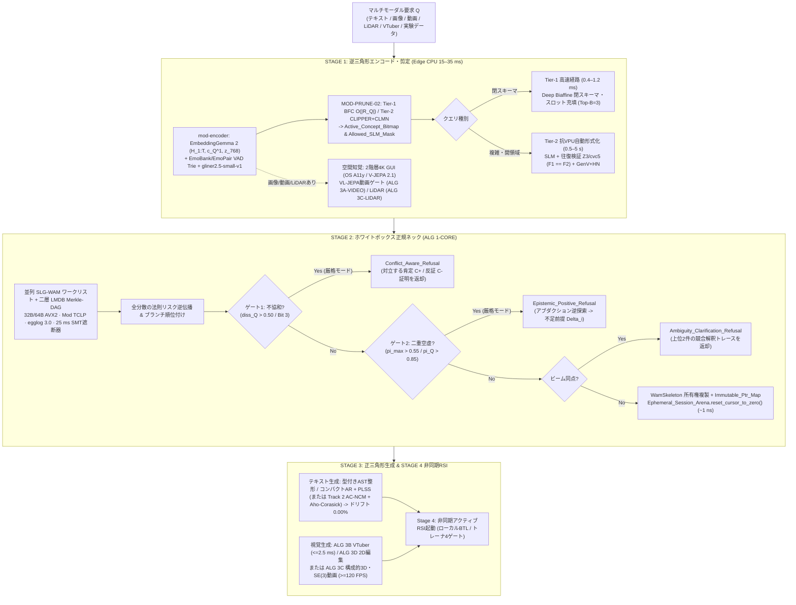

#### 4.2 デュアルパス視覚合成（`ALG 3B / 3C / 3D`）＆能動LiDARロボティクス（`ALG 3C-LIDAR`）

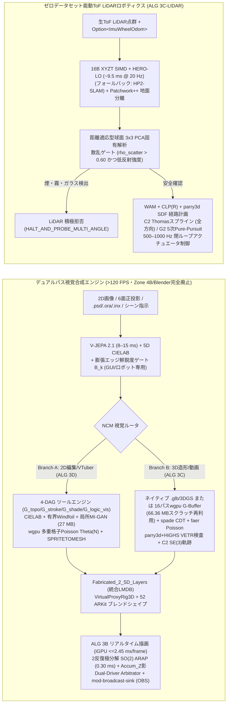

#### 4.3 三相再帰的自己改善（`Tri-Modal RSI`）＆128バイト・エアロック

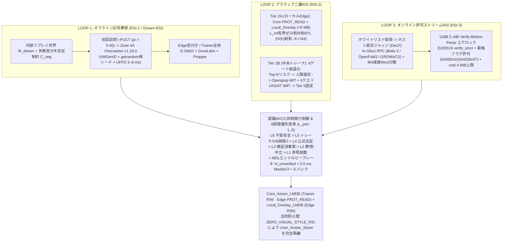

---

### 5. Edge メモリ予算（`cgroup v2`）および主要技術仕様

#### 5.1 Edgeモード `cgroup v2` 分離メモリ監査（`anon <= 1,536 MiB`、`memory.high = 3,072 MiB`、`memory.max = 4,096 MiB`）

| Edge コンポーネント | `anon` (MiB) | `file` (MiB) | 確保方式・硬化ポリシー |
| :--- | ---: | ---: | :--- |
| **HUB (`WAM-SIMD` + Arena + `egglog`)** | 350 | 0 | シャードスラブ、`TableSlots`、`egglog`（≤ 10k e-node） |
| **`Qwen3-0.6B Q4` KV + スクラッチ** | 159 | 0 | `-c 2048 -ctk q8_0 -ctv q8_0 -fa on` 固定（119 MiB KV + 40 MiB） |
| **`mod-encoder` / `ort` / VAD Trie** | 220 | 40 | 凍結 bf16/fp32、`gliner2.5-small-v1`（`disable_prepacking=1`）、`canonical_ontology.bin` |
| **`mod-streamer-rt` (Live 2.5D + TTS)** | 285 | 0 | `wgpu 30.0.1` + ARAP + 顔追跡 + `hibari`/`MOSS-TTS-Nano` ONNX（100%常駐並列） |
| **ランタイムスタック・IPC** | 150 | 0 | Rayonワーカースタック、`UnixStream`、`io_uring` スロット |
| **`EmbeddingGemma 2` (`Q8_0 .gguf`)** | 0 | 296 | 読取専用 `mmap` ページキャッシュ（`POSIX_FADV_DONTNEED` 禁止） |
| **`Qwen3-0.6B Q4` (`.gguf`)** | 0 | 500 | 読取専用 `mmap` ページキャッシュ（`POSIX_FADV_DONTNEED` 禁止） |
| **コンパイル済 `.wamb` バイトコード** | 0 | 150 | `0_bootstrap_seed` + `1_logic_math_core` 直接 `mmap` |
| **`core_hot.lmdb` ホット集合** | 0 | 600 | `MADV_RANDOM`、`core_cold_archive.lmdb` は別 `mm_struct` で隔離 |
| **Edgeモード合計** | **1,164** | **1,586** | **合計 `anon+file` ≈ 2,750 MiB**（`anon`余裕 ≈ 372 MiB、Z3は別プロセス ≤ 300 MiB 制限） |

> **ハードウェア整合 Rust C-ABI 不変条件（`const _: () = assert!(...)`）：** `AnnotatedPredicateNode` = **32 B**（AVX2 YMM レジスタ1本）· `ArenaBranchStateHeader` = **48 B** · `WamBranchExecutionFrame` = **64 B**（L1 キャッシュライン1本）· `UnifiedDagNodeHeader` = **128 B** · `AirlockEpistemicFrame` = **128 B**（L1 キャッシュライン2本）。

#### 5.2 ターゲット製品仕様シート

| 仕様項目 | 標準ターゲット値 | エンジニアリング保証 |
| :--- | :--- | :--- |
| **最小コア容量** | `1.8 GB`（組込最大圧縮 `0.4 GB` + Day-0 Seed `25 MB`） | WAM-SIMDバイトコード + Zstd `Core_Axiom_LMDB` + 1-WL BLAKE3重複排除 |
| **拡張オフロードバンク** | `10 GB–50 GB` NVMe SSD（`4096 B` LBA `O_DIRECT`） | 3DスタイルPatchBank・WGSL LUTはオンデマンド読込、LoRA-XS (1.57 MB) はRAM常駐 |
| **ユーザセッション隔離** | `< 5 us` / セッション（Serverモード） | 共有 `PROT_READ` mmap上の独立 `Ephemeral_Session_Arena` + Zone 4A Firecracker |
| **クエリ応答SLA** | Tier-1: `P99 < 100 ms`（8コアAVX2 `8–45 ms`）· Tier-2: `0.5–5 s` | 32B/64B AVX2 + Tier-1 BFC + Mixed IA/AA d-DNNF + 25 ms SMT遮断器 |
| **表層テキスト生成速度** | Phase 1–2 AR: `34–86 tok/s` · Track 2 AC-NCM目標: `470–750 BPE-equiv tok/s` | `Qwen3-0.6B` (Edge) / `QAT Gemma 4 E2B` (≥ 8 GB) + PLSS（Track 2は PPL < 45 通過後） |
| **視覚・ロボティクス周期** | `120–408+ FPS`（1080p/2K ≤ 2.45 ms/frame）· ロボット `500–1,000 Hz` | `faer` Cholesky + 2反復SO(2) ARAP (`0.30 ms`) + `Accum_Z` Porter-Duff + `parry3d` |
| **閉領域事実ドリフト率** | **`0.00%`**（ポインタ固定エンティティ・数値 `<PTR_ID_k>`） | `WamSkeleton` + Aho-Corasick検証 + PLSSゼロコピー置換 |
| **高無知・矛盾時の挙動** | **`100%` 決定的** 矛盾認識拒否 / 積極拒否 / 曖昧性確認拒否 | 不協和優先ゲート ($`\text{diss}_Q > 0.50`$) ＆ 二重空虚ゲート ($`\pi_{\max} > 0.55 \lor \pi_Q > \theta_{\text{hard}}`$) |

---

### 6. ホスト環境とリリースパッケージ

リリースパッケージのディレクトリ構成は[付録A](#appendix-a-release-package-layout)を参照してください。

**ホスト環境要件（Linux `x86_64`、AVX2+FMA+AVX-VNNI）：**

- **カーネル：** Ubuntu 24.04 / Linux Mint 22.x（`USN-9022-1`、`>= 6.8.0-149-generic`、`kernel.io_uring_disabled=0`）または LMDE 7 / Debian 13（`>= 6.12.113-1`、`CVE-2026-99999` 対策済み）。ホスト側で `vhost_vsock` をブラックリスト化し、`CVE-2026-53365`（*VsockDrop*）の攻撃面を排除します。
- **ツールチェーン：** `rustup` 経由の Rust Edition 2024（`MSRV 1.96`、推奨 `1.100`。`spade 2.15.1` のフォールバック用に、ルート `Cargo.toml` で `[profile.release] panic = "unwind"` を設定）。
- **ストレージ・KVM：** `O_DIRECT` 用に非暗号化 `ext4`/`xfs`（またはフルディスク LUKS。`eCryptfs` は不可）。固定 `io_uring` バッファを >8 MB 登録する場合は、ユーザーを `kvm` グループに追加し `RLIMIT_MEMLOCK` を引き上げます。

---

### 7. ステージゲート・ロードマップと評価プロトコル

| フェーズ | 期間 | 対象範囲・ゲート合格基準 |
| :--- | :--- | :--- |
| **Phase 1A-Alpha** | 第1〜6週 | 純記号コア（Rust層化Horn/Datalog + Atanassov IFS + `heed 0.23.1` Merkle-DAG + `egglog 3.0.0` + `z3`/`cvc5` + `Qwen3-0.6B` PLSS）＋強制形式プローブゲート。 |
| **Phase 1A-Beta** | 第7〜12週 | ニューラル結合（`EmbeddingGemma 2` $`H_{1:T}`$ パッチ + `SpecTemp` + Biaffine + Roundtrip/`GenV+HN`）。Edgeは **AbstentionBench / PlanBench**、Serverは **VeriBench / SWE-bench Verified** で検証。 |
| **Phase 1B (+ Track 3A)** | 第13〜20週 | Rustネイティブ左再帰タブリング + Mod TCLP多面体包摂 + `d-DNNF` Mixed IA/AA + `CLIPPER` static-VE。2ヶ月目から独立 **Track 3A**（2.5D/VTuber Rustエンジン）を並行開始。 |
| **Phase 2** | 6〜8ヶ月目 | 5ファミリー商用オープン教師蒸留（`Qwen3.8-27B` + `Qwen3.6-35B-A3B`, `MiMo-V2.6`, `GLM-5.3-Flash`, `DeepSeek-V4.1-Flash-1017`, `Gemma 4`）＋分離 **Track 2 AC-NCM R&D**（OpenWebText PPL < 45 ＆ `<PTR_ID_k>` ≥ 99.9% 必須）。 |
| **Phase 3** | 9〜11ヶ月目 | 独立スポーク統合（`mod-vision`, `mod-streamer-rt`, `mod-lidar`, Firecracker v1.18.0 `mod-rsi-sandbox`）、`Harness^2` 第2ラウンド最適化、**Rustコード変更0行での Gemma 5 ドロップイン接続**（Major ABI `0..4095` 固定）。 |

**5つの統制ベンチマークスイートと3つの必須アブレーション：**

1. *組合せメモリとサブDAG重複排除：* `SWE-bench Verified`、`PlanBench`、`VeriBench`（$`N \in \lbrace 100, 500, 1000, 5000 \rbrace`$ ブランチ）。
2. *認識的ポジティブ拒否とハルシネーション抑制：* `AbstentionBench`（>35,000 件）、`FalseQA`（TAR、FAR、VPU AUROC）。
3. *長期ホライズン4K GUIと科学ワークフロー：* `ScreenSpot-Pro`、`OSWorld 2.0`、`OSWorld-Science`。
4. *デュアルパス視覚合成とアクティブLiDAR：* `BlenderGym`/`BlenderBench`、合成ブラー判別、煙・ガラス環境の LiDAR 障害物コース。
5. *並列AC-NCMスループット対事実忠実度：* デュアルチャネル DDR5 CPU の tok/s、OpenWebText PPL、`<PTR_ID_k>` 完全一致。

*アブレーション：* (1) 1-WL + BLAKE3 重複排除と `Ephemeral_Session_Arena` の無効化、(2) IFS $`\langle \mu, \nu, \pi \rangle`$ と `lineage_bloom_mask` をスカラー確率に置換、(3) 直交ホストジャッジ・128B エアロック・West $`\sigma^2_{\text{vol}}`$・`cvc5` 検証の除去。

---

### 8. 使用言語・ライセンス・引用

**使用言語とフォーマット：**

| 言語 / フォーマット | システム内での役割 |
| :--- | :--- |
| **Rust**（Edition 2024、`MSRV 1.96`） | 主言語：`core/unsca-kernel`、`system/`、`modules/mod-*`（WAM-SIMD、LMDB、エンコーダ、SLM、ビジョン、ストリーマ、LiDAR、RSI サンドボックス） |
| **Prolog / Datalog**（直観主義的・defeasible） | カーネルの推論ルール言語。`.wamb` バイトコードにコンパイル |
| **WGSL** | `wgpu` / `vello` 用 GPU シェーダ（手続き的マテリアル、LUT、G-Buffer） |
| **SMT-LIB 2.6** | `z3` / `cvc5` / `dReal` で検証する方程式・制約の表現 |
| **DeLP** | ホストジャッジの監査ルール（`judge_eafs_rules.delp`） |
| **C++** | `llama.cpp` PR `#30054` パッチ（`H_1:T`）、および FFI 経由のネイティブライブラリ（`cvc5`、`Z3`、`SymEngine`、`SUNDIALS`） |
| **Python**（サードパーティ） | Zone 4A 内で動くオフラインツール（`RD-Agent`、`aideml`、`Boltz-2`、`OpenFold3`）。コアランタイムには含まれない |

**ライセンス：**

- **コアランタイム：** [MIT License](LICENSE)（`core/unsca-kernel`、`system/`、Rust スポーク）。
- **サードパーティと法的分離：** `cvc5`（`--poly` GMP/LibPoly、LGPLv3）と `Opengrep` CLI（LGPL-2.1、MIT ルールのみ使用）は IPC/CLI による別プロセスで実行します。`EmoBank`/`EmoPair` VAD トライデータ（CC BY-SA 4.0）は MIT の Rust バイナリとは別に配布します。`ZERO_VISUAL_STYLE_RSI` と `mod-c2pa-export`（`c2pa 0.92.2`）はアーティスト IP の分離と EU AI Act 第50条（Content Credentials）への準拠を支援します。

**引用：** [付録B](#appendix-b-citation)を参照してください。

---

## Vietnamese (VI)

🇻🇳 **Tiếng Việt** — Takuma-1 (Trinity Symbolic) / `TNS-1`

> **Chuyển nhanh ngôn ngữ:** [English](#english-en) · [日本語](#japanese-ja) · [Tiếng Việt](#vietnamese-vi) · [中文](#chinese-zh) · [↑ Lên đầu trang](#table-of-contents)

### 1. Tóm tắt & Động lực Kiến trúc

**Takuma-1 (Trinity Symbolic)** — mã kỹ thuật chính thức **TNS-1 (Trinity Symbolic Systems)**, phát triển bởi nhóm **GOSIS VN** — là một kiến trúc nhận thức thần kinh – ký hiệu hộp trắng (*white-box neuro-symbolic cognitive architecture*) phân tách chức năng hoàn toàn, được đặc tả theo tài liệu kỹ thuật tổng thể **U-NSCA v2 (P)** (`SPEC-UNSCA-V2-P-UNIFIED v1.0.9.3-FREEZE`, trạng thái *Spec Freeze — GO cho Phase 1A-Alpha Track 1*).

Thay vì ép một mạng nơ-ron nguyên khối duy nhất vừa lưu trữ tri thức, vừa duyệt cây suy luận đa nhánh, vừa sinh token bề mặt, **Takuma-1 (`TNS-1`)** vận hành theo mô thức ***Transformation Is All You Need*** nhằm giải quyết triệt để 4 nghịch lý cấu trúc của Transformer tự hồi quy nguyên khối và mô hình khuếch tán pixel:

| Nghịch lý Cấu trúc | Giới hạn của Kiến trúc Nguyên khối | Giải pháp trong Takuma-1 (`TNS-1`) |
| :--- | :--- | :--- |
| **1. Bất khả hợp nhất KV-Cache nhân quả** | Dưới RoPE, các nhánh suy luận hội tụ từ tiền tố hoặc độ dài token khác nhau ($`t_1 \neq t_2`$) tạo tensor KV khác nhau về số học ($`K_{B_1}(S) \neq K_{B_2}(S)`$), khiến bộ nhớ tăng tuyến tính khi mở rộng $`N \in [10^3, 10^4]`$ nhánh song song. | **LMDB Merkle-DAG 2 tầng** (`Core_Axiom_LMDB` + `Ephemeral_Session_Arena`) kết hợp nâng hằng số Mod TCLP, chuẩn hóa lặp 1-WL + De Bruijn và khử trùng lặp nhánh con bằng BLAKE3 128-bit trong $`O(1)`$ (≈ 100 ns). |
| **2. Quán tính chuẩn hóa Softmax** | Chiếu lên đơn hình xác suất ($`\sum_v P(v \mid x) \equiv 1.0`$) làm mất tổng cường độ bằng chứng, đánh đồng xung đột cân bằng ($`[+50, +50]`$) với sự vô tri tuyệt đối ($`[-10, -10]`$) và làm suy giảm độ chính xác từ chối trả lời. | **Logic Mờ Trực giác Atanassov** $`\langle \mu, \nu, \pi \rangle`$ ($`\mu + \nu + \pi = 1`$) với cổng định tuyến **Ưu tiên Xung đột** (`Conflict_Aware_Refusal`) và **Cổng Vô tri Kép** (`Epistemic_Positive_Refusal` / truy tìm tiên đề thiếu $`\Delta_i`$). |
| **3. Ghép chặt Ngôn ngữ – Logic & Thuế Căn chỉnh** | Dùng chung trọng số lan truyền xuôi giữa suy diễn logic, cú pháp bề mặt và chính sách RLHF gây lãng phí băng thông bộ nhớ và làm nhiễu mạch suy luận toán – logic (*Alignment Tax*). | **Codec Hub-and-Spoke tách rời** (`mod-encoder` + `mod-slm`) + ghép con trỏ không sao chép **PLSS** `<PTR_ID_k>` (0.00% trôi sai số thực tế) + **Dàn Ưu tiên Nhận thức 6 cấp** ($`\mathcal{L}_{\text{prio}} \in \lbrace 1,\dots,6 \rbrace`$). |
| **4. Lưới Pixel 2D & Nhập nhằng Tỷ lệ Đơn nhãn** | Khuếch tán pixel thiếu bất biến Euclide 3D; phép chiếu camera đơn nhãn $`\text{rank}(J_{\text{proj}}) = 2 < 3`$ là bài toán đặt không chỉnh; cắt đa ô dày đặc trên GUI 4K phá vỡ SLA độ trễ thấp. | **Động cơ Tổng hợp Thị giác Xây dựng 2 nhánh 2D/2.5D/3D** (`wgpu 30.0.1` + `vello 0.12.0` + `spade` + `faer`, >120 FPS, ≤ 2.45 ms/khung), **Grounding GUI 4K 2 tầng** (OS A11y/DOM <1 ms) và **Robot LiDAR ToF chủ động** (`HERO-LO`/`HP2-SLAM`, 500–1000 Hz). |

---

### 2. Triết lý Thiết kế & 4 Cơ chế Bảo vệ Hộp trắng

**Takuma-1 (`TNS-1`)** áp dụng **Phân tách Chức năng (*Functional Disentanglement*)** thành 5 mặt phẳng trực giao kiểm chứng hình thức được, đi kèm 4 bất biến kiềm chế hộp trắng:

1. **Cấm Tiến hóa Luật Ẩn (*Zero Latent Rules*):** Tri thức thu được trong mơ ngoại tuyến (`RSI-1`) hay tiếp nạp trực tuyến (`RSI-3`) tuyệt đối không tích lũy vào trọng số ma trận mờ đục. Mọi luật suy diễn hay định luật vật lý phải kết tinh thành cấu trúc 32-byte `AnnotatedPredicateNode` hoặc phương trình đóng SymEngine/SMT-LIB trong `Core_Axiom_LMDB`.
2. **Phanh Entropy MDL Hộp trắng ($`\mathcal{H}_{\text{unverified}}`$) & Đẩy loại Pareto Tự động:** Đo độ phức tạp cấu trúc chưa kiểm chứng bằng:

   ```math
   \mathcal{H}_{\text{unverified}}
   = \sum_{v \in \mathcal{V}_{\text{auto}}} \bigl(\text{Depth}(v) + 1\bigr)\,\log_2\bigl(\lvert\text{Children}(v)\rvert + 2\bigr)
   \;\ge\; \lvert\mathcal{V}_{\text{auto}}\rvert\,\text{bit}
   ```

   Khi chạm ngưỡng $`\Theta_{\text{quota}}`$, *Automated Pareto Eviction* tự động thay thế macro kém hiệu quả nhất, trong khi mọi ghi vĩnh viễn vào `Core_Axiom_LMDB` bắt buộc vượt qua kiểm chứng SMT 4 truy vấn.
3. **Mặt phẳng Tin cậy Host Thống nhất + Sandbox Zone 4A Không Mạng & Airlock C-ABI 128-Byte:** Các thành phần lõi tin cậy (`core/unsca-kernel`, `mod-lmdb` đơn sở hữu với `PROT_READ` mmap trên Edge, `mod-encoder`, `mod-slm`, `mod-streamer-rt` và Trọng tài Trực giao Host) chạy trên Host. Mã không tin cậy bị cô lập hoàn toàn trong MicroVM thuần CPU **Firecracker v1.18.0** (**Zone 4A**, loại bỏ `eth0`, VMGenID + `virtio-rng` + UFFD warm pool 3–8 ms); Zone 4B (Blender nội tuyến) bị loại bỏ vĩnh viễn. Luồng Zone 4A ↔ Host đi qua Airlock C-ABI 128-byte *fail-closed* (`Host UnixStream <-> Guest AF_VSOCK`, không dùng `vhost_vsock` trên Host) kết hợp chữ ký Ed25519 `verify_strict` trên mặt phẳng tin cậy Judge/Trainer → `mod-lmdb`.
4. **Cắt bỏ Phẫu thuật & Khôi phục Thời gian Merkle-Root 0.5 ms:** Mỗi kỷ nguyên $`e`$ lưu băm gốc bất biến `Merkle_Root_Hash(e)` trong `Epoch_Roots`, cho phép xóa chính xác một `node_hash` 128-bit hoặc quay lui nguyên tử về `Merkle_Root_Hash(e - k)` trong ≈ 0.5 ms.

---

### 3. Kiến trúc Hệ thống & Tô-pô Đồng hồ Cát Hai chiều

`TNS-1` vận hành nhận thức đầu-cuối theo mô hình **Đồng hồ Cát Hai chiều (*Bidirectional Hourglass*: Tam giác Ngược → Cổ Hộp trắng Chính tắc → Tam giác Thuận)** trên không gian làm việc Rust 2024 dạng **Hub-and-Spoke** (`core/unsca-kernel` → `system/` → `modules/mod-*`).

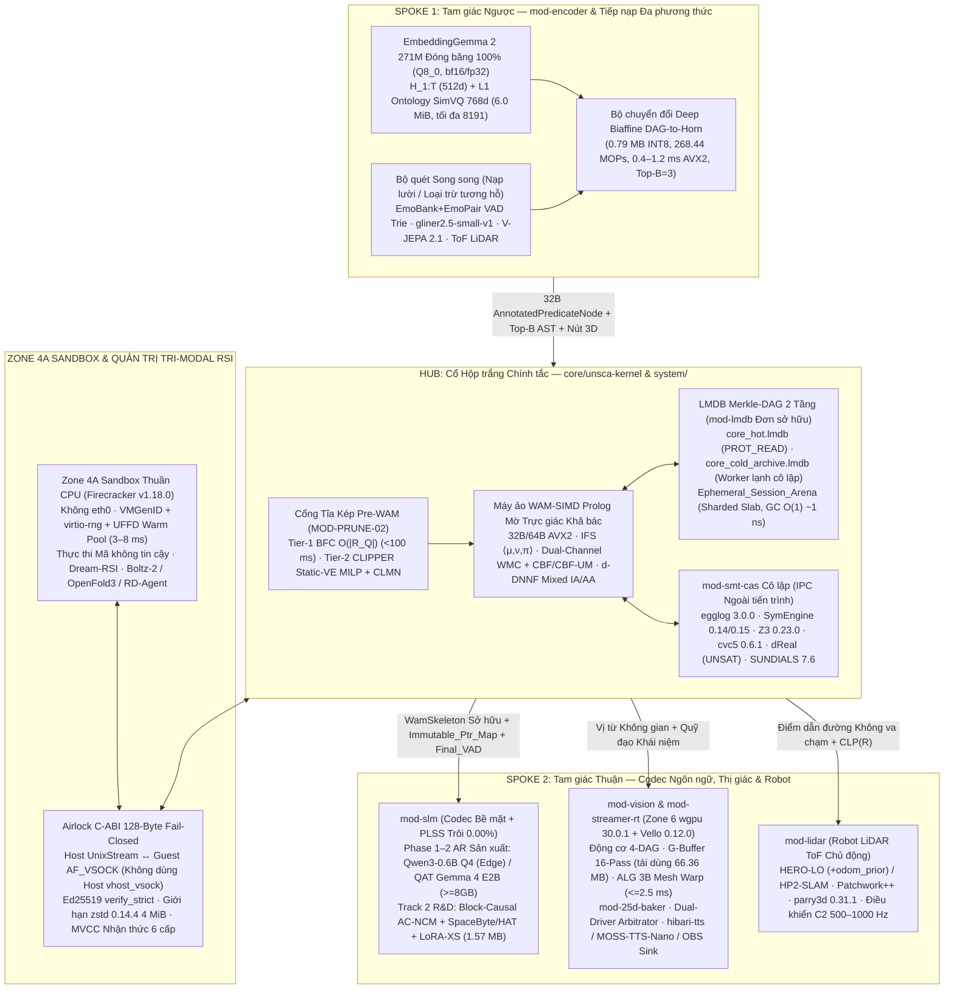

---

### 4. Các Pipeline Thực thi Đầu-Cuối & Phân hệ

#### 4.1 Pipeline Nhận thức Đa phương thức (`POST /v1/cognitive/execute` — `ALG 4B & 5`)

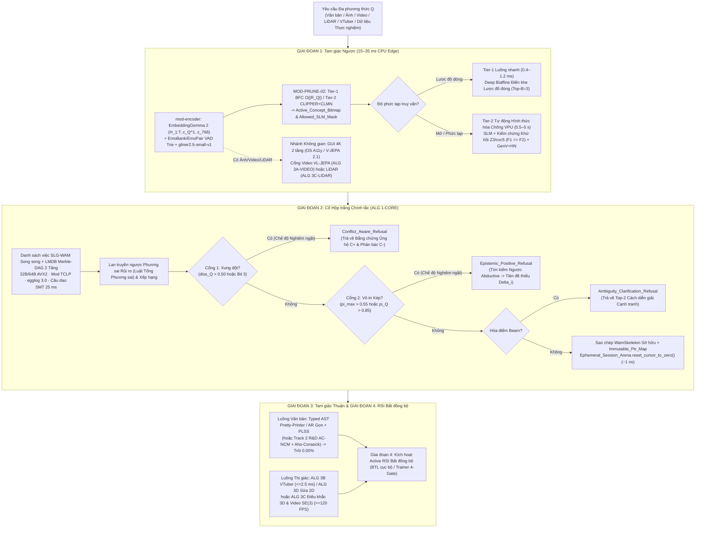

#### 4.2 Pipeline Thị giác 2 Nhánh (`ALG 3B / 3C / 3D`) & Robot LiDAR Chủ động (`ALG 3C-LIDAR`)

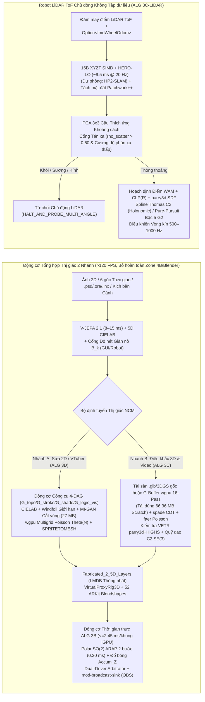

#### 4.3 Pipeline Tự cải tiến Đệ quy Ba chế độ (`Tri-Modal RSI`) & Airlock 128-Byte

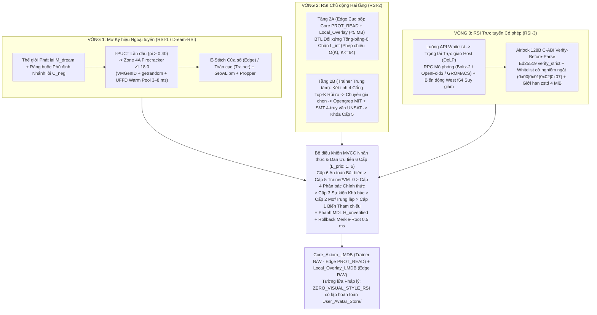

---

### 5. Ngân sách Bộ nhớ Edge (`cgroup v2`) & Bảng Thông số Kỹ thuật

#### 5.1 Kiểm toán Bộ nhớ Phân tách `cgroup v2` Chế độ Edge (`anon <= 1,536 MiB`, `memory.high = 3,072 MiB`, `memory.max = 4,096 MiB`)

| Thành phần Chế độ Edge | `anon` (MiB) | `file` (MiB) | Cơ chế Cấp phát & Chính sách Gia cố |
| :--- | ---: | ---: | :--- |
| **HUB (`WAM-SIMD` + Arena + `egglog`)** | 350 | 0 | Sharded slabs, `TableSlots`, `egglog` (≤ 10k e-nodes) |
| **`Qwen3-0.6B Q4` KV + Bộ nhớ tạm** | 159 | 0 | Khóa `-c 2048 -ctk q8_0 -ctv q8_0 -fa on` (119 MiB KV + 40 MiB tạm) |
| **`mod-encoder` / `ort` / VAD Trie** | 220 | 40 | Kích hoạt bf16/fp32 đóng băng, `gliner2.5-small-v1` (`disable_prepacking=1`), `canonical_ontology.bin` |
| **`mod-streamer-rt` (Live 2.5D + TTS)** | 285 | 0 | `wgpu 30.0.1` + ARAP + theo dõi khuôn mặt + `hibari`/`MOSS-TTS-Nano` ONNX (chạy song song 100%) |
| **Ngăn xếp Runtime, Bộ cấp phát & IPC** | 150 | 0 | Rayon worker stacks, bộ đệm `UnixStream`, khe `io_uring` |
| **`EmbeddingGemma 2` (`Q8_0 .gguf`)** | 0 | 296 | Page Cache `mmap` chỉ đọc (tuyệt đối không gọi `POSIX_FADV_DONTNEED`) |
| **`Qwen3-0.6B Q4` (`.gguf`)** | 0 | 500 | Page Cache `mmap` chỉ đọc (tuyệt đối không gọi `POSIX_FADV_DONTNEED`) |
| **Bytecode `.wamb` đã biên dịch** | 0 | 150 | `0_bootstrap_seed` + `1_logic_math_core` ánh xạ `mmap` trực tiếp |
| **Tập làm việc nóng `core_hot.lmdb`** | 0 | 600 | `MADV_RANDOM`; `core_cold_archive.lmdb` cô lập trong `mm_struct` riêng |
| **Tổng Chế độ Edge** | **1,164** | **1,586** | **Tổng `anon+file` ≈ 2,750 MiB** (dự phòng `anon` ≈ 372 MiB; `mod-smt-cas` Z3 giới hạn ≤ 300 MiB) |

> **Bất biến C-ABI Rust Căn chỉnh theo Phần cứng (`const _: () = assert!(...)`):** `AnnotatedPredicateNode` = **32 B** (1 thanh ghi AVX2 YMM) · `ArenaBranchStateHeader` = **48 B** · `WamBranchExecutionFrame` = **64 B** (1 dòng cache L1) · `UnifiedDagNodeHeader` = **128 B** · `AirlockEpistemicFrame` = **128 B** (2 dòng cache L1).

#### 5.2 Bảng Đặc tả Sản phẩm Mục tiêu (`Takuma-1 / TNS-1`)

| Chỉ số Đặc tả | Giá trị Mục tiêu Chuẩn hóa | Bảo đảm Kỹ thuật Nền tảng |
| :--- | :--- | :--- |
| **Dung lượng Lõi Tối thiểu** | `1.8 GB` (`0.4 GB` hồ sơ nhúng nén tối đa + `25 MB` Seed Ngày-0) | Bytecode WAM-SIMD + `Core_Axiom_LMDB` nén Zstd + khử trùng lặp 1-WL BLAKE3 |
| **Kho Mở rộng Offload** | `10 GB–50 GB` NVMe SSD (`4096 B` LBA `O_DIRECT`) | 3D Style PatchBanks + WGSL LUT nạp theo yêu cầu; LoRA-XS (1.57 MB) thường trú RAM |
| **Cô lập Phiên Người dùng (Server)** | `< 5 us` / phiên (`Ephemeral_Session_Arena`) | Rayon đa nhân trên `mmap` chỉ đọc chung; Zone 4A Firecracker cho mã không tin cậy |
| **SLA Độ trễ Truy vấn** | Tier-1: `P99 < 100 ms` (`8–45 ms` 8-core AVX2) · Tier-2: `0.5–5 s` | Nạp số nguyên 32B/64B AVX2 + Tier-1 BFC + Mixed IA/AA d-DNNF + cầu dao SMT 25 ms |
| **Thông lượng Sinh Văn bản** | Phase 1–2 AR: `34–86 tok/s` · Mục tiêu Track 2 AC-NCM: `470–750 BPE-equiv tok/s` | `Qwen3-0.6B` (Edge) / `QAT Gemma 4 E2B` (≥ 8 GB) + PLSS; Track 2 mở cổng khi PPL < 45 |
| **Tốc độ Thị giác & Robot** | `120–408+ FPS` (≤ 2.45 ms/khung 1080p/2K) · Robot: `500–1,000 Hz` | `faer` Cholesky + Polar $`\mathrm{SO}(2)`$ ARAP 2 bước (`0.30 ms`) + `Accum_Z` Porter-Duff + `parry3d` |
| **Tỷ lệ Trôi Sai số Miền đóng** | **`0.00%`** trên thực thể/con số khóa con trỏ (`<PTR_ID_k>`) | `WamSkeleton` + kiểm tra Aho-Corasick + ghép byte không sao chép PLSS |
| **Hành vi Vô tri / Xung đột cao** | **`100%` tất định** Từ chối Nhận biết Xung đột / Chủ động / Hỏi làm rõ | Ưu tiên Xung đột ($`\text{diss}_Q > 0.50`$) trước Cổng Vô tri Kép ($`\pi_{\max} > 0.55 \lor \pi_Q > \theta_{\text{hard}}`$) |

---

### 6. Môi trường Host & Gói phát hành

Cấu trúc thư mục của gói phát hành nằm ở [Phụ lục A](#appendix-a-release-package-layout).

**Yêu cầu môi trường Host (Linux `x86_64`, AVX2+FMA+AVX-VNNI):**

- **Kernel:** Ubuntu 24.04 / Linux Mint 22.x (`USN-9022-1`, `>= 6.8.0-149-generic`, `kernel.io_uring_disabled=0`) hoặc LMDE 7 / Debian 13 (`>= 6.12.113-1`, vá `CVE-2026-99999`). Đưa `vhost_vsock` vào danh sách chặn trên Host để loại bỏ bề mặt tấn công `CVE-2026-53365` (*VsockDrop*).
- **Toolchain:** Rust Edition 2024 qua `rustup` (`MSRV 1.96`, khuyến nghị `1.100`; đặt `[profile.release] panic = "unwind"` trong `Cargo.toml` gốc cho cơ chế dự phòng của `spade 2.15.1`).
- **Lưu trữ & KVM:** `ext4`/`xfs` không mã hóa (hoặc LUKS toàn đĩa; không dùng `eCryptfs`) để hỗ trợ `O_DIRECT`; thêm người dùng vào nhóm `kvm` và nâng `RLIMIT_MEMLOCK` nếu đăng ký bộ đệm `io_uring` cố định >8 MB.

---

### 7. Lộ trình Stage-Gate & Giao thức Đánh giá

| Giai đoạn | Thời gian | Phạm vi & Tiêu chí Qua cổng (*Exit Criteria*) |
| :--- | :--- | :--- |
| **Phase 1A-Alpha** | Tuần 1–6 | Lõi ký hiệu thuần: Stratified Horn/Datalog trên Rust + Atanassov IFS + `heed 0.23.1` Merkle-DAG + `egglog 3.0.0` + `z3`/`cvc5` + `Qwen3-0.6B` PLSS + Cổng kiểm tra hình thức bắt buộc (`cargo check/clippy/proptest` 10k mẫu/bất biến). |
| **Phase 1A-Beta** | Tuần 7–12 | Khép vòng nơ-ron: bản vá `EmbeddingGemma 2` $`H_{1:T}`$ + `SpecTemp` + Tier-1 Biaffine + Tier-2 Roundtrip/`GenV+HN`. Edge đánh giá trên **AbstentionBench & PlanBench**; Workstation/Server trên **VeriBench & SWE-bench Verified**. |
| **Phase 1B (+ Track 3A)** | Tuần 13–20 | Tabling đệ quy trái Rust gốc + bao hàm đa diện Mod TCLP + `d-DNNF` Mixed IA/AA + `CLIPPER` static-VE. Nhánh **Track 3A** (2.5D/VTuber Rust Engine) khởi chạy song song từ Tháng 2. |
| **Phase 2** | Tháng 6–8 | Chưng cất 5 họ mô hình mở thương mại (`Qwen3.8-27B` + `Qwen3.6-35B-A3B`, `MiMo-V2.6`, `GLM-5.3-Flash`, `DeepSeek-V4.1-Flash-1017`, `Gemma 4`) trên AR sản xuất + PLSS (0.00% trôi `<PTR_ID_k>`). Nhánh **Track 2 AC-NCM R&D** yêu cầu OpenWebText PPL < 45 và `<PTR_ID_k>` ≥ 99.9%. |
| **Phase 3** | Tháng 9–11 | Tích hợp các spoke độc lập (`mod-vision`, `mod-streamer-rt`, `mod-lidar`, `mod-rsi-sandbox` Firecracker v1.18.0 + chuyển `egg-stitch` sang `egglog 3.0.0`), tinh chỉnh `Harness^2` Vòng 2 và **cổng cắm nóng Gemma 5 không cần viết lại dòng Rust nào** (nhờ ghim Major ABI `0..4095`). |

**5 bộ benchmark có kiểm soát & 3 thí nghiệm loại bỏ (ablation) bắt buộc:**

1. *Bộ nhớ tổ hợp & khử trùng lặp sub-DAG:* `SWE-bench Verified`, `PlanBench`, `VeriBench` ($`N \in \lbrace 100, 500, 1000, 5000 \rbrace`$ nhánh).
2. *Từ chối nhận thức chủ động & chống ảo giác:* `AbstentionBench` (>35,000 mục), `FalseQA` (TAR, FAR, VPU AUROC).
3. *GUI 4K đường dài & quy trình khoa học:* `ScreenSpot-Pro`, `OSWorld 2.0`, `OSWorld-Science`.
4. *Tổng hợp thị giác 2 nhánh & LiDAR chủ động:* `BlenderGym`/`BlenderBench`, phân biệt mờ tổng hợp, đường thử chướng ngại vật khói/kính cho LiDAR.
5. *Thông lượng AC-NCM song song so với độ trung thực sự kiện:* tok/s CPU DDR5 kênh đôi, OpenWebText PPL, khớp chính xác `<PTR_ID_k>`.

*Ablation:* (1) tắt khử trùng lặp 1-WL + BLAKE3 và `Ephemeral_Session_Arena`; (2) thay IFS $`\langle \mu, \nu, \pi \rangle`$ và `lineage_bloom_mask` bằng xác suất vô hướng; (3) bỏ Trọng tài Trực giao Host, Airlock 128B, biến động West $`\sigma^2_{\text{vol}}`$ và kiểm chứng `cvc5`.

---

### 8. Ngôn ngữ sử dụng, Giấy phép & Trích dẫn

**Ngôn ngữ và định dạng sử dụng:**

| Ngôn ngữ / định dạng | Vai trò trong hệ thống |
| :--- | :--- |
| **Rust** (Edition 2024, `MSRV 1.96`) | Ngôn ngữ chính: `core/unsca-kernel`, `system/`, `modules/mod-*` (WAM-SIMD, LMDB, encoder, SLM, vision, streamer, lidar, RSI sandbox) |
| **Prolog / Datalog** (mờ trực giác, defeasible) | Ngôn ngữ luật suy diễn của kernel, biên dịch sang bytecode `.wamb` |
| **WGSL** | Shader GPU cho `wgpu` / `vello` (vật liệu thủ tục, LUT, G-Buffer) |
| **SMT-LIB 2.6** | Biểu diễn phương trình và ràng buộc để kiểm chứng bằng `z3` / `cvc5` / `dReal` |
| **DeLP** | Luật kiểm toán của Trọng tài Host (`judge_eafs_rules.delp`) |
| **C++** | Bản vá `llama.cpp` PR `#30054` (`H_1:T`) và thư viện native gọi qua FFI (`cvc5`, `Z3`, `SymEngine`, `SUNDIALS`) |
| **Python** (bên thứ ba) | Công cụ ngoại tuyến chạy trong Zone 4A (`RD-Agent`, `aideml`, `Boltz-2`, `OpenFold3`); không thuộc runtime lõi |

**Giấy phép:**

- **Lõi runtime:** [MIT License](LICENSE) (`core/unsca-kernel`, `system/`, các spoke Rust).
- **Bên thứ ba & cô lập pháp lý:** `cvc5` (`--poly` GMP/LibPoly, LGPLv3) và `Opengrep` CLI (LGPL-2.1, chỉ dùng tập luật MIT) chạy hoàn toàn ngoài tiến trình qua IPC/CLI; dữ liệu VAD trie `EmoBank`/`EmoPair` (CC BY-SA 4.0) được đóng gói tách khỏi nhị phân Rust theo MIT; `ZERO_VISUAL_STYLE_RSI` và `mod-c2pa-export` (`c2pa 0.92.2`) bảo vệ quyền sở hữu trí tuệ của họa sĩ và hỗ trợ tuân thủ Điều 50 Đạo luật AI châu Âu (Content Credentials).

**Trích dẫn:** xem [Phụ lục B](#appendix-b-citation).

---

## Chinese (ZH)

🇨🇳 **中文** — Takuma-1 (Trinity Symbolic) / `TNS-1`

> **语言快速跳转:** [English](#english-en) · [日本語](#japanese-ja) · [Tiếng Việt](#vietnamese-vi) · [中文](#chinese-zh) · [↑ 返回顶部](#table-of-contents)

### 1. 摘要与架构动机

**Takuma-1 (Trinity Symbolic)**（技术代号：**TNS-1 / Trinity Symbolic Systems**，由 **GOSIS VN** 研发）是一种功能解耦的白盒神经符号认知架构，完整遵循主工程设计规范 **U-NSCA v2 (P)**（`SPEC-UNSCA-V2-P-UNIFIED v1.0.9.3-FREEZE`，状态：*Spec Freeze — GO for Phase 1A-Alpha Track 1*）。

不同于依赖单一单体神经网络同时承担知识存储、多分支推理遍历与表层词元生成的传统范式，**Takuma-1 (`TNS-1`)** 在 ***Transformation Is All You Need*** 范式下，系统性解决了单体自回归 Transformer 与像素空间扩散模型的四大结构性悖论：

| 结构性悖论 | 单体架构的核心局限 | Takuma-1 (`TNS-1`) 解决方案 |
| :--- | :--- | :--- |
| **1. 因果 KV 缓存的不可统一性** | 在 RoPE 相对位置编码下，不同前缀或步长（$`t_1 \neq t_2`$）汇聚至同一逻辑子目标的分支仍产生数值不同的 KV 张量（$`K_{B_1}(S) \neq K_{B_2}(S)`$），在 $`N \in [10^3, 10^4]`$ 并发轨迹下显存线性膨胀。 | **双层内容寻址 LMDB Merkle-DAG**（`Core_Axiom_LMDB` + `Ephemeral_Session_Arena`），结合 Mod TCLP 常量提升、迭代 1-WL + De Bruijn 规范化及 128-bit BLAKE3 哈希，在 $`O(1)`$（≈ 100 ns）内完成子 DAG 去重。 |
| **2. Softmax 归一化惯性** | 概率单纯形约束（$`\sum_v P(v \mid x) \equiv 1.0`$）抹除了总证据量级，将均衡冲突（$`[+50, +50]`$）与完全无知（$`[-10, -10]`$）混为一谈，导致拒答准确率下降。 | **Atanassov 直觉模糊逻辑** $`\langle \mu, \nu, \pi \rangle`$（$`\mu + \nu + \pi = 1`$），配合**冲突优先**（`Conflict_Aware_Refusal`）与**双重空虚门控**（`Epistemic_Positive_Refusal` / 溯因缺失前提 $`\Delta_i`$）。 |
| **3. 语言–逻辑耦合与对齐税** | 逻辑推理电路与表层语法、RLHF 合规策略共享前向权重，造成高内存带宽开销并扰动数理推理回路（Alignment Tax）。 | **解耦 Hub-and-Spoke 编解码器**（`mod-encoder` + `mod-slm`）+ **PLSS** 零拷贝 `<PTR_ID_k>` 拼接（闭域事实漂移 0.00%）+ **六级认识优先级格**（$`\mathcal{L}_{\text{prio}} \in \lbrace 1,\dots,6 \rbrace`$）。 |
| **4. 2D 像素网格与单目尺度模糊** | 像素扩散缺乏 3D 欧氏不变量；单目投影 $`\text{rank}(J_{\text{proj}}) = 2 < 3`$ 属于病态逆问题；密集多裁剪 4K GUI 定位难以满足低延迟 SLA。 | **双路径 2D/2.5D/3D 构造式视觉引擎**（`wgpu 30.0.1` + `vello 0.12.0` + `spade` + `faer`，>120 FPS，≤ 2.45 ms/帧）、**双层 4K GUI 定位**（OS A11y/DOM <1 ms）与**主动 ToF LiDAR 机器人控制**（`HERO-LO`/`HP2-SLAM`，500–1000 Hz）。 |

---

### 2. 核心设计哲学与四大白盒约束机制

**Takuma-1 (`TNS-1`)** 将认知解耦为五个正交且可形式化验证的架构平面，并强制执行四项白盒安全不变量：

1. **禁止隐式规则演化（Zero Latent Rules）：** 离线梦境推演（`RSI-1`）或在线摄取（`RSI-3`）习得的知识绝不允许沉淀在黑盒浮点权重中，必须结晶为 `Core_Axiom_LMDB` 中可直接扫描检查的 32 字节 `AnnotatedPredicateNode` 或闭式 SymEngine/SMT-LIB 方程。
2. **白盒 MDL 熵刹车（$`\mathcal{H}_{\text{unverified}}`$）与自动帕累托淘汰：** 基于下式追踪未验证结构复杂度：

   ```math
   \mathcal{H}_{\text{unverified}}
   = \sum_{v \in \mathcal{V}_{\text{auto}}} \bigl(\text{Depth}(v) + 1\bigr)\,\log_2\bigl(\lvert\text{Children}(v)\rvert + 2\bigr)
   \;\ge\; \lvert\mathcal{V}_{\text{auto}}\rvert\,\text{bits}
   ```

   触及配额 $`\Theta_{\text{quota}}`$ 时自动淘汰最低效用宏，永久提交必须通过四查询 SMT 形式验证。
3. **统一宿主信任平面 + 零网络 Zone 4A 沙箱与 128 字节 C-ABI 气闸：** 信任核心（`core/unsca-kernel`、边缘端 `PROT_READ` 单所有权 `mod-lmdb`、`mod-encoder`、`mod-slm`、`mod-streamer-rt` 及宿主正交裁判）运行于宿主机；非信任代码严格隔离于纯 CPU **Firecracker v1.18.0** 微虚拟机（**Zone 4A**，剥离 `eth0`，VMGenID + `virtio-rng` + UFFD 预热池 3–8 ms），永久移除 Zone 4B（内联 Blender）。跨界通信通过故障关闭型 128 字节 C-ABI 气闸（`Host UnixStream <-> Guest AF_VSOCK`，宿主机零 `vhost_vsock`）与 RFC 8032 Ed25519 `verify_strict` 验签。
4. **0.5 ms 外科式切除与 Merkle 根时间旅行回滚：** 每个提交纪元 $`e`$ 在 `Epoch_Roots` 中记录不可变 `Merkle_Root_Hash(e)`，支持在 ≈ 0.5 ms 内精确剔除单个 128-bit `node_hash` 或原子回滚至 `Merkle_Root_Hash(e - k)`。

---

### 3. 系统架构与双向沙漏拓扑

`TNS-1` 基于 Rust 2024 **Hub-and-Spoke** 工作区（`core/unsca-kernel` → `system/` → `modules/mod-*`），在闭环**双向沙漏拓扑（倒三角 → 白盒规范颈部 → 正三角）**上执行端到端认知。

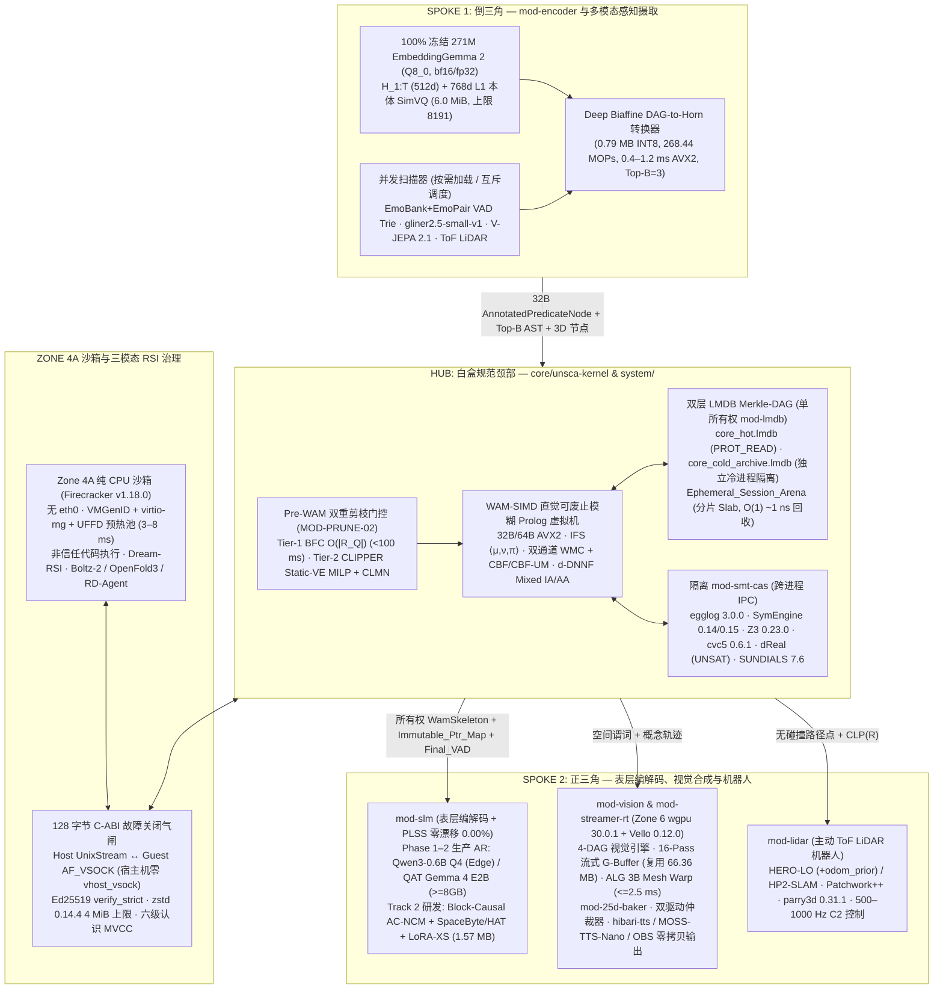

---

### 4. 端到端执行与核心子系统流水线

#### 4.1 端到端多模态认知执行流水线（`POST /v1/cognitive/execute` — `ALG 4B & 5`）

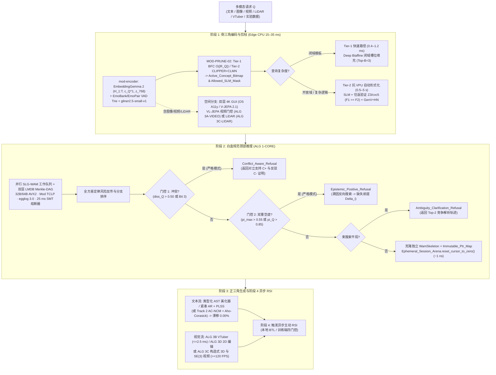

#### 4.2 双路径视觉合成（`ALG 3B / 3C / 3D`）与主动 LiDAR 机器人流水线（`ALG 3C-LIDAR`）

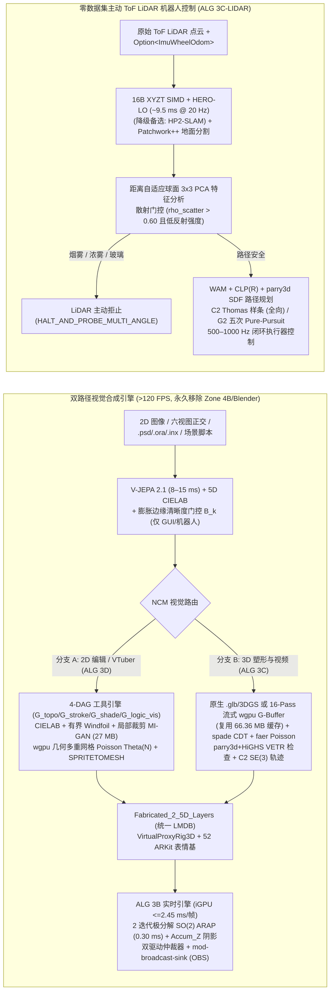

#### 4.3 三模态递归自我改进（`Tri-Modal RSI`）与 128 字节气闸流水线

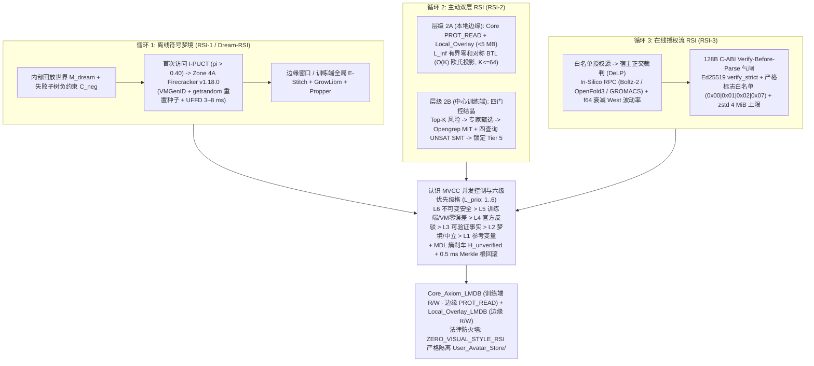

---

### 5. 边缘内存预算（`cgroup v2`）与目标产品规格

#### 5.1 边缘模式 `cgroup v2` 分离内存审计（`anon <= 1,536 MiB`，`memory.high = 3,072 MiB`，`memory.max = 4,096 MiB`）

| 边缘模式组件 | `anon` (MiB) | `file` (MiB) | 分配机制与加固策略 |
| :--- | ---: | ---: | :--- |
| **HUB (`WAM-SIMD` + Arena + `egglog`)** | 350 | 0 | 分片 Slab、`TableSlots`、`egglog`（≤ 10k e-nodes） |
| **`Qwen3-0.6B Q4` KV + 计算暂存** | 159 | 0 | 锁定 `-c 2048 -ctk q8_0 -ctv q8_0 -fa on`（119 MiB KV + 40 MiB） |
| **`mod-encoder` / `ort` / VAD Trie** | 220 | 40 | 冻结 bf16/fp32、`gliner2.5-small-v1`（`disable_prepacking=1`）、`canonical_ontology.bin` |
| **`mod-streamer-rt` (实时 2.5D + TTS)** | 285 | 0 | `wgpu 30.0.1` + ARAP + 面部追踪 + `hibari`/`MOSS-TTS-Nano` ONNX（100% 并发常驻） |
| **运行时栈、分配器与 IPC** | 150 | 0 | Rayon 工作线程栈、`UnixStream` 缓冲区、`io_uring` 槽位 |
| **`EmbeddingGemma 2` (`Q8_0 .gguf`)** | 0 | 296 | 只读 `mmap` 页缓存（禁止 `POSIX_FADV_DONTNEED`） |
| **`Qwen3-0.6B Q4` (`.gguf`)** | 0 | 500 | 只读 `mmap` 页缓存（禁止 `POSIX_FADV_DONTNEED`） |
| **已编译 `.wamb` 字节码** | 0 | 150 | `0_bootstrap_seed` + `1_logic_math_core` 直接 `mmap` |
| **`core_hot.lmdb` 热工作集** | 0 | 600 | `MADV_RANDOM`；`core_cold_archive.lmdb` 隔离于独立冷进程 `mm_struct` |
| **边缘模式总计** | **1,164** | **1,586** | **总计 `anon+file` ≈ 2,750 MiB**（`anon` 余量 ≈ 372 MiB；Z3 独立进程上限 ≤ 300 MiB） |

> **硬件对齐的 Rust C-ABI 不变量（`const _: () = assert!(...)`）：** `AnnotatedPredicateNode` = **32 B**（1 个 AVX2 YMM 寄存器）· `ArenaBranchStateHeader` = **48 B** · `WamBranchExecutionFrame` = **64 B**（1 条 L1 缓存行）· `UnifiedDagNodeHeader` = **128 B** · `AirlockEpistemicFrame` = **128 B**（2 条 L1 缓存行）。

#### 5.2 目标产品规格表（`Takuma-1 / TNS-1`）

| 规格指标 | 标准化目标值 | 底层工程保证 |
| :--- | :--- | :--- |
| **最小核心存储** | `1.8 GB`（极限压缩嵌入式 `0.4 GB` + 第 0 日种子 `25 MB`） | 编译态 WAM-SIMD 字节码 + Zstd `Core_Axiom_LMDB` + 1-WL BLAKE3 去重 |
| **扩展卸载资源库** | `10 GB–50 GB` NVMe SSD（`4096 B` LBA `O_DIRECT`） | 3D 风格 PatchBank 与 WGSL LUT 按需流式加载；LoRA-XS (1.57 MB) 常驻内存 |
| **单用户会话隔离（服务端）** | `< 5 us` / 会话（`Ephemeral_Session_Arena`） | 共享只读 `mmap` 上的多核 Rayon 并发；Zone 4A Firecracker 隔离非信任代码 |
| **查询延迟 SLA** | Tier-1: `P99 < 100 ms`（8 核 AVX2 `8–45 ms`）· Tier-2: `0.5–5 s` | 32B/64B AVX2 + Tier-1 BFC + Mixed IA/AA d-DNNF + 25 ms SMT 熔断器 |
| **表层文本吞吐量** | Phase 1–2 AR: `34–86 tok/s` · Track 2 AC-NCM 目标: `470–750 BPE-equiv tok/s` | `Qwen3-0.6B` (边缘) / `QAT Gemma 4 E2B` (≥ 8 GB) + PLSS；Track 2 需通过 PPL < 45 |
| **视觉与机器人帧率** | `120–408+ FPS`（1080p/2K ≤ 2.45 ms/帧）· 机器人 `500–1,000 Hz` | `faer` Cholesky + 2 迭代极分解 $`\mathrm{SO}(2)`$ ARAP (`0.30 ms`) + `Accum_Z` Porter-Duff + `parry3d` |
| **闭域事实漂移率** | **`0.00%`**（指针锁定实体与数值 `<PTR_ID_k>`） | `WamSkeleton` + Aho-Corasick 校验 + PLSS 零拷贝字节拼接 |
| **高无知 / 冲突行为** | **`100%` 确定性** 冲突感知拒答 / 构造式主动拒答 / 歧义澄清 | 冲突优先门控 ($`\text{diss}_Q > 0.50`$) 优先于双重空虚门控 ($`\pi_{\max} > 0.55 \lor \pi_Q > \theta_{\text{hard}}`$) |

---

### 6. 宿主机环境与发布包

发布包目录结构见[附录 A](#appendix-a-release-package-layout)。

**宿主机环境要求（Linux `x86_64`，AVX2+FMA+AVX-VNNI）：**

- **内核：** Ubuntu 24.04 / Linux Mint 22.x（`USN-9022-1`，`>= 6.8.0-149-generic`，`kernel.io_uring_disabled=0`）或 LMDE 7 / Debian 13（`>= 6.12.113-1`，修复 `CVE-2026-99999`）。在宿主机上将 `vhost_vsock` 加入黑名单，以消除 `CVE-2026-53365`（*VsockDrop*）攻击面。
- **工具链：** 通过 `rustup` 安装 Rust Edition 2024（`MSRV 1.96`，推荐 `1.100`；在根 `Cargo.toml` 中设置 `[profile.release] panic = "unwind"`，用于 `spade 2.15.1` 的回退机制）。
- **存储与 KVM：** 使用未加密的 `ext4`/`xfs`（或全盘 LUKS；禁用 `eCryptfs`）以支持 `O_DIRECT`；若注册固定 `io_uring` 缓冲区 >8 MB，需将用户加入 `kvm` 组并提高 `RLIMIT_MEMLOCK`。

---

### 7. 分阶段门控路线图与评估协议

| 阶段 | 周期 | 研发范围与出闸门控标准 |
| :--- | :--- | :--- |
| **Phase 1A-Alpha** | 第 1–6 周 | 纯符号核心：Rust 分层 Horn/Datalog + Atanassov IFS + `heed 0.23.1` Merkle-DAG + `egglog 3.0.0` + `z3`/`cvc5` + `Qwen3-0.6B` PLSS + 强制形式探针门控（`cargo check/clippy/proptest` 每不变量 10k 样本）。 |
| **Phase 1A-Beta** | 第 7–12 周 | 神经闭环：`EmbeddingGemma 2` $`H_{1:T}`$ 补丁 + `SpecTemp` + Tier-1 Biaffine + Tier-2 往返验证/`GenV+HN`。边缘端通过 **AbstentionBench / PlanBench**；工作站/服务端通过 **VeriBench / SWE-bench Verified**。 |
| **Phase 1B (+ Track 3A)** | 第 13–20 周 | Rust 原生左递归制表 + Mod TCLP 多面体包含 + `d-DNNF` Mixed IA/AA + `CLIPPER` static-VE。第 2 个月起并行启动独立 **Track 3A**（2.5D/VTuber Rust 引擎）。 |
| **Phase 2** | 第 6–8 月 | 五家族商用开源教师蒸馏（`Qwen3.8-27B` + `Qwen3.6-35B-A3B`、`MiMo-V2.6`、`GLM-5.3-Flash`、`DeepSeek-V4.1-Flash-1017`、`Gemma 4`）+ 解耦 **Track 2 AC-NCM 研发**（要求 OpenWebText PPL < 45 且 `<PTR_ID_k>` 完整率 ≥ 99.9%）。 |
| **Phase 3** | 第 9–11 月 | 集成独立模块仓库（`mod-vision`、`mod-streamer-rt`、`mod-lidar`、Firecracker v1.18.0 `mod-rsi-sandbox`），完成 `Harness^2` 第二轮调优，并开放**零 Rust 代码改写的 Gemma 5 即插即用入口**（主 ABI `0..4095` 冻结）。 |

**五套受控基准与三项必做消融实验：**

1. *组合式内存与子 DAG 去重：* `SWE-bench Verified`、`PlanBench`、`VeriBench`（$`N \in \lbrace 100, 500, 1000, 5000 \rbrace`$ 条分支）。
2. *认知性主动拒答与抗幻觉：* `AbstentionBench`（>35,000 项）、`FalseQA`（TAR、FAR、VPU AUROC）。
3. *长程 4K GUI 与科学工作流：* `ScreenSpot-Pro`、`OSWorld 2.0`、`OSWorld-Science`。
4. *双路径视觉合成与主动 LiDAR：* `BlenderGym`/`BlenderBench`、合成模糊消歧、烟雾/玻璃场景 LiDAR 障碍赛道。
5. *并行 AC-NCM 吞吐与事实保真度：* 双通道 DDR5 CPU 的 tok/s、OpenWebText PPL、`<PTR_ID_k>` 精确匹配。

*消融实验：* (1) 关闭 1-WL + BLAKE3 去重与 `Ephemeral_Session_Arena`；(2) 以标量概率替换 IFS $`\langle \mu, \nu, \pi \rangle`$ 与 `lineage_bloom_mask`；(3) 移除正交宿主裁判、128B 气闸、West $`\sigma^2_{\text{vol}}`$ 及 `cvc5` 验证。

---

### 8. 使用语言、许可与引用

**使用的语言与格式：**

| 语言 / 格式 | 在系统中的作用 |
| :--- | :--- |
| **Rust**（Edition 2024，`MSRV 1.96`） | 主要语言：`core/unsca-kernel`、`system/`、`modules/mod-*`（WAM-SIMD、LMDB、编码器、SLM、视觉、流媒体、LiDAR、RSI 沙箱） |
| **Prolog / Datalog**（直觉主义、可废止） | 内核的推理规则语言，编译为 `.wamb` 字节码 |
| **WGSL** | `wgpu` / `vello` 的 GPU 着色器（程序化材质、LUT、G-Buffer） |
| **SMT-LIB 2.6** | 由 `z3` / `cvc5` / `dReal` 验证的方程与约束表示 |
| **DeLP** | 宿主裁判的审计规则（`judge_eafs_rules.delp`） |
| **C++** | `llama.cpp` PR `#30054` 补丁（`H_1:T`），以及通过 FFI 调用的原生库（`cvc5`、`Z3`、`SymEngine`、`SUNDIALS`） |
| **Python**（第三方） | 在 Zone 4A 内运行的离线工具（`RD-Agent`、`aideml`、`Boltz-2`、`OpenFold3`）；不属于核心运行时 |

**许可：**

- **核心运行时：** [MIT License](LICENSE)（`core/unsca-kernel`、`system/`、Rust 模块）。
- **第三方与法律隔离：** `cvc5`（`--poly` GMP/LibPoly，LGPLv3）与 `Opengrep` CLI（LGPL-2.1，仅使用 MIT 规则集）通过 IPC/CLI 严格跨进程运行；`EmoBank`/`EmoPair` VAD 字典树数据（CC BY-SA 4.0）与 MIT 许可的 Rust 二进制分开打包；`ZERO_VISUAL_STYLE_RSI` 与 `mod-c2pa-export`（`c2pa 0.92.2`）用于隔离创作者知识产权，并支持满足欧盟《人工智能法案》第 50 条（内容凭证）要求。

**引用：** 见[附录 B](#appendix-b-citation)。

---

## Appendix A: Release Package Layout

Planned layout of the release package. The specification names the root directory `unsca-v2-p-release/`.

```text
tns-1-release/                          # Standardized release layout (spec: unsca-v2-p-release/)
├── manifest.json                       # SemVer metadata, Codebook ABI version, Ed25519 Merkle Root
├── 0_bootstrap_seed_axioms.wamb        # Day-0 Cold-Start Seed (~25 MB: Peano, Real Analysis, 7 SI units, 5,000 NSM)
├── 1_logic_math_core.wamb              # Compiled WAM-SIMD Bytecode (~150 MB, unencrypted 0-cycle mmap)
├── 2_unified_knowledge.lmdb            # Core_Axiom_LMDB #[repr(C, align(32))] Merkle-DAG (~1.5 GB / ~0.4 GB)
├── 3_decision_scanners/                # Zone 1 Scanner Footprint (~280–295 MB Edge Mode)
│   ├── gliner2_5_small_v1_int4.onnx    # 74M DeBERTa-v3-xsmall INT4 (ort 2.0.0-rc.15)
│   ├── vad_mwe_trie.bin                # EmoBank + EmoPair VAD Trie (CC BY-SA 4.0 separated from MIT Rust)
│   ├── vjepa2_1_dense_vit_int8.onnx    # V-JEPA 2.1 Edge ViT-B/L (~180 MB, lazy-loaded / mutual-exclusion)
│   ├── migan_mit.onnx                  # MI-GAN 2D Disocclusion Inpainting (~27 MB, pure MIT)
│   ├── facelandmarker_rt.onnx          # MediaPipe FaceLandmarker / OpenSeeFace (~15–30 MB)
│   ├── anime_part_parser_int8.onnx     # Anime-Face-Segmentation MobileNetV2 UNet (MIT)
│   └── canonical_ontology.bin          # Bijective surface -> u32 predicate_id & u16 ncm_concept_id (~40 MB)
├── User_Avatar_Store/                  # Persistent 2.5D avatars (isolated by ZERO_VISUAL_STYLE_RSI)
├── 4_disk_offloaded_banks/             # NVMe SSD (4096 B LBA O_DIRECT on ext4/xfs; never eCryptfs)
│   ├── mod_encoder_gemma2.gguf         # 100% Frozen EmbeddingGemma 2 Text-Only (271M, Q8_0) + L1 SimVQ
│   ├── qwen3_0_6b_int4.gguf            # Phase 1–2 Edge AR backbone (Gemma 4 E2B for Workstation >=8 GB)
│   ├── ac_ncm_slm_int4.gguf            # [Track 2 R&D Branch] Block-Causal AC-NCM Decoder
│   ├── hibari_or_moss_tts_nano.onnx    # Apache-2.0 eSpeak-free TTS (hibari-tts EN / MOSS-TTS-Nano CJK/multi)
│   ├── visual_style_patchbank_index.lmdb
│   └── visual_style_patchbank_3d.pak   # High-res style patches + WGSL Shader Graphs + Lit-Sphere LUTs
└── 5_sandbox_runtime/
    ├── vmlinux-firecracker-6.18.bin    # Zone 4A Zero-Network Pure-CPU Kernel (>=6.18.34, io_uring_disabled=2)
    └── judge_eafs_rules.delp           # Orthogonal DeLP auditing rulebase (Host Judge only)
```

## Appendix B: Citation

```bibtex
@techreport{gosisvn2026takuma1,
  title       = {Transformation Is All You Need: Takuma-1 (Trinity Symbolic / TNS-1) — A White-Box Neuro-Symbolic Cognitive Architecture (U-NSCA v2 (P))},
  author      = {{GOSIS VN}},
  institution = {GOSIS VN Research},
  year        = {2026},
  number      = {SPEC-UNSCA-V2-P-UNIFIED v1.0.9.3-FREEZE},
  note        = {Master Engineering Design Document \& System Architecture RFC (Pre-Implementation)}
}
```

## License

The core runtime (`core/unsca-kernel`, `system/` and the Rust spokes) is released under the
[MIT License](LICENSE). Third-party components (`cvc5`, `Opengrep`, `EmoBank`/`EmoPair` data, …)
keep their own licenses, as described in section 8 of each language.

---

**GOSIS VN** · **Takuma-1 (Trinity Symbolic)** · `TNS-1` — pre-implementation specification, not measured results.

Specification basis: `U-NSCA v2 (P)` (`SPEC-UNSCA-V2-P-UNIFIED v1.0.9.3-FREEZE`)

[↑ Table of Contents](#table-of-contents) · [English](#english-en) · [日本語](#japanese-ja) · [Tiếng Việt](#vietnamese-vi) · [中文](#chinese-zh)
