# Takuma-1 (Trinity Symbolic) · `TNS-1`

**Transformation Is All You Need — A White-Box Neuro-Symbolic Cognitive Architecture**

Technical architecture specification developed by **GOSIS VN**: a functionally disentangled cognitive system combining a compiled Prolog reasoning kernel, content-addressable LMDB Merkle-DAG memory, decoupled concept encoding and pointer-locked language generation, real-time 2D/2.5D/3D visual synthesis, active LiDAR robotics, and Firecracker-sandboxed recursive self-improvement.

**Technical Designation:** `TNS-1` (*Trinity Symbolic Systems*) · **Architecture Specification:** `U-NSCA v2 (P)` (`SPEC-UNSCA-V2-P-UNIFIED v1.0.9.3-FREEZE`)


[](https://www.rust-lang.org/)
[](https://isocpp.org/)
[](https://www.w3.org/TR/WGSL/)
[](https://en.wikipedia.org/wiki/Prolog)
[](https://smt-lib.org/)


[License: MIT](https://www.google.com/search?q=LICENSE)

[🇬🇧 English](#english-en) ·
[🇯🇵 日本語](#japanese-ja) ·
[🇻🇳 Tiếng Việt](#vietnamese-vi) ·
[🇨🇳 中文](#chinese-zh) ·
[🗂️ Release Package](#appendix-a-release-package-layout) ·
[📖 Citation](#appendix-b-citation) ·
[⚖️ License](#license)

---

> [!NOTE]
> **Language & Terminology.** English is the primary reference language of this specification. Japanese, Vietnamese, and Chinese sections follow directly below. Module identifiers, crate names, file paths, and architectural symbols remain in English across all sections for cross-team consistency.

> [!WARNING]
> **Pre-Implementation Specification (RFC).** All latency, frame-rate, memory-envelope, and throughput figures reported here are **engineering design targets** frozen in `SPEC-UNSCA-V2-P-UNIFIED v1.0.9.3-FREEZE`, not measured benchmark results. The directory hierarchy in [Appendix A](#appendix-a-release-package-layout) describes the planned production release layout.

> [!NOTE]
> **Licensing & Component Isolation.** The core runtime (`core/unsca-kernel`, `system/`, and Rust spokes) is licensed under the [MIT License](https://www.google.com/search?q=LICENSE). Third-party solvers, CLI analyzers, and datasets retain their respective upstream licenses and are isolated out-of-process or packaged separately — see [License](#license).

## Table of Contents

- [🇬🇧 English (EN)](#english-en)
- [🇯🇵 日本語 (JA)](#japanese-ja)
- [🇻🇳 Tiếng Việt (VI)](#vietnamese-vi)
- [🇨🇳 中文 (ZH)](#chinese-zh)
- [Appendix A: Release Package Layout](#appendix-a-release-package-layout)
- [Appendix B: Citation](#appendix-b-citation)
- [License](#license)

---

## English (EN)

🇬🇧 **English** — Takuma-1 (Trinity Symbolic) / `TNS-1`

> **Quick Jump:** [English](#english-en) · [日本語](#japanese-ja) · [Tiếng Việt](#vietnamese-vi) · [中文](#chinese-zh) · [↑ Top](#table-of-contents)

### 1. Overview & Architectural Motivation

**Takuma-1 (Trinity Symbolic)** — technically designated **TNS-1 (Trinity Symbolic Systems)** and developed by **GOSIS VN** — is a functionally disentangled, white-box neuro-symbolic cognitive architecture defined by the master engineering specification **U-NSCA v2 (P)** (`SPEC-UNSCA-V2-P-UNIFIED v1.0.9.3-FREEZE`, *GO for Phase 1A-Alpha Track 1*).

Rather than relying on a single monolithic neural network to store world knowledge, explore multi-branch reasoning trees, enforce policy constraints, and generate surface text or pixels simultaneously, **Takuma-1 (`TNS-1`)** follows the design principle ***Transformation Is All You Need***. It separates perception, formal reasoning, memory storage, surface generation, spatial synthesis, and self-improvement into dedicated, inspectable subsystems designed to address four structural bottlenecks of monolithic architectures:

| Architectural Bottleneck | Limitation in Monolithic Models | System Resolution in Takuma-1 (`TNS-1`) |
| :--- | :--- | :--- |
| **1. Non-Unifiable Multi-Branch Memory** | Converging reasoning branches with different prefixes or token positions generate distinct KV-cache states that cannot be merged mid-graph, causing memory usage to grow linearly across thousands of parallel trajectories. | **Dual-Tier LMDB Merkle-DAG** (`Core_Axiom_LMDB` + `Ephemeral_Session_Arena`) with canonical AST normalization, constraint constant lifting, and 128-bit BLAKE3 sub-graph deduplication in constant time (~100 ns). |
| **2. Conflicting Evidence vs. Ignorance** | Standard normalized output distributions collapse total evidence magnitude, making balanced contradiction look identical to complete lack of knowledge and degrading abstention reliability. | **Three-State Epistemic Tracking** (support, refutation, and explicit ignorance) paired with **Dissonance-First** (`Conflict_Aware_Refusal`) and **Dual Vacuity** (`Epistemic_Positive_Refusal` with abductive missing-precondition search) routing gates. |
| **3. Language–Logic Coupling & Alignment Tax** | Sharing weights across logical deduction, surface syntax, and policy guardrails wastes memory bandwidth and lets rhetorical alignment updates perturb internal reasoning circuits. | **Decoupled Hub-and-Spoke Codec** (`mod-encoder` + `mod-slm`) with **PLSS** zero-copy `<PTR_ID_k>` pointer splicing (0.00% closed-domain factual drift) and a **6-Level Epistemic Priority Lattice** enforced at the storage layer. |
| **4. Pixel-Grid Synthesis & Monocular Ambiguity** | Iterative pixel denoising lacks explicit 3D scene geometry and collision invariants; passive monocular vision suffers from scale ambiguity, and multi-crop 4K GUI grounding breaks low-latency budgets. | **Dual-Path 2D/2.5D/3D Constructive Visual Engine** (`wgpu 30.0.1` + `vello 0.12.0` + `spade` + `faer`, >120 FPS, <= 2.45 ms/frame), **2-Tier 4K GUI Grounding** (OS Accessibility/DOM <1 ms), and **Active ToF LiDAR Robotics** (`HERO-LO` / `HP2-SLAM`, 500–1,000 Hz). |

---

### 2. Design Philosophy & Four White-Box Containment Safeguards

**Takuma-1 (`TNS-1`)** enforces **Functional Disentanglement** across five orthogonal, auditable architectural planes:

1. **Deduction, Planning & Verification:** Executed by a pure-Rust compiled Prolog virtual machine (`WAM-SIMD`) integrated with out-of-process constraint and symbolic verification solvers (`egglog 3.0.0`, `SymEngine 0.14/0.15`, `Z3 0.23.0`, `cvc5 0.6.1`, `dReal` UNSAT-only, and `SUNDIALS CVODE 7.6.0`).
2. **Content-Addressable Memory:** Managed by a Dual-Tier LMDB Merkle-DAG (`Core_Axiom_LMDB` + `Ephemeral_Session_Arena`) storing hardware-aligned 32-byte binary records indexed by 128-bit BLAKE3 hashes.
3. **Linguistic Expression & Affective Nuance:** Handled by a decoupled encoder (`mod-encoder`) and surface codec (`mod-slm`) constrained by a Pointer-Locked Semantic Skeleton (`PLSS`) so verified entities and numbers are spliced directly without neural alteration.
4. **Spatial Grounding, Visual Synthesis & Robotics:** Unified under a native Rust GPU visual engine (`wgpu 30.0.1` + `vello 0.12.0`), 2.5D avatar baking and live streaming (`mod-25d-baker`, `mod-streamer-rt`), and active Time-of-Flight LiDAR control (`mod-lidar`).
5. **Sandboxed Evolution & Governance:** Governed by a Tri-Modal Recursive Self-Improvement engine (`Tri-Modal RSI`) separating offline dreaming, dual-tier active feedback, and online licensed ingestion behind an orthogonal Host Judge and a 128-byte binary airlock.

To keep autonomous evolution inspectable and reversible, the runtime enforces **four structural white-box safeguards**:

1. **Zero Latent Rules:** Knowledge acquired during offline dreaming (`RSI-1`) or online ingestion (`RSI-3`) never accumulates inside opaque neural weights. Every rule, macro, or empirical law must crystallize into an inspectable 32-byte `AnnotatedPredicateNode` or an explicit `SymEngine` / `SMT-LIB 2.6` record inside `Core_Axiom_LMDB`.
2. **White-Box Complexity Brake & Automated Pareto Eviction:** The runtime tracks the structural complexity of unverified auto-invented rules in the ephemeral arena against a strict quota. When the quota is reached, Automated Pareto Eviction replaces the lowest-utility macros with higher-coverage, more compact candidates, while every permanent promotion to `Core_Axiom_LMDB` is gated by a 4-query formal SMT verification suite.
3. **Unified Host Trust Plane + Zero-Network Zone 4A Sandbox & 128-Byte C-ABI Airlock:** Trusted Hub components (`core/unsca-kernel`, single-owner `mod-lmdb` with hardware read-only `PROT_READ` mmap on Edge, `mod-encoder`, `mod-slm`, `mod-streamer-rt`, and the Host Orthogonal Judge) run directly on the Host. All untrusted code execution, Dream-RSI rollouts, and scientific simulation workers run strictly inside pure-CPU **Firecracker v1.18.0** MicroVMs (**Zone 4A**, with `eth0` stripped at the hypervisor level, ACPI `VMGenID` + `virtio-rng` PRNG reseeding, and a 3–8 ms UFFD warm pool). Zone 4B (inline Blender) is permanently removed. All Zone 4A to Host traffic crosses a fail-closed 128-byte C-ABI binary airlock (`Host UnixStream <-> Guest AF_VSOCK`, with zero Host `vhost_vsock`), while trusted Host Judge and Central Trainer commits carry RFC 8032 Ed25519 `verify_strict` signatures verified before parsing.
4. **Sub-Millisecond Surgical Excision & Merkle-Root Rollback:** Every commit epoch records an immutable `Merkle_Root_Hash` in `Epoch_Roots`, allowing any faulty deductive node to be excised by its 128-bit `node_hash` or the entire knowledge graph to roll back atomically to a prior epoch within ~0.5 ms.

---

### 3. System Architecture & Bidirectional Hourglass Topology

`TNS-1` executes end-to-end cognition across a closed **Bidirectional Hourglass** (*Inverted Triangle -> White-Box Canonical Neck -> Forward Triangle*) organized as a Rust 2024 **Hub-and-Spoke** workspace (`core/unsca-kernel` -> `system/` -> `modules/mod-*`).

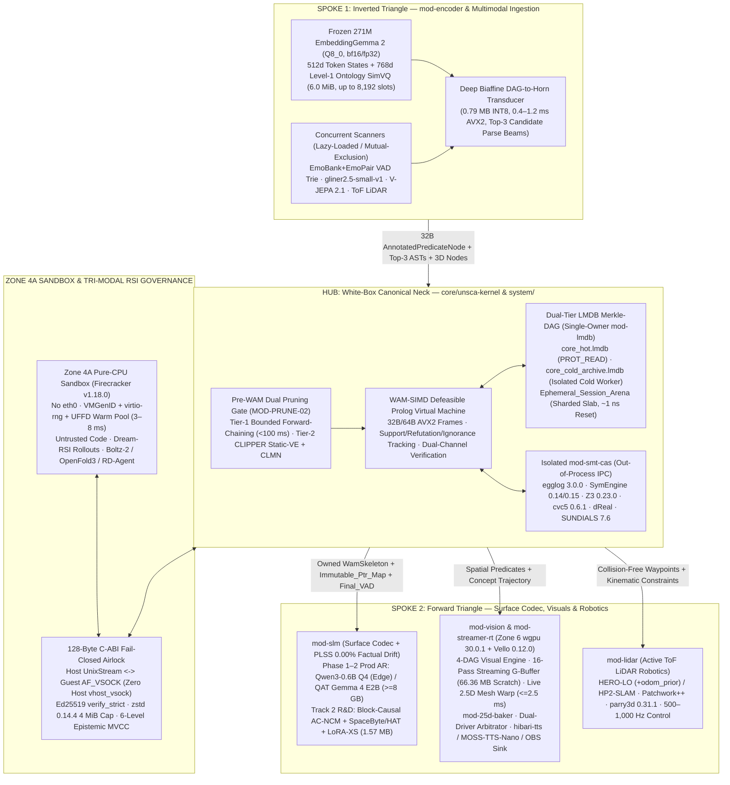

#### The Six Interoperable Subsystems

1. **Compiled Defeasible Prolog Kernel (`core/unsca-kernel`):** Runs a SIMD-aligned Warren Abstract Machine (`WAM-SIMD`) over 32-byte predicate nodes and 64-byte branch execution frames. It separates rule-body evaluation from rule-head detachment, phases execution from Stratified Horn/Datalog (Phase 1A) to native-Rust tabling with constraint subsumption (Phase 1B), tracks context via 64-bit `SpecTemp` SimHash fingerprints, runs a Two-Mode Pre-WAM Pruning Gate (Tier-1 bounded reachability for low-latency queries; Tier-2 entity-indexed `CLIPPER` + `CLMN` for complex queries), and offloads empirical law discovery (`EGG-SR`) and 4-query formal verification (`z3 0.23.0` / `cvc5 0.6.1` / `dReal`) to an isolated worker.
2. **Dual-Tier Content-Addressable LMDB Merkle-DAG (`modules/mod-lmdb`):** Pairs persistent read-only memory-mapped `Core_Axiom_LMDB` (split into `core_hot.lmdb` on the hot process and `core_cold_archive.lmdb` inside an isolated cold-archive worker via `heed 0.23.1`, with SIMD bounding-box pre-filtering and asynchronous `DashMap` reference counting) with a session-local sharded-slab `Ephemeral_Session_Arena` that reclaims all unselected branches in ~1 ns via cursor reset.
3. **Decoupled Encoder (`mod-encoder`) & Pragmatic AR / Track-2 AC-NCM Surface Codec (`mod-slm`):** Pins a 100% frozen 271M text-only `EmbeddingGemma 2` backbone (`Q8_0`, 512d token states exposed via a `llama.cpp` PR `#30054` patch or dual-output `ort` ONNX + 768d Level-1 Ontology SimVQ with `MAX_NCM_CONCEPT_ID = 8191`) paired with a 0.79 MB INT8 Deep Biaffine head for Tier-1 closed-schema slot-filling and Tier-2 Roundtrip + distilled `GenV+HN` anti-unfaithfulness verification. Production Phase 1–2 generation uses compact AR backbones (`Qwen3-0.6B Q4` on Edge; `QAT Gemma 4 E2B` on Workstation/Server >= 8 GB RAM) plus a deterministic Typed AST Pretty-Printer and `PLSS` zero-copy `<PTR_ID_k>` splicing, while Block-Causal `AC-NCM` + `SpaceByte`/`T-Free HAT` + Activation-Aware `LoRA-XS` (1.57 MB) evolves independently on Track 2 R&D.
4. **Dual-Path 2D/2.5D/3D Visual Synthesis, VTuber 2.5D & Active LiDAR Robotics (`mod-vision`, `mod-streamer-rt`, `mod-lidar`):** Delivers >120 FPS (<= 2.45 ms/frame in 2.5D Mesh Warp mode) through the 4-DAG Visual Tool Engine (`G_topo`, `G_stroke`, `G_shade`, `G_logic_vis`), `V-JEPA 2.1` + CIELAB color snapping + bounded `Windfoil` + cropped `MI-GAN` (MIT), `mod-25d-baker` (1-view *Unleashed* vs. 6-view *Strict* + 52 ARKit blendshapes + `VirtualProxyRig3D`), live 2.5D runtime (`ALGORITHM 3B` + `mod-streamer-io` + Dual-Driver Arbitrator + zero-copy OBS `mod-broadcast-sink` + Apache-2.0 eSpeak-free TTS via `hibari-tts`/`MOSS-TTS-Nano`/`Kokoro-82M`/`Paradee-8M`), native `wgpu 30.0.1` + `vello 0.12.0` 16-pass streaming G-Buffer (66.36 MB reused scratch), `spade 2.15.1` meshing + `faer 0.24.4` real-time deformation, `WAFT` + `RobMOT` video tracking, and `HERO-LO`/`HP2-SLAM` + `Patchwork++` + `parry3d 0.31.1` 500–1,000 Hz robotics.
5. **White-Box MIT Sandboxed Runtime & Tri-Modal RSI (`modules/mod-rsi-sandbox`):** Isolates untrusted execution inside pure-CPU Firecracker v1.18.0 (Zone 4A) and coordinates three evolutionary loops: `RSI-1` (Offline Symbolic Dream-RSI with `E-Stitch` / `GrowLibm` / `Propper`), `RSI-2` (Local Edge preference overlay in `<5 MB Local_Overlay_LMDB` vs. Central Trainer 4-Gate Crystallization), and `RSI-3` (Online Licensed RSI audited by an orthogonal DeLP Host Judge with scientific RPCs such as `Boltz-2` / `OpenFold3` / `GROMACS` and 6-Level Epistemic Governance) across a fail-closed 128-byte airlock (`zstd 0.14.4` 4 MiB decompression cap).
6. **Hybrid Micro-Batching Production Serving & Stage-Gate Pipeline:** Combines Zero-Batching symbolic `Ephemeral_Session_Arena` isolation (<5 us/session over shared read-only `mmap`) with Ragged Dynamic Micro-Batching for shared-basis neural spokes, Linux `cgroup v2` split memory accounting, six production infrastructure hardening rules, and an 11-month Stage-Gate roadmap featuring a zero-rewrite **Gemma 5** drop-in portal.

---

### 4. End-to-End Execution & Subsystem Pipelines

#### 4.1 End-to-End Multimodal Cognitive Pipeline (`POST /v1/cognitive/execute`)

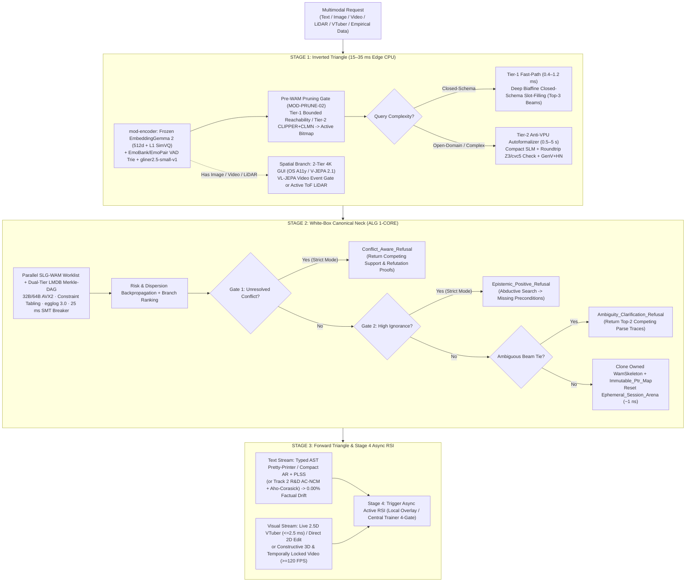

#### 4.2 Dual-Path Visual Synthesis & Active LiDAR Robotics Pipeline

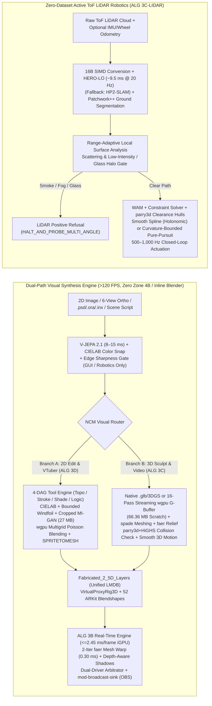

#### 4.3 Tri-Modal Recursive Self-Improvement (`Tri-Modal RSI`) & 128-Byte Airlock Pipeline

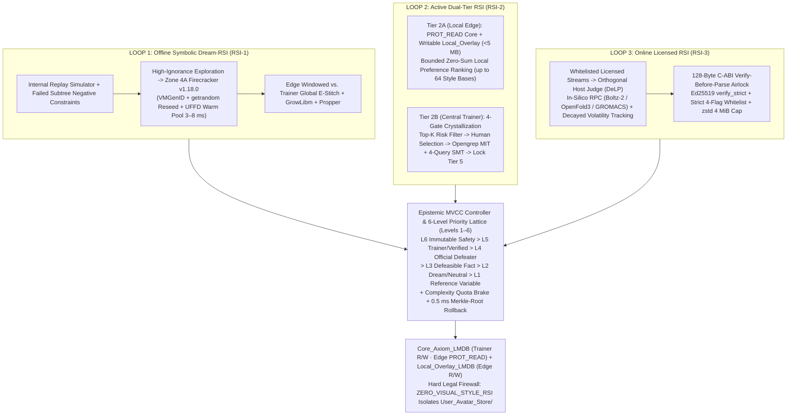

---

### 5. Edge Memory Budget (`cgroup v2`), Binary ABI Invariants & Target Specifications

#### 5.1 Edge Mode `cgroup v2` Split Memory Accounting (`anon <= 1,536 MiB`, `memory.high = 3,072 MiB`, `memory.max = 4,096 MiB`)

Because Linux `cgroup v2` charges `memory.current` with both anonymous process memory (`anon`) and kernel File Page Cache (`file`), Edge Mode accounts for both pools explicitly so `.gguf` weight pages stay resident without thrashing:

| Edge Mode Component | `anon` (MiB) | `file` (MiB) | Allocation Mechanism & Hardening Policy |
| :--- | ---: | ---: | :--- |
| **HUB (`WAM-SIMD` + Arena + `egglog`)** | 350 | 0 | Sharded slabs, `TableSlots`, `egglog` (capped at 10k e-nodes) |
| **`Qwen3-0.6B Q4` KV + Compute Scratch** | 159 | 0 | Locked `-c 2048 -ctk q8_0 -ctv q8_0 -fa on` (119 MiB KV + 40 MiB scratch) |
| **`mod-encoder` / `ort` / VAD Trie** | 220 | 40 | Frozen bf16/fp32 activations, L1 SimVQ, `gliner2.5-small-v1` (`disable_prepacking=1`, `cpu_mem_arena=false`); `canonical_ontology.bin` (40 MiB) |
| **`mod-streamer-rt` (Live 2.5D + TTS)** | 285 | 0 | `wgpu 30.0.1` + ARAP + face tracking + `hibari`/`MOSS-TTS-Nano` ONNX (100% concurrent) |
| **Runtime Stacks, Allocators & IPC** | 150 | 0 | Rayon worker stacks, `UnixStream` buffers, `io_uring` slots |
| **`EmbeddingGemma 2` (`Q8_0 .gguf`)** | 0 | 296 | Read-only `mmap` Page Cache (never evicted via `POSIX_FADV_DONTNEED`) |
| **`Qwen3-0.6B Q4` (`.gguf`)** | 0 | 500 | Read-only `mmap` Page Cache (never evicted via `POSIX_FADV_DONTNEED`) |
| **Compiled `.wamb` Bytecode** | 0 | 150 | `0_bootstrap_seed` + `1_logic_math_core` direct `mmap` |
| **`core_hot.lmdb` Hot Working Set** | 0 | 600 | `MADV_RANDOM`; `core_cold_archive.lmdb` isolated in a separate cold-worker process |
| **Edge Mode Total** | **1,164** | **1,586** | **Total `anon+file` ~2,750 MiB** (~372 MiB `anon` headroom; out-of-process `mod-smt-cas` Z3 capped at 256 MB / <= 300 MiB cgroup) |

> **Hardware-Aligned Rust C-ABI Invariants (verified at compile time via `const _: () = assert!(...)`):** `AnnotatedPredicateNode` = **32 B** (1 AVX2 YMM register) · `ArenaBranchStateHeader` = **48 B** · `WamBranchExecutionFrame` = **64 B** (1 L1 cache line) · `UnifiedDagNodeHeader` = **128 B** · `AirlockEpistemicFrame` = **128 B** (2 L1 cache lines) · `NcmConceptHyperGraphRecord` = **1,568 B**.

#### 5.2 Target System Specification Sheet

| Specification Metric | Standardized Design Target | Engineering Guarantee |
| :--- | :--- | :--- |
| **Minimum Core Storage** | `1.8 GB` (`0.4 GB` max-compressed embedded profile + `25 MB` Day-0 Seed) | Compiled `WAM-SIMD` bytecode + Zstd `Core_Axiom_LMDB` (sparse NTFS support on Windows) + BLAKE3 deduplication |
| **Extended Offloaded Banks** | `10 GB–50 GB` NVMe SSD (`4096 B` LBA `O_DIRECT`) | 3D Style PatchBanks + WGSL LUTs streamed on demand; `LoRA-XS` (1.57 MB) stays resident in RAM |
| **Per-User Isolation (Server)** | `< 5 us` per-session `Ephemeral_Session_Arena` | Multi-core Rayon over shared read-only `mmap`; Firecracker Zone 4A for untrusted execution |
| **Query Traversal SLA** | Tier-1: `P99 < 100 ms` (`8–45 ms` on 8-core AVX2) · Tier-2: `0.5–5 s` | 32B/64B AVX2 frames + Tier-1 bounded reachability + `egglog 3.0` + 25 ms SMT circuit breaker |
| **Surface Text Throughput** | Phase 1–2 AR: `34–86 tok/s` · Track 2 AC-NCM target: `470–750 BPE-equiv tok/s` | `Qwen3-0.6B` (Edge) / `QAT Gemma 4 E2B` (>= 8 GB Workstation/Server) + `PLSS`; Track 2 gated on CPU PPL < 45 |
| **Visual & Robotics Rate** | `120–408+ FPS` (<= 2.45 ms/frame at 1080p/2K) · Robotics: `500–1,000 Hz` | `faer` Cholesky + 2-iter mesh warp (`0.30 ms`) + depth-aware Porter-Duff compositing + `parry3d` |
| **Closed-Domain Factual Drift** | **`0.00%`** on pointer-locked entities and numbers (`<PTR_ID_k>`) | `WamSkeleton` + Aho-Corasick `<PTR_ID_k>` verification + zero-copy `PLSS` byte splicing |
| **High-Ignorance / Conflict** | **`100%` deterministic** Conflict-Aware, Positive, or Ambiguity Refusal | Dissonance-first refusal gate evaluated before Dual Vacuity abductive search and beam-tie clarification |

---

### 6. Host Environment, Production Hardening Rules & Release Package

The planned release package directory layout is documented in [Appendix A](#appendix-a-release-package-layout).

**Host Environment Requirements (Linux `x86_64`, AVX2 + FMA + AVX-VNNI):**

- **Kernel:** Ubuntu 24.04 / Linux Mint 22.x (`USN-9022-1`, `>= 6.8.0-149-generic`, `kernel.io_uring_disabled=0`) or LMDE 7 / Debian 13 (`>= 6.12.113-1`, patching `CVE-2026-99999`). Blacklist `vhost_vsock` on the Host to eliminate the `CVE-2026-53365` (*VsockDrop*) attack surface; run Firecracker guest kernels `>= 6.18.34` with `kernel.io_uring_disabled=2`.
- **Toolchain:** Rust Edition 2024 via `rustup` (`MSRV 1.96`, `1.100` recommended; lock `[profile.release] panic = "unwind"` in the root `Cargo.toml` so `spade 2.15.1` falls back safely to `earcutr`).
- **Storage & KVM:** Unencrypted `ext4`/`xfs` (or full-disk LUKS; never `eCryptfs`) for `O_DIRECT`; add the runtime user to the `kvm` group and raise `RLIMIT_MEMLOCK` when registering fixed `io_uring` buffers >8 MB.

**Six Production Infrastructure Hardening Rules:**

1. **Aligned I/O & Dedicated Ring Threading:** Heap-allocate 4096-byte aligned DMA buffers for `O_DIRECT`; run Linux `io_uring` inside a dedicated pinned I/O thread with mutually exclusive setup flags (wrapping Windows DirectStorage/IoRing and macOS `dispatch_io`).
2. **Database Isolation & Sparse Storage:** Use per-worker `RoTxn` handles on `core_hot.lmdb` (`max_readers = 4096`, `MDB_NOTLS`), isolate `core_cold_archive.lmdb` inside a dedicated cold-worker process, refresh Dream-RSI snapshots every 50 ms, and enable `FSCTL_SET_SPARSE` on Windows NTFS.
3. **Lock-Free WAM Dispatch Updates:** Update compiled predicate dispatch chains out-of-place using epoch-based RCU (`crossbeam-epoch >= 0.9.20`) with a `compare_exchange_weak` retry loop so concurrent RSI commits never race active readers.
4. **Split Edge Memory & Page-Cache Hygiene:** Enforce `cgroup v2` `anon` and total container ceilings separately, apply `MADV_RANDOM` on LMDB, reclaim cold pages only during idle batches (never on `.gguf` weights), and enforce mutual exclusion between `mod-vision-heavy` and `mod-smt-cas`.
5. **Major ABI Codebook Pinning:** Freeze Level-1 ontology codebook indices `0..4095` as an immutable Major ABI and append newly discovered macro-concepts strictly into the `4096..8191` OTA expansion range.
6. **Observability & 25 ms SMT Circuit Breaker:** Export OpenTelemetry/Prometheus counters (`wam_cache_hit_ratio`, `positive_refusal_trigger_rate`, `unverified_mdl_entropy`) and abort any online Z3/cvc5 call exceeding 25 ms or its memory cap, offloading deep proofs to the asynchronous offline Dream-RSI queue.

---

### 7. Stage-Gate Roadmap & Evaluation Protocol

Engineering delivery is split into sequential Stage-Gate phases with decoupled R&D tracks (`Track 2` AC-NCM and `Track 3A` 2.5D/VTuber) so no experimental research track blocks the core symbolic path:

| Phase | Timeline | Scope & Exit Criteria |
| :--- | :--- | :--- |
| **Phase 1A-Alpha** | Weeks 1–6 | Pure symbolic core: Stratified Horn/Datalog in Rust + three-state epistemic VM + `heed 0.23.1` LMDB Merkle-DAG + `egglog 3.0.0` + `z3`/`cvc5` + `Qwen3-0.6B` PLSS + Mandatory Hard Formal Probe Gate (`cargo check/clippy/proptest` 10k inputs/invariant). |
| **Phase 1A-Beta** | Weeks 7–12 | Neural loop closure: `EmbeddingGemma 2` 512d token-state patch + `SpecTemp` SimHash + Tier-1 Biaffine + Tier-2 Roundtrip/`GenV+HN`. Edge gated on **AbstentionBench** & **PlanBench**; Workstation/Server gated on **VeriBench** & **SWE-bench Verified**. |
| **Phase 1B (+ Track 3A)** | Weeks 13–20 | Native-Rust left-recursive answer tables + constraint subsumption + non-monotone verification + Tier-2 `CLIPPER` static-VE. Parallel **Track 3A** (standalone 2.5D/VTuber Rust engine) launches in Month 2. |
| **Phase 2** | Months 6–8 | Five-Family Commercial-Open Teacher Distillation (`Qwen3.8-27B` + `Qwen3.6-35B-A3B`, `MiMo-V2.6`, `GLM-5.3-Flash`, `DeepSeek-V4.1-Flash-1017`, `Gemma 4`) on Production AR + PLSS (0.00% `<PTR_ID_k>` drift). Decoupled **Track 2 AC-NCM R&D** gated on OpenWebText PPL < 45 & `<PTR_ID_k>` intact rate >= 99.9%. |
| **Phase 3** | Months 9–11 | Independent spoke integration (`mod-vision`, `mod-streamer-rt`, `mod-lidar`, `mod-rsi-sandbox` Firecracker v1.18.0 + `egg-stitch` port to `egglog 3.0.0`), `Harness^2` Round 2 tuning, and **Zero-Rewrite Gemma 5 Drop-In** (0 Rust lines modified via Major ABI pinning `0..4095`). |

**Five Controlled Benchmark Suites & Three Mandatory Ablation Studies:**

1. *Combinatorial Memory & Sub-DAG Deduplication:* `SWE-bench Verified`, `PlanBench`, and `VeriBench` across 100 to 5,000 concurrent reasoning branches (measuring peak `cgroup v2` memory, deduplication ratio, and ~1 ns arena reset latency).
2. *Epistemic Positive Refusal & Anti-Hallucination:* `AbstentionBench` (>35,000 items) and `FalseQA` (True/False Abstention Rate, Fuel-Exhausted Refusal Rate, anti-VPU detection AUROC, and abductive missing-precondition accuracy).
3. *Long-Horizon 4K GUI & Scientific Workflows:* `ScreenSpot-Pro`, `OSWorld 2.0`, and `OSWorld-Science` (task completion rate, pixel localization error, and visual prompt-injection blocking).
4. *Dual-Path Visual Synthesis & Active LiDAR:* `BlenderGym` / `BlenderBench`, controlled blur disambiguation pairs, and indoor/outdoor LiDAR obstacle courses with smoke, fog, and transparent glass hazards.
5. *Parallel AC-NCM Throughput vs. Factual Fidelity:* Dual-channel DDR5 CPU throughput (BPE-equiv tok/s), OpenWebText perplexity, and exact `<PTR_ID_k>` pointer preservation.

*Mandatory Ablations:* (1) disable canonical BLAKE3 deduplication and `Ephemeral_Session_Arena`; (2) replace three-state epistemic tracking and ancestor lineage Bloom masks with single-value confidence scores; (3) remove the Orthogonal Host Judge, 128-byte Airlock, decayed volatility tracking, and `cvc5` formal verification during online RSI.

---

### 8. Languages Used, License & Citation

**Languages and Formats Used:**

| Language / Format | Role in the System |
| :--- | :--- |
| **Rust** (Edition 2024, `MSRV 1.96`) | Primary implementation language: `core/unsca-kernel`, `system/`, `modules/mod-*` (`WAM-SIMD`, `mod-lmdb`, `mod-encoder`, `mod-slm`, `mod-vision`, `mod-streamer-rt`, `mod-lidar`, `mod-rsi-sandbox`) |
| **Prolog / Datalog** (Defeasible) | Kernel reasoning-rule language compiled into `.wamb` bytecode |
| **WGSL** | GPU shaders for `wgpu 30.0.1` / `vello 0.12.0` (procedural materials, Lit-Sphere LUTs, 16-pass streaming G-Buffer) |
| **SMT-LIB 2.6** | Formal constraint and law representation verified by `z3` / `cvc5` / `dReal` |
| **DeLP** | Independent auditing rulebase executed by the Host Orthogonal Judge (`judge_eafs_rules.delp`) |
| **C++** | `llama.cpp` PR `#30054` token-state patch and native libraries invoked via FFI (`cvc5`, `Z3`, `SymEngine`, `SUNDIALS`) |
| **Python** (Third-Party) | Offline scientific and distillation tooling isolated inside Zone 4A (`RD-Agent`, `aideml`, `Boltz-2`, `OpenFold3`); not part of the core runtime |

**License & Legal Isolation:**

- **Core Runtime:** [MIT License](https://www.google.com/search?q=LICENSE) (`core/unsca-kernel`, `system/`, and Rust spokes).
- **Third-Party & IP Isolation:** `cvc5` (`--poly` GMP/LibPoly, LGPLv3) and the `Opengrep` CLI (LGPL-2.1, MIT rules subset only) run strictly out-of-process via IPC/CLI; `EmoBank`/`EmoPair` VAD trie data (CC BY-SA 4.0) is packaged separately from MIT Rust binaries; `ZERO_VISUAL_STYLE_RSI` and the isolated `mod-c2pa-export` crate (`c2pa 0.92.2`) enforce artist IP isolation and support EU AI Act Article 50 (Content Credentials) compliance.

**Citation:** see [Appendix B](#appendix-b-citation).

---

## Japanese (JA)

🇯🇵 **日本語** — Takuma-1 (Trinity Symbolic) / `TNS-1`

> **言語クイックジャンプ:** [English](#english-en) · [日本語](#japanese-ja) · [Tiếng Việt](#vietnamese-vi) · [中文](#chinese-zh) · [↑ トップへ](#table-of-contents)

### 1. 概要とアーキテクチャ動機

**Takuma-1 (Trinity Symbolic)**（技術コード：**TNS-1 / Trinity Symbolic Systems**、開発：**GOSIS VN**）は、マスターエンジニアリング仕様 **U-NSCA v2 (P)**（`SPEC-UNSCA-V2-P-UNIFIED v1.0.9.3-FREEZE`、*Phase 1A-Alpha Track 1 実装GO*）に基づく、機能分離型のホワイトボックス・ニューロシンボリック認知アーキテクチャです。

単一の巨大ニューラルネットワークに知識保持・多枝推論探索・安全制約・表層テキストおよび画像生成をすべて担わせるのではなく、**Takuma-1 (`TNS-1`)** は ***Transformation Is All You Need*** の設計思想のもと、知覚・形式推論・記憶・言語生成・空間視覚合成・自己改善を独立した検証可能なサブシステムへ分離し、モノリシックモデルが抱える4つの構造的課題を解消します。

| 構造的課題 | モノリシックモデルの制約 | Takuma-1 (`TNS-1`) におけるシステム解決策 |
| :--- | :--- | :--- |
| **1. 多枝推論メモリの非統一性** | 異なる前置文脈やステップ位置から同一サブゴールに収束する分岐でもKVキャッシュを統合できず、数千本の並列探索でメモリ消費が線形膨張する。 | **二層構造 LMDB Merkle-DAG**（`Core_Axiom_LMDB` + `Ephemeral_Session_Arena`）。AST正規化・定数リフト・128-bit BLAKE3により定数時間（約100 ns）で部分グラフを重複排除。 |
| **2. 証拠対立と知識欠如の混同** | 通常の正規化出力では証拠の総量が失われるため、均衡した矛盾と完全な無知が区別できず、棄権（回答拒否）の信頼性が低下する。 | **3状態認識トラッキング**（支持・反証・無知の分離保持）と、**矛盾優先ゲート**（`Conflict_Aware_Refusal`）および**二重空虚ゲート**（`Epistemic_Positive_Refusal`・不足前提の逆探索）を搭載。 |
| **3. 言語・論理結合とアライメント税** | 論理推論・表層構文・RLHFポリシーが同一重みを共有するため、メモリ帯域の浪費と推論回路の劣化（Alignment Tax）が生じる。 | **分離型 Hub-and-Spoke コーデック**（`mod-encoder` + `mod-slm`）＋**PLSS** ゼロコピー `<PTR_ID_k>` 接合（閉領域事実ドリフト 0.00%）＋ストレージ層で強制される**6段階認識優先度制御**。 |
| **4. ピクセル生成と単眼スケール曖昧性** | ピクセル拡散は明示的な3D幾何や衝突不変量を欠き、受動単眼カメラはスケール曖昧性を抱える。また4K GUIの高密度クロップは低遅延SLAを破綻させる。 | **デュアルパス 2D/2.5D/3D 構成的視覚エンジン**（`wgpu 30.0.1` + `vello 0.12.0` + `spade` + `faer`、>120 FPS、<= 2.45 ms/frame）、**2階層4K GUIグラウンディング**（OS A11y/DOM <1 ms）、**能動ToF LiDARロボティクス**（`HERO-LO`/`HP2-SLAM`、500–1,000 Hz）。 |

---

### 2. 設計思想と4つのホワイトボックス封じ込め保証

**Takuma-1 (`TNS-1`)** は**機能分離（Functional Disentanglement）**を原則とし、認知処理を以下の5つの独立した監査可能プレーンへ分割します。

1. **推論・計画・形式検証：** Pure Rust のコンパイル型 Prolog 仮想マシン（`WAM-SIMD`）と、別プロセス隔離された制約・記号検証ソルバ群（`egglog 3.0.0`、`SymEngine 0.14/0.15`、`Z3 0.23.0`、`cvc5 0.6.1`、`dReal`、`SUNDIALS CVODE 7.6.0`）が担当。
2. **コンテンツアドレス可能メモリ：** ハードウェア境界整合された32バイトレコードを128-bit BLAKE3で索引化する二層 LMDB Merkle-DAG（`Core_Axiom_LMDB` + `Ephemeral_Session_Arena`）。
3. **表層言語生成と感情ニュアンス：** エンコーダ（`mod-encoder`）と表層コーデック（`mod-slm`）を完全分離し、`PLSS`（Pointer-Locked Semantic Skeleton）により検証済み数値・実体を改変なしで直接接合。
4. **空間知覚・視覚合成・ロボティクス：** ネイティブ Rust GPU 描画基盤（`wgpu 30.0.1` + `vello 0.12.0`）、2.5Dアバター生成・ライブ配信パイプライン（`mod-25d-baker`、`mod-streamer-rt`）、能動ToF LiDAR制御（`mod-lidar`）を統合。
5. **サンドボックス自律進化とガバナンス：** オフライン夢想・二層アクティブ改善・オンライン許可ストリーム取得を直交ホストジャッジと128バイト・バイナリエアロック越しに統制する三相RSIエンジン（`Tri-Modal RSI`）。

自律的な自己改善を常に検査可能かつ可逆に保つため、次の**4つのホワイトボックス封じ込め不変条件**を強制します。

1. **潜在ルール進化の禁止（Zero Latent Rules）：** オフライン夢想（`RSI-1`）やオンライン取得（`RSI-3`）で獲得された知識は不透明なニューラル重みへ蓄積せず、すべて32バイトの `AnnotatedPredicateNode` または `Core_Axiom_LMDB` 内の明示的な `SymEngine` / `SMT-LIB 2.6` レコードとして結晶化されます。
2. **ホワイトボックス複雑度上限と自動パレート追い出し：** 一時アリーナ内の未検証自動生成ルール群の構造複雑度をクォータ上限で監視し、上限到達時に低効用マクロを高カバレッジかつ簡潔な候補へ自動置換します。`Core_Axiom_LMDB` への永続昇格はすべて4クエリSMT形式検証を必須とします。
3. **統合ホスト信頼プレーン＋無ネットワーク Zone 4A サンドボックス＆128バイト C-ABI エアロック：** 信頼Hub（`core/unsca-kernel`、Edge上 `PROT_READ` 単一所有 `mod-lmdb`、`mod-encoder`、`mod-slm`、`mod-streamer-rt`、Host直交ジャッジ）をホスト上で実行。非信頼コード実行・Dream-RSIロールアウト・外部シミュレーションは純CPU **Firecracker v1.18.0**（**Zone 4A**、`eth0`除去、ACPI `VMGenID` + `virtio-rng` 再シード、3–8 ms UFFDウォームプール）に隔離し、Zone 4B（インラインBlender）は完全廃止。境界通信はフェイルクローズドな128バイトC-ABI（`Host UnixStream <-> Guest AF_VSOCK`、ホスト側 `vhost_vsock` 不使用）と RFC 8032 Ed25519 `verify_strict` 署名検証で保護します。
4. **サブミリ秒外科的切除と Merkle ルート・タイムトラベルロールバック：** 各コミットエポックの不変ハッシュ `Merkle_Root_Hash` を `Epoch_Roots` に記録し、特定 `node_hash` の切除または過去エポックへの原子的ロールバックを約 0.5 ms で完了します。

---

### 3. システムアーキテクチャと双方向砂時計トポロジ

`TNS-1` は Rust 2024 の **Hub-and-Spoke** ワークスペース（`core/unsca-kernel` -> `system/` -> `modules/mod-*`）上で、閉じた**双方向砂時計（逆三角形 -> ホワイトボックス正規ネック -> 正三角形）**としてエンドツーエンド認知を実行します。

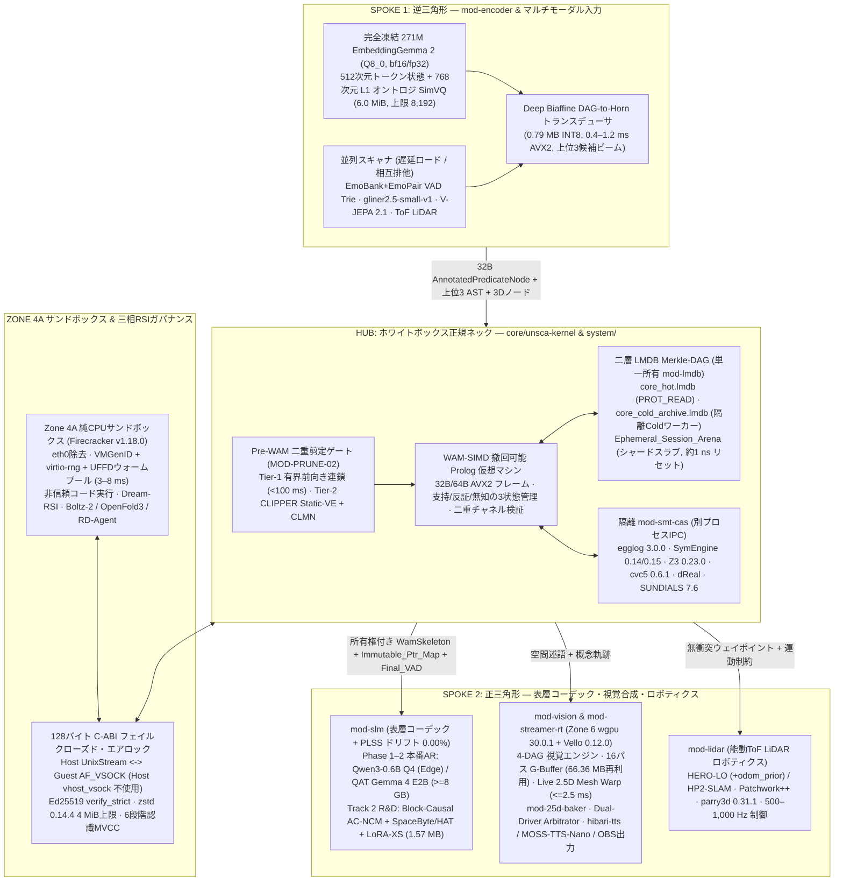

#### 6つの相互運用サブシステム

1. **コンパイル型 撤回可能 Prolog カーネル（`core/unsca-kernel`）：** 32バイト述語ノードと64バイト実行フレームを扱う SIMD 整合 Warren 抽象機械（`WAM-SIMD`）。Phase 1A の層化 Horn/Datalog から Phase 1B のネイティブ Rust タブリング・制約包摂へ段階拡張し、64-bit `SpecTemp` SimHash による文脈照合、Pre-WAM 二重剪定ゲート（Tier-1 有界到達性 / Tier-2 エンティティ索引付き `CLIPPER` + `CLMN`）、および別プロセスでの経験則発見（`EGG-SR`）と4クエリSMT検証を統合します。
2. **二層コンテンツアドレス可能 LMDB Merkle-DAG（`modules/mod-lmdb`）：** ホット領域（`core_hot.lmdb`）と別プロセス隔離のコールド領域（`core_cold_archive.lmdb`）を `heed 0.23.1` で単一所有管理し、セッション一時メモリ（`Ephemeral_Session_Arena`）と組み合わせることで、未選択分岐を約 1 ns で一括解放します。
3. **分離型エンコーダ（`mod-encoder`）＆表層コーデック（`mod-slm`）：** 100%凍結した271M `EmbeddingGemma 2`（`Q8_0`、`llama.cpp` PR `#30054` パッチまたはデュアル出力 ONNX + 768次元 Level-1 Ontology SimVQ `MAX_NCM_CONCEPT_ID = 8191`）と 0.79 MB INT8 Deep Biaffine ヘッドを搭載。Phase 1–2 本番環境はコンパクト AR（Edge: `Qwen3-0.6B Q4` / Workstation-Server >= 8 GB: `QAT Gemma 4 E2B`）＋型付き AST 整形器＋`PLSS` ゼロコピー接合を採用し、`Block-Causal AC-NCM` + `SpaceByte/HAT` + `LoRA-XS` (1.57 MB) は独立 Track 2 R&D として推進します。
4. **デュアルパス視覚合成・VTuber 2.5D・能動 LiDAR ロボティクス（`mod-vision`, `mod-streamer-rt`, `mod-lidar`）：** 4-DAG 視覚ツールエンジン、`V-JEPA 2.1` + CIELAB 境界スナップ + 有界 `Windfoil` + 局所 `MI-GAN` (MIT)、`mod-25d-baker`（1視点 *Unleashed* / 6視点 *Strict* + 52 ARKit ブレンドシェイプ + `VirtualProxyRig3D`）、ライブ配信エンジン（`ALGORITHM 3B` + `mod-streamer-io` + Dual-Driver Arbitrator + OBSゼロコピー出力 + Apache-2.0 eSpeak不要TTS）、ネイティブ `wgpu 30.0.1` + `vello 0.12.0` 16パス G-Buffer（66.36 MB再利用）、および `HERO-LO`/`HP2-SLAM` + `Patchwork++` + `parry3d 0.31.1` の 500–1,000 Hz ロボット制御を統合します。
5. **ホワイトボックス MIT サンドボックス＆三相 RSI（`modules/mod-rsi-sandbox`）：** 非信頼実行を純CPU Firecracker v1.18.0（Zone 4A）に封じ込め、`RSI-1`（オフライン夢想＋`E-Stitch`/`GrowLibm`/`Propper`）、`RSI-2`（ローカルEdge嗜好オーバーレイ `<5 MB` 対 中央トレーナ4ゲート結晶化）、`RSI-3`（直交ホストジャッジ＋`Boltz-2`/`OpenFold3`/`GROMACS` RPC＋6段階認識ガバナンス）を128バイトエアロック越しに連携します。
6. **ハイブリッド・マイクロバッチ本番配信＆ステージゲート計画：** セッション単位のゼロバッチ記号隔離（<5 us/セッション）と共有基底ニューラル・マイクロバッチングを両立し、Linux `cgroup v2` 分離メモリ監査、6つの本番インフラ硬化ルール、および Rust コード変更0行の **Gemma 5** ドロップイン接続口を備えます。

---

### 4. エンドツーエンド実行・サブシステムパイプライン

#### 4.1 マルチモーダル認知実行パイプライン（`POST /v1/cognitive/execute`）

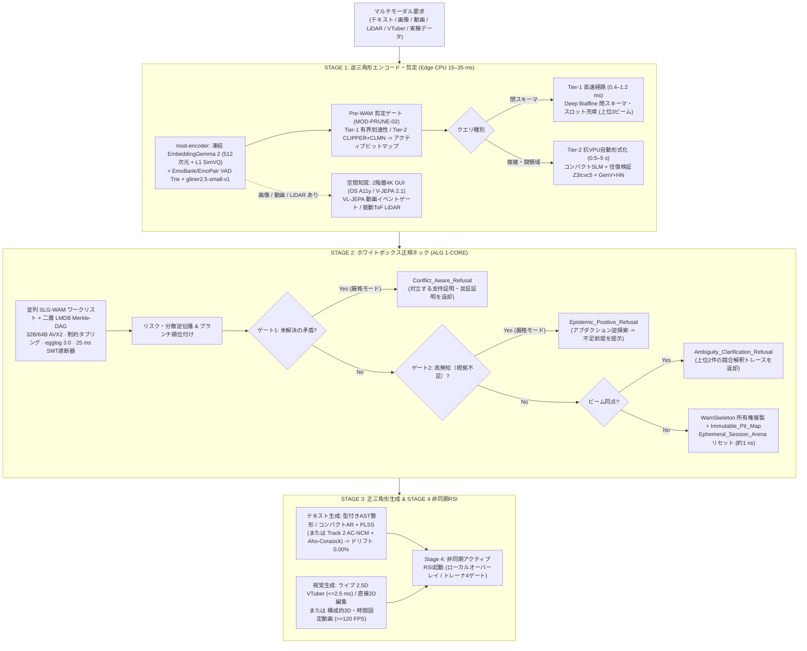

#### 4.2 デュアルパス視覚合成＆能動 LiDAR ロボティクス

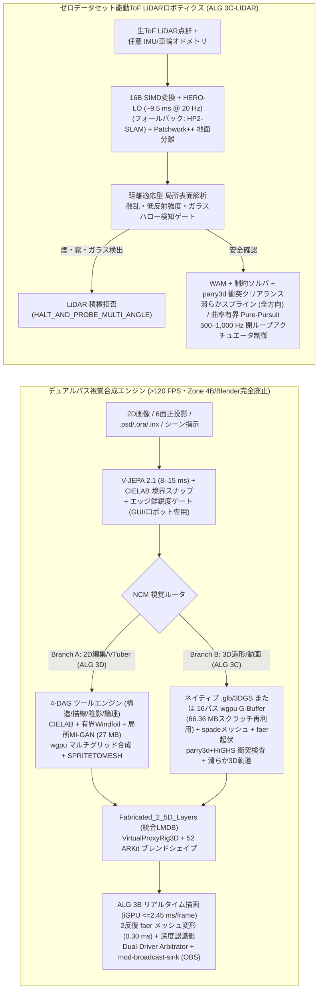

#### 4.3 三相再帰的自己改善（`Tri-Modal RSI`）＆128バイト・エアロック

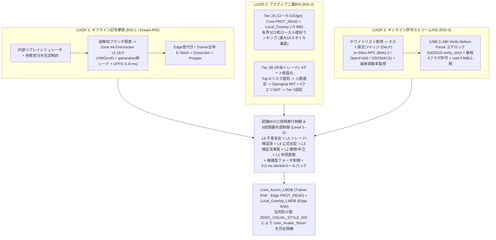

---

### 5. Edge メモリ予算（`cgroup v2`）・バイナリ不変条件・ターゲット仕様

#### 5.1 Edgeモード `cgroup v2` 分離メモリ監査（`anon <= 1,536 MiB`、`memory.high = 3,072 MiB`、`memory.max = 4,096 MiB`）

| Edge コンポーネント | `anon` (MiB) | `file` (MiB) | 確保方式・硬化ポリシー |
| :--- | ---: | ---: | :--- |
| **HUB (`WAM-SIMD` + Arena + `egglog`)** | 350 | 0 | シャードスラブ、`TableSlots`、`egglog`（上限 10k e-node） |
| **`Qwen3-0.6B Q4` KV + スクラッチ** | 159 | 0 | `-c 2048 -ctk q8_0 -ctv q8_0 -fa on` 固定（119 MiB KV + 40 MiB） |
| **`mod-encoder` / `ort` / VAD Trie** | 220 | 40 | 凍結 bf16/fp32、`gliner2.5-small-v1`（`disable_prepacking=1`）、`canonical_ontology.bin` |
| **`mod-streamer-rt` (Live 2.5D + TTS)** | 285 | 0 | `wgpu 30.0.1` + ARAP + 顔追跡 + `hibari`/`MOSS-TTS-Nano` ONNX（100%常駐並列） |
| **ランタイムスタック・IPC** | 150 | 0 | Rayonワーカースタック、`UnixStream`、`io_uring` スロット |
| **`EmbeddingGemma 2` (`Q8_0 .gguf`)** | 0 | 296 | 読取専用 `mmap` ページキャッシュ（`POSIX_FADV_DONTNEED` 禁止） |
| **`Qwen3-0.6B Q4` (`.gguf`)** | 0 | 500 | 読取専用 `mmap` ページキャッシュ（`POSIX_FADV_DONTNEED` 禁止） |
| **コンパイル済 `.wamb` バイトコード** | 0 | 150 | `0_bootstrap_seed` + `1_logic_math_core` 直接 `mmap` |
| **`core_hot.lmdb` ホット集合** | 0 | 600 | `MADV_RANDOM`、`core_cold_archive.lmdb` は別コールドワーカープロセスで隔離 |
| **Edgeモード合計** | **1,164** | **1,586** | **合計 `anon+file` 約 2,750 MiB**（`anon`余裕 約 372 MiB、Z3は別プロセス <= 300 MiB 制限） |

> **ハードウェア整合 Rust C-ABI 不変条件（`const _: () = assert!(...)`）：** `AnnotatedPredicateNode` = **32 B**（AVX2 YMM レジスタ1本）· `ArenaBranchStateHeader` = **48 B** · `WamBranchExecutionFrame` = **64 B**（L1 キャッシュライン1本）· `UnifiedDagNodeHeader` = **128 B** · `AirlockEpistemicFrame` = **128 B**（L1 キャッシュライン2本）· `NcmConceptHyperGraphRecord` = **1,568 B**。

#### 5.2 ターゲット製品仕様シート

| 仕様項目 | 標準設計ターゲット | エンジニアリング保証 |
| :--- | :--- | :--- |
| **最小コア容量** | `1.8 GB`（組込最大圧縮 `0.4 GB` + Day-0 Seed `25 MB`） | `WAM-SIMD` バイトコード + Zstd `Core_Axiom_LMDB`（Windows NTFS スパース対応）+ BLAKE3 重複排除 |
| **拡張オフロードバンク** | `10 GB–50 GB` NVMe SSD（`4096 B` LBA `O_DIRECT`） | 3DスタイルPatchBank・WGSL LUTはオンデマンド読込、`LoRA-XS` (1.57 MB) はRAM常駐 |
| **ユーザセッション隔離** | `< 5 us` / セッション（Serverモード） | 共有 `PROT_READ` mmap上の独立 `Ephemeral_Session_Arena` + Zone 4A Firecracker |
| **クエリ応答SLA** | Tier-1: `P99 < 100 ms`（8コアAVX2 `8–45 ms`）· Tier-2: `0.5–5 s` | 32B/64B AVX2 フレーム + Tier-1 有界到達性 + `egglog 3.0` + 25 ms SMT遮断器 |
| **表層テキスト生成速度** | Phase 1–2 AR: `34–86 tok/s` · Track 2 AC-NCM目標: `470–750 BPE-equiv tok/s` | `Qwen3-0.6B` (Edge) / `QAT Gemma 4 E2B` (>= 8 GB) + `PLSS`（Track 2は CPU PPL < 45 通過後） |
| **視覚・ロボティクス周期** | `120–408+ FPS`（1080p/2K <= 2.45 ms/frame）· ロボット `500–1,000 Hz` | `faer` Cholesky + 2反復メッシュ変形 (`0.30 ms`) + 深度認識 Porter-Duff 合成 + `parry3d` |
| **閉領域事実ドリフト率** | **`0.00%`**（ポインタ固定エンティティ・数値 `<PTR_ID_k>`） | `WamSkeleton` + Aho-Corasick検証 + `PLSS` ゼロコピー置換 |
| **高無知・矛盾時の挙動** | **`100%` 決定的** 矛盾認識拒否 / 積極拒否 / 曖昧性確認拒否 | 矛盾優先ゲートを二重空虚アブダクション探索・ビーム同点確認より先に評価 |

---

### 6. ホスト環境・本番硬化ルール・リリースパッケージ

リリースパッケージのディレクトリ構成は[付録A](#appendix-a-release-package-layout)を参照してください。

**ホスト環境要件（Linux `x86_64`、AVX2 + FMA + AVX-VNNI）：**

- **カーネル：** Ubuntu 24.04 / Linux Mint 22.x（`USN-9022-1`、`>= 6.8.0-149-generic`、`kernel.io_uring_disabled=0`）または LMDE 7 / Debian 13（`>= 6.12.113-1`、`CVE-2026-99999` 対策済み）。ホスト側で `vhost_vsock` をブラックリスト化して `CVE-2026-53365`（*VsockDrop*）の攻撃面を排除し、Firecracker ゲストカーネルは `>= 6.18.34`（`kernel.io_uring_disabled=2`）を使用します。
- **ツールチェーン：** `rustup` 経由の Rust Edition 2024（`MSRV 1.96`、推奨 `1.100`。`spade 2.15.1` の `earcutr` フォールバック用にルート `Cargo.toml` で `[profile.release] panic = "unwind"` を固定）。
- **ストレージ・KVM：** `O_DIRECT` 用に非暗号化 `ext4`/`xfs`（またはフルディスク LUKS、`eCryptfs` 不可）。固定 `io_uring` バッファを >8 MB 登録する場合は `kvm` グループ追加と `RLIMIT_MEMLOCK` 引上げが必要です。

**6つの本番インフラ硬化ルール：**

1. **整合 I/O と専用リングスレッド：** `O_DIRECT` 用に 4096 バイト整合 DMA バッファをヒープ確保し、Linux `io_uring` を専用ピン留めスレッドで運用（Windows DirectStorage / macOS `dispatch_io` ラッパー対応）。
2. **DB隔離とスパース領域：** `core_hot.lmdb` はワーカー毎の `RoTxn`（`max_readers = 4096`, `MDB_NOTLS`）で読み、`core_cold_archive.lmdb` は別コールドワーカーへ隔離、50 ms 毎にスナップショット更新、Windows NTFS では `FSCTL_SET_SPARSE` を有効化。
3. **ロックフリー WAM ディスパッチ更新：** `crossbeam-epoch >= 0.9.20` と `compare_exchange_weak` ループにより、並列 RSI 更新中でも読取競合を発生させずに述語チェーンを差し替え。
4. **Edge 分離メモリとページキャッシュ衛生：** `cgroup v2` の `anon` とコンテナ総量上限を分離管理し、LMDB に `MADV_RANDOM` を適用、コールドページ解放はアイドルバッチのみ（`.gguf` は対象外）とし、`mod-vision-heavy` と `mod-smt-cas` を相互排他制御。
5. **Major ABI コードブック固定：** Level-1 オントロジ索引 `0..4095` を不変 Major ABI として凍結し、OTA 拡張は `4096..8191` への追記専用に限定。
6. **可観測性と 25 ms SMT 遮断器：** OpenTelemetry/Prometheus 指標を出力し、25 ms またはメモリ上限を超えたオンライン Z3/cvc5 呼び出しを即座に遮断してオフライン Dream-RSI キューへ退避。

---

### 7. ステージゲート・ロードマップと評価プロトコル

| フェーズ | 期間 | 対象範囲・ゲート合格基準 |
| :--- | :--- | :--- |
| **Phase 1A-Alpha** | 第1〜6週 | 純記号コア（Rust 層化 Horn/Datalog + 3状態認識VM + `heed 0.23.1` Merkle-DAG + `egglog 3.0.0` + `z3`/`cvc5` + `Qwen3-0.6B` PLSS）＋強制形式プローブゲート（`cargo check/clippy/proptest`）。 |
| **Phase 1A-Beta** | 第7〜12週 | ニューラル結合（`EmbeddingGemma 2` 512次元パッチ + `SpecTemp` SimHash + Tier-1 Biaffine + Tier-2 Roundtrip/`GenV+HN`）。Edgeは **AbstentionBench / PlanBench**、Serverは **VeriBench / SWE-bench Verified** で検証。 |
| **Phase 1B (+ Track 3A)** | 第13〜20週 | Rustネイティブ左再帰回答テーブル + 制約包摂 + 非単調検証 + Tier-2 `CLIPPER` static-VE。2ヶ月目から独立 **Track 3A**（2.5D/VTuber Rust エンジン）を並行開始。 |
| **Phase 2** | 6〜8ヶ月目 | 5ファミリー商用オープン教師蒸留（`Qwen3.8-27B` + `Qwen3.6-35B-A3B`, `MiMo-V2.6`, `GLM-5.3-Flash`, `DeepSeek-V4.1-Flash-1017`, `Gemma 4`）＋分離 **Track 2 AC-NCM R&D**（OpenWebText PPL < 45 ＆ `<PTR_ID_k>` >= 99.9% 必須）。 |
| **Phase 3** | 9〜11ヶ月目 | 独立スポーク統合（`mod-vision`, `mod-streamer-rt`, `mod-lidar`, Firecracker v1.18.0 `mod-rsi-sandbox` + `egg-stitch` 移植）、`Harness^2` 第2ラウンド最適化、**Rustコード変更0行の Gemma 5 ドロップイン接続**（Major ABI `0..4095` 固定）。 |

**5つの統制ベンチマークスイートと3つの必須アブレーション：**

1. *組合せメモリとサブDAG重複排除：* `SWE-bench Verified`、`PlanBench`、`VeriBench`（100〜5,000並列分岐におけるピークメモリ・重複排除率・アリーナ約1 nsリセット遅延）。
2. *認識的ポジティブ拒否とハルシネーション抑制：* `AbstentionBench`（>35,000件）、`FalseQA`（TAR、FAR、燃料枯渇拒否率、VPU検知AUROC）。
3. *長期ホライズン4K GUIと科学ワークフロー：* `ScreenSpot-Pro`、`OSWorld 2.0`、`OSWorld-Science`。
4. *デュアルパス視覚合成とアクティブLiDAR：* `BlenderGym` / `BlenderBench`、制御ブラー判別ペア、煙・霧・ガラス環境の LiDAR 障害物コース。
5. *並列 AC-NCM スループット対事実忠実度：* デュアルチャネル DDR5 CPU の tok/s、OpenWebText PPL、`<PTR_ID_k>` 完全一致率。

*アブレーション：* (1) BLAKE3 正規重複排除と `Ephemeral_Session_Arena` の無効化、(2) 3状態認識管理と祖先系統 Bloom マスクを単一信頼度スコアへ置換、(3) オンライン RSI 時の直交ホストジャッジ・128B エアロック・減衰変動率監視・`cvc5` 検証の除去。

---

### 8. 使用言語・ライセンス・引用

**使用言語とフォーマット：**

| 言語 / フォーマット | システム内での役割 |
| :--- | :--- |
| **Rust**（Edition 2024、`MSRV 1.96`） | 主言語：`core/unsca-kernel`、`system/`、`modules/mod-*`（WAM-SIMD、LMDB、エンコーダ、SLM、ビジョン、ストリーマ、LiDAR、RSI サンドボックス） |
| **Prolog / Datalog**（撤回可能） | カーネルの推論ルール言語。`.wamb` バイトコードにコンパイル |
| **WGSL** | `wgpu 30.0.1` / `vello 0.12.0` 用 GPU シェーダ（手続き的マテリアル、LUT、16パス G-Buffer） |
| **SMT-LIB 2.6** | `z3` / `cvc5` / `dReal` で検証する制約・法則の形式表現 |
| **DeLP** | ホスト直交ジャッジの監査ルール（`judge_eafs_rules.delp`） |
| **C++** | `llama.cpp` PR `#30054` トークン状態パッチ、および FFI 経由のネイティブライブラリ（`cvc5`、`Z3`、`SymEngine`、`SUNDIALS`） |
| **Python**（サードパーティ） | Zone 4A 内で動くオフラインツール（`RD-Agent`、`aideml`、`Boltz-2`、`OpenFold3`）。コアランタイムには含まれない |

**ライセンスと法的分離：**

- **コアランタイム：** [MIT License](https://www.google.com/search?q=LICENSE)（`core/unsca-kernel`、`system/`、Rust スポーク）。
- **サードパーティと知的財産分離：** `cvc5`（`--poly` GMP/LibPoly、LGPLv3）と `Opengrep` CLI（LGPL-2.1、MIT ルールのみ使用）は IPC/CLI による別プロセスで実行します。`EmoBank`/`EmoPair` VAD トライデータ（CC BY-SA 4.0）は MIT の Rust バイナリとは別に配布します。`ZERO_VISUAL_STYLE_RSI` と隔離クレート `mod-c2pa-export`（`c2pa 0.92.2`）によりアーティスト IP の分離と EU AI Act 第50条（Content Credentials）への準拠を支援します。

**引用：** [付録B](#appendix-b-citation)を参照してください。

---

## Vietnamese (VI)

🇻🇳 **Tiếng Việt** — Takuma-1 (Trinity Symbolic) / `TNS-1`

> **Chuyển nhanh ngôn ngữ:** [English](#english-en) · [日本語](#japanese-ja) · [Tiếng Việt](#vietnamese-vi) · [中文](#chinese-zh) · [↑ Lên đầu trang](#table-of-contents)

### 1. Tổng quan & Động lực Kiến trúc

**Takuma-1 (Trinity Symbolic)** — mã kỹ thuật chính thức **TNS-1 (Trinity Symbolic Systems)**, phát triển bởi **GOSIS VN** — là một kiến trúc nhận thức thần kinh – ký hiệu hộp trắng (*white-box neuro-symbolic cognitive architecture*) phân tách chức năng hoàn toàn, được đặc tả theo tài liệu kỹ thuật tổng thể **U-NSCA v2 (P)** (`SPEC-UNSCA-V2-P-UNIFIED v1.0.9.3-FREEZE`, trạng thái *Spec Freeze — GO cho Phase 1A-Alpha Track 1*).

Thay vì ép một mạng nơ-ron nguyên khối duy nhất vừa lưu trữ tri thức, vừa duyệt cây suy luận đa nhánh, vừa thực thi chính sách an toàn và sinh văn bản/hình ảnh bề mặt, **Takuma-1 (`TNS-1`)** vận hành theo nguyên lý ***Transformation Is All You Need***. Hệ thống tách riêng nhận thức, suy luận hình thức, bộ nhớ, sinh ngôn ngữ, tổng hợp thị giác và tự cải tiến thành các phân hệ kiểm toán được để giải quyết 4 nút thắt cấu trúc của kiến trúc nguyên khối:

| Nút thắt Kiến trúc | Giới hạn của Mô hình Nguyên khối | Giải pháp Hệ thống trong Takuma-1 (`TNS-1`) |
| :--- | :--- | :--- |
| **1. Bộ nhớ đa nhánh không hợp nhất được** | Các nhánh suy luận hội tụ từ tiền tố hoặc vị trí token khác nhau tạo trạng thái KV-cache riêng biệt không thể gộp giữa đồ thị, khiến RAM tăng tuyến tính qua hàng nghìn nhánh song song. | **LMDB Merkle-DAG 2 tầng** (`Core_Axiom_LMDB` + `Ephemeral_Session_Arena`) với chuẩn hóa AST chính tắc, nâng hằng số ràng buộc và khử trùng lặp đồ thị con bằng BLAKE3 128-bit trong thời gian hằng số (~100 ns). |
| **2. Nhầm lẫn giữa Xung đột và Vô tri** | Đầu ra chuẩn hóa tiêu chuẩn làm mất độ lớn tổng bằng chứng, khiến hai bằng chứng mâu thuẫn cân bằng trông giống hệt trạng thái hoàn toàn thiếu tri thức và làm giảm độ tin cậy khi từ chối trả lời. | **Theo dõi Trạng thái Nhận thức 3 thành phần** (ủng hộ, phản bác, và mức độ vô tri tường minh) đi kèm cổng **Ưu tiên Xung đột** (`Conflict_Aware_Refusal`) và **Cổng Vô tri Kép** (`Epistemic_Positive_Refusal` truy tìm tiên đề thiếu). |
| **3. Ghép chặt Ngôn ngữ – Logic & Thuế Căn chỉnh** | Dùng chung trọng số giữa suy diễn logic, cú pháp bề mặt và chính sách RLHF gây lãng phí băng thông bộ nhớ và làm nhiễu mạch suy luận (*Alignment Tax*). | **Codec Hub-and-Spoke tách rời** (`mod-encoder` + `mod-slm`) + ghép con trỏ không sao chép **PLSS** `<PTR_ID_k>` (0.00% trôi sai số thực tế miền đóng) + **Phân cấp Ưu tiên Nhận thức 6 mức** thực thi ngay tại tầng lưu trữ. |
| **4. Tổng hợp Lưới Pixel & Nhập nhằng Đơn nhãn** | Khuếch tán pixel thiếu hình học 3D tường minh và bất biến va chạm; camera đơn nhãn thụ động gặp nhập nhằng tỷ lệ, còn cắt đa ô trên GUI 4K phá vỡ SLA độ trễ thấp. | **Động cơ Thị giác Xây dựng 2 nhánh 2D/2.5D/3D** (`wgpu 30.0.1` + `vello 0.12.0` + `spade` + `faer`, >120 FPS, <= 2.45 ms/khung), **Grounding GUI 4K 2 tầng** (OS A11y/DOM <1 ms) và **Robot LiDAR ToF chủ động** (`HERO-LO`/`HP2-SLAM`, 500–1,000 Hz). |

---

### 2. Triết lý Thiết kế & 4 Cơ chế Bảo vệ Hộp trắng

**Takuma-1 (`TNS-1`)** áp dụng **Phân tách Chức năng (*Functional Disentanglement*)** thành 5 mặt phẳng kiến trúc độc lập, kiểm toán được:

1. **Suy diễn, Hoạch định & Kiểm chứng:** Do máy ảo Prolog biên dịch viết thuần Rust (`WAM-SIMD`) đảm nhiệm, phối hợp với cụm bộ giải ràng buộc và kiểm chứng hình thức chạy ngoài tiến trình (`egglog 3.0.0`, `SymEngine 0.14/0.15`, `Z3 0.23.0`, `cvc5 0.6.1`, `dReal`, `SUNDIALS CVODE 7.6.0`).
2. **Bộ nhớ Định địa chỉ Nội dung:** Quản lý bởi LMDB Merkle-DAG 2 tầng (`Core_Axiom_LMDB` + `Ephemeral_Session_Arena`), lưu bản ghi nhị phân 32-byte căn chỉnh theo phần cứng và lập chỉ mục bằng băm BLAKE3 128-bit.
3. **Biểu đạt Ngôn ngữ & Sắc thái Cảm xúc:** Tách rời bộ mã hóa (`mod-encoder`) khỏi bộ giải mã bề mặt (`mod-slm`), khóa chặt bằng khung ngữ nghĩa `PLSS` để ghép trực tiếp thực thể và con số đã kiểm chứng mà không bị mạng nơ-ron sửa đổi.
4. **Định vị Không gian, Tổng hợp Thị giác & Robot:** Hợp nhất động cơ GPU thuần Rust (`wgpu 30.0.1` + `vello 0.12.0`), dây chuyền dựng và livestream avatar 2.5D (`mod-25d-baker`, `mod-streamer-rt`) cùng điều khiển robot LiDAR ToF chủ động (`mod-lidar`).
5. **Tiến hóa trong Sandbox & Quản trị:** Điều phối bởi động cơ Tự cải tiến Đệ quy Ba chế độ (`Tri-Modal RSI`), tách riêng mơ ngoại tuyến, phản hồi hai tầng và tiếp nạp trực tuyến có phép sau Trọng tài Host độc lập và Airlock nhị phân 128-byte.

Để quá trình tự tiến hóa luôn minh bạch và có thể hoàn tác, hệ thống thực thi **4 cơ chế bảo vệ hộp trắng**:

1. **Cấm Tiến hóa Luật Ẩn (*Zero Latent Rules*):** Tri thức thu được từ mơ ngoại tuyến (`RSI-1`) hay tiếp nạp trực tuyến (`RSI-3`) tuyệt đối không tích lũy vào trọng số nơ-ron mờ đục. Mọi luật suy diễn hay quy luật thực nghiệm phải kết tinh thành cấu trúc 32-byte `AnnotatedPredicateNode` hoặc bản ghi `SymEngine` / `SMT-LIB 2.6` tường minh trong `Core_Axiom_LMDB`.
2. **Giới hạn Độ phức tạp Hộp trắng & Đẩy loại Pareto Tự động:** Hệ thống giám sát độ phức tạp cấu trúc của các luật tự sinh chưa kiểm chứng trong arena tạm theo hạn mức cứng. Khi chạm ngưỡng, cơ chế Đẩy loại Pareto Tự động thay thế các macro kém hiệu quả bằng ứng viên gọn hơn và bao phủ tốt hơn, còn mọi ghi vĩnh viễn vào `Core_Axiom_LMDB` bắt buộc vượt qua bộ kiểm chứng hình thức SMT 4 truy vấn.
3. **Mặt phẳng Tin cậy Host Thống nhất + Sandbox Zone 4A Không Mạng & Airlock C-ABI 128-Byte:** Các thành phần lõi tin cậy (`core/unsca-kernel`, `mod-lmdb` đơn sở hữu với `PROT_READ` mmap trên Edge, `mod-encoder`, `mod-slm`, `mod-streamer-rt` và Trọng tài Trực giao Host) chạy trực tiếp trên Host. Toàn bộ mã không tin cậy, mô phỏng Dream-RSI và tác vụ khoa học chạy cô lập trong MicroVM thuần CPU **Firecracker v1.18.0** (**Zone 4A**, loại bỏ `eth0` ở tầng hypervisor, cấp hạt giống lại qua ACPI `VMGenID` + `virtio-rng`, và UFFD warm pool 3–8 ms); Zone 4B (Blender nội tuyến) bị loại bỏ vĩnh viễn. Luồng Zone 4A ↔ Host đi qua Airlock nhị phân C-ABI 128-byte *fail-closed* (`Host UnixStream <-> Guest AF_VSOCK`, không dùng `vhost_vsock` trên Host), còn mọi cam kết từ Trọng tài Host / Trainer sang `mod-lmdb` bắt buộc qua xác thực chữ ký Ed25519 `verify_strict` trước khi giải mã.
4. **Cắt bỏ Phẫu thuật & Quay lui Merkle-Root Dưới 1 ms:** Mỗi kỷ nguyên cam kết lưu băm gốc bất biến `Merkle_Root_Hash` trong `Epoch_Roots`, cho phép xóa chính xác một nút lỗi theo `node_hash` 128-bit hoặc quay lui nguyên tử toàn bộ đồ thị tri thức về kỷ nguyên trước trong ~0.5 ms.

---

### 3. Kiến trúc Hệ thống & Tô-pô Đồng hồ Cát Hai chiều

`TNS-1` vận hành nhận thức đầu-cuối theo mô hình **Đồng hồ Cát Hai chiều (*Tam giác Ngược -> Cổ Hộp trắng Chính tắc -> Tam giác Thuận*)** trên không gian làm việc Rust 2024 dạng **Hub-and-Spoke** (`core/unsca-kernel` -> `system/` -> `modules/mod-*`).

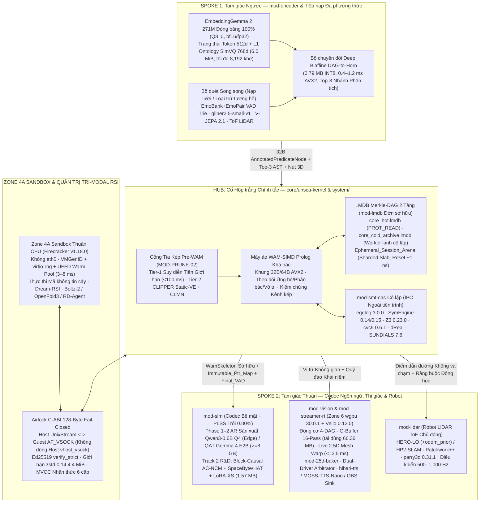

#### 6 Phân hệ Tương tác Lõi

1. **Lõi Prolog Khả bác Biên dịch (`core/unsca-kernel`):** Chạy máy ảo `WAM-SIMD` căn chỉnh theo thanh ghi SIMD trên nút vị từ 32-byte và khung nhánh 64-byte. Tách rõ đánh giá thân luật với tách đầu luật, nâng cấp theo giai đoạn từ Stratified Horn/Datalog (Phase 1A) lên tabling thuần Rust kèm bao hàm ràng buộc (Phase 1B), đối chiếu ngữ cảnh bằng dấu vân tay `SpecTemp` SimHash 64-bit, tỉa luật 2 chế độ trước WAM, và đẩy khám phá quy luật (`EGG-SR`) cùng kiểm chứng SMT 4 truy vấn sang worker cô lập.
2. **LMDB Merkle-DAG 2 Tầng (`modules/mod-lmdb`):** Kết hợp `Core_Axiom_LMDB` chỉ đọc ánh xạ bộ nhớ (tách `core_hot.lmdb` và `core_cold_archive.lmdb` chạy ở worker lạnh riêng qua `heed 0.23.1`) với vùng nhớ phiên `Ephemeral_Session_Arena` giải phóng toàn bộ nhánh không được chọn trong ~1 ns.
3. **Bộ mã hóa Tách rời (`mod-encoder`) & Codec Bề mặt (`mod-slm`):** Ghim `EmbeddingGemma 2` 271M đóng băng 100% (`Q8_0`, xuất trạng thái 512d qua bản vá `llama.cpp` PR `#30054` hoặc ONNX đầu ra kép + bảng SimVQ Ontology cấp 1 768d với `MAX_NCM_CONCEPT_ID = 8191`) kết hợp đầu Deep Biaffine 0.79 MB INT8 cho luồng nhanh Tier-1 và kiểm chứng khứ hồi + `GenV+HN` cho Tier-2. Giai đoạn sản xuất 1–2 dùng AR gọn (`Qwen3-0.6B Q4` trên Edge; `QAT Gemma 4 E2B` trên Workstation/Server >= 8 GB RAM) + Typed AST Pretty-Printer + ghép con trỏ không sao chép `PLSS`, trong khi `Block-Causal AC-NCM` + `SpaceByte/HAT` + `LoRA-XS` (1.57 MB) phát triển độc lập ở Track 2 R&D.
4. **Tổng hợp Thị giác 2D/2.5D/3D, VTuber 2.5D & Robot LiDAR (`mod-vision`, `mod-streamer-rt`, `mod-lidar`):** Đạt >120 FPS (<= 2.45 ms/khung ở chế độ 2.5D Mesh Warp) nhờ Động cơ Công cụ 4-DAG, `V-JEPA 2.1` + khớp biên màu CIELAB + `Windfoil` giới hạn + `MI-GAN` cắt vùng (MIT), `mod-25d-baker` (1 góc *Unleashed* / 6 góc *Strict* + 52 ARKit blendshapes + `VirtualProxyRig3D`), luồng livestream 2.5D (`ALGORITHM 3B` + `mod-streamer-io` + Dual-Driver Arbitrator + OBS zero-copy + TTS Apache-2.0 không phụ thuộc eSpeak), `wgpu 30.0.1` + `vello 0.12.0` G-Buffer 16-pass tái dùng 66.36 MB, và robot LiDAR 500–1,000 Hz (`HERO-LO`/`HP2-SLAM` + `Patchwork++` + `parry3d 0.31.1`).
5. **Runtime Sandbox MIT & Tự cải tiến Ba chế độ (`modules/mod-rsi-sandbox`):** Cô lập mã không tin cậy trong Firecracker v1.18.0 thuần CPU (Zone 4A), điều phối `RSI-1` (Mơ ngoại tuyến + `E-Stitch`/`GrowLibm`/`Propper`), `RSI-2` (lớp phủ sở thích cục bộ Edge `<5 MB` đối chiếu Kết tinh 4 Cổng ở Trainer trung tâm) và `RSI-3` (tiếp nạp trực tuyến có phép qua Trọng tài Host DeLP + RPC `Boltz-2`/`OpenFold3`/`GROMACS` + Quản trị Nhận thức 6 cấp) qua Airlock 128-byte.
6. **Phục vụ Sản xuất Micro-Batch Lai & Lộ trình Stage-Gate:** Kết hợp cô lập phiên ký hiệu Zero-Batching (<5 us/phiên trên `mmap` chỉ đọc dùng chung) với Ragged Dynamic Micro-Batching cho các spoke nơ-ron dùng chung cơ sở, hạch toán RAM tách biệt `cgroup v2`, 6 quy tắc gia cố hạ tầng và cổng cắm nóng **Gemma 5** không cần sửa dòng Rust nào.

---

### 4. Các Pipeline Thực thi Đầu-Cuối & Phân hệ

#### 4.1 Pipeline Nhận thức Đa phương thức (`POST /v1/cognitive/execute`)

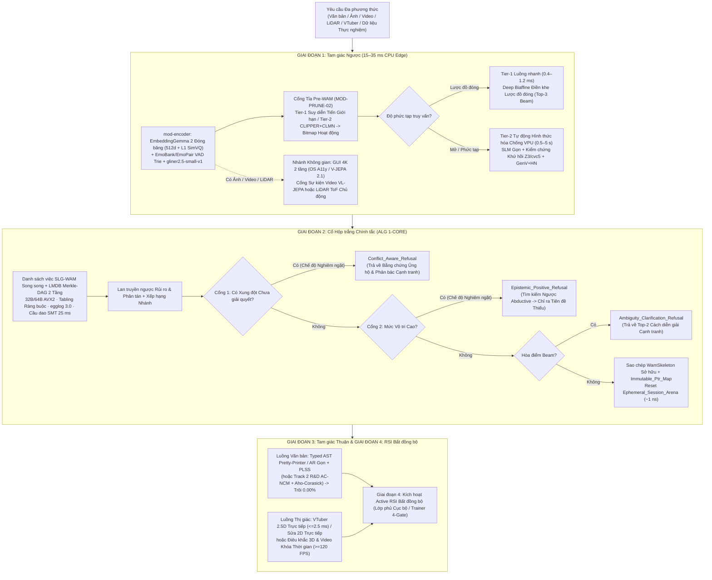

#### 4.2 Pipeline Thị giác 2 Nhánh & Robot LiDAR Chủ động

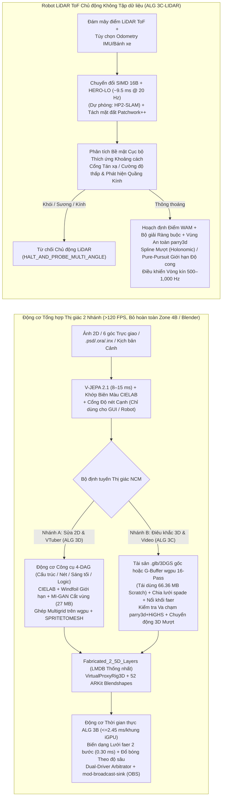

#### 4.3 Pipeline Tự cải tiến Đệ quy Ba chế độ (`Tri-Modal RSI`) & Airlock 128-Byte

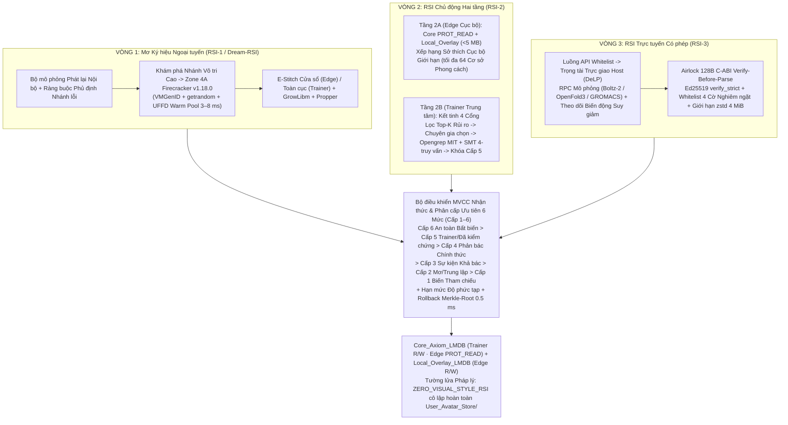

---

### 5. Ngân sách Bộ nhớ Edge (`cgroup v2`), Bất biến ABI & Thông số Mục tiêu

#### 5.1 Kiểm toán Bộ nhớ Phân tách `cgroup v2` Chế độ Edge (`anon <= 1,536 MiB`, `memory.high = 3,072 MiB`, `memory.max = 4,096 MiB`)

| Thành phần Chế độ Edge | `anon` (MiB) | `file` (MiB) | Cơ chế Cấp phát & Chính sách Gia cố |
| :--- | ---: | ---: | :--- |
| **HUB (`WAM-SIMD` + Arena + `egglog`)** | 350 | 0 | Sharded slabs, `TableSlots`, `egglog` (giới hạn 10k e-nodes) |
| **`Qwen3-0.6B Q4` KV + Bộ nhớ tạm** | 159 | 0 | Khóa `-c 2048 -ctk q8_0 -ctv q8_0 -fa on` (119 MiB KV + 40 MiB tạm) |
| **`mod-encoder` / `ort` / VAD Trie** | 220 | 40 | Kích hoạt bf16/fp32 đóng băng, `gliner2.5-small-v1` (`disable_prepacking=1`), `canonical_ontology.bin` |
| **`mod-streamer-rt` (Live 2.5D + TTS)** | 285 | 0 | `wgpu 30.0.1` + ARAP + theo dõi khuôn mặt + `hibari`/`MOSS-TTS-Nano` ONNX (chạy song song 100%) |
| **Ngăn xếp Runtime, Bộ cấp phát & IPC** | 150 | 0 | Rayon worker stacks, bộ đệm `UnixStream`, khe `io_uring` |
| **`EmbeddingGemma 2` (`Q8_0 .gguf`)** | 0 | 296 | Page Cache `mmap` chỉ đọc (tuyệt đối không gọi `POSIX_FADV_DONTNEED`) |
| **`Qwen3-0.6B Q4` (`.gguf`)** | 0 | 500 | Page Cache `mmap` chỉ đọc (tuyệt đối không gọi `POSIX_FADV_DONTNEED`) |
| **Bytecode `.wamb` đã biên dịch** | 0 | 150 | `0_bootstrap_seed` + `1_logic_math_core` ánh xạ `mmap` trực tiếp |
| **Tập làm việc nóng `core_hot.lmdb`** | 0 | 600 | `MADV_RANDOM`; `core_cold_archive.lmdb` cô lập trong tiến trình worker lạnh riêng |
| **Tổng Chế độ Edge** | **1,164** | **1,586** | **Tổng `anon+file` ~2,750 MiB** (dự phòng `anon` ~372 MiB; `mod-smt-cas` Z3 giới hạn <= 300 MiB) |

> **Bất biến C-ABI Rust Căn chỉnh Phần cứng (`const _: () = assert!(...)`):** `AnnotatedPredicateNode` = **32 B** (1 thanh ghi AVX2 YMM) · `ArenaBranchStateHeader` = **48 B** · `WamBranchExecutionFrame` = **64 B** (1 dòng cache L1) · `UnifiedDagNodeHeader` = **128 B** · `AirlockEpistemicFrame` = **128 B** (2 dòng cache L1) · `NcmConceptHyperGraphRecord` = **1,568 B**.

#### 5.2 Bảng Đặc tả Hệ thống Mục tiêu (`Takuma-1 / TNS-1`)

| Chỉ số Đặc tả | Giá trị Mục tiêu Thiết kế | Bảo đảm Kỹ thuật Nền tảng |
| :--- | :--- | :--- |
| **Dung lượng Lõi Tối thiểu** | `1.8 GB` (`0.4 GB` hồ sơ nhúng nén tối đa + `25 MB` Seed Ngày-0) | Bytecode `WAM-SIMD` + `Core_Axiom_LMDB` nén Zstd (hỗ trợ sparse NTFS) + khử trùng lặp BLAKE3 |
| **Kho Mở rộng Offload** | `10 GB–50 GB` NVMe SSD (`4096 B` LBA `O_DIRECT`) | 3D Style PatchBanks + WGSL LUT nạp theo yêu cầu; `LoRA-XS` (1.57 MB) thường trú RAM |
| **Cô lập Phiên Người dùng (Server)** | `< 5 us` / phiên (`Ephemeral_Session_Arena`) | Rayon đa nhân trên `mmap` chỉ đọc chung; Zone 4A Firecracker cho mã không tin cậy |
| **SLA Độ trễ Truy vấn** | Tier-1: `P99 < 100 ms` (`8–45 ms` 8-core AVX2) · Tier-2: `0.5–5 s` | Khung 32B/64B AVX2 + Tier-1 suy diễn tiến giới hạn + `egglog 3.0` + cầu dao SMT 25 ms |
| **Thông lượng Sinh Văn bản** | Phase 1–2 AR: `34–86 tok/s` · Mục tiêu Track 2 AC-NCM: `470–750 BPE-equiv tok/s` | `Qwen3-0.6B` (Edge) / `QAT Gemma 4 E2B` (>= 8 GB) + `PLSS`; Track 2 mở cổng khi CPU PPL < 45 |
| **Tốc độ Thị giác & Robot** | `120–408+ FPS` (<= 2.45 ms/khung 1080p/2K) · Robot: `500–1,000 Hz` | `faer` Cholesky + biến dạng lưới 2 bước (`0.30 ms`) + ghép Porter-Duff theo độ sâu + `parry3d` |
| **Tỷ lệ Trôi Sai số Miền đóng** | **`0.00%`** trên thực thể/con số khóa con trỏ (`<PTR_ID_k>`) | `WamSkeleton` + kiểm tra Aho-Corasick + ghép byte không sao chép `PLSS` |
| **Hành vi Vô tri / Xung đột cao** | **`100%` tất định** Từ chối Nhận biết Xung đột / Chủ động / Hỏi làm rõ | Cổng Xung đột đánh giá trước Cổng Vô tri Kép truy tìm tiên đề thiếu và hỏi làm rõ khi hòa nhánh |

---

### 6. Môi trường Host, Quy tắc Gia cố Hạ tầng & Gói phát hành

Cấu trúc thư mục gói phát hành được mô tả ở [Phụ lục A](#appendix-a-release-package-layout).

**Yêu cầu Môi trường Host (Linux `x86_64`, AVX2 + FMA + AVX-VNNI):**

- **Kernel:** Ubuntu 24.04 / Linux Mint 22.x (`USN-9022-1`, `>= 6.8.0-149-generic`, `kernel.io_uring_disabled=0`) hoặc LMDE 7 / Debian 13 (`>= 6.12.113-1`, vá `CVE-2026-99999`). Chặn `vhost_vsock` trên Host để loại bỏ bề mặt tấn công `CVE-2026-53365` (*VsockDrop*); dùng kernel khách Firecracker `>= 6.18.34` với `kernel.io_uring_disabled=2`.
- **Toolchain:** Rust Edition 2024 qua `rustup` (`MSRV 1.96`, khuyến nghị `1.100`; khóa `[profile.release] panic = "unwind"` ở `Cargo.toml` gốc để `spade 2.15.1` dự phòng an toàn sang `earcutr`).
- **Lưu trữ & KVM:** `ext4`/`xfs` không mã hóa (hoặc LUKS toàn đĩa; không dùng `eCryptfs`) cho `O_DIRECT`; thêm người dùng vào nhóm `kvm` và nâng `RLIMIT_MEMLOCK` nếu đăng ký bộ đệm `io_uring` cố định >8 MB.

**6 Quy tắc Gia cố Hạ tầng Sản xuất:**

1. **I/O Căn chỉnh & Luồng Ring Chuyên biệt:** Cấp phát bộ đệm DMA căn chỉnh 4096-byte trên heap cho `O_DIRECT`; chạy `io_uring` trên luồng I/O ghim cố định (bọc tương thích Windows DirectStorage/IoRing và macOS `dispatch_io`).
2. **Cô lập CSDL & Tập tin Thưa:** Mở `RoTxn` riêng cho từng worker trên `core_hot.lmdb` (`max_readers = 4096`, `MDB_NOTLS`), tách `core_cold_archive.lmdb` sang tiến trình worker lạnh riêng, làm mới snapshot Dream-RSI mỗi 50 ms và bật `FSCTL_SET_SPARSE` trên Windows NTFS.
3. **Cập nhật Bảng Điều phối WAM Không Khóa:** Dùng `crossbeam-epoch >= 0.9.20` kết hợp vòng lặp `compare_exchange_weak` để thay chuỗi lệnh vị từ ngoài chỗ mà không tranh chấp với luồng đọc.
4. **Hạch toán RAM Tách biệt & Vệ sinh Page Cache:** Áp trần riêng cho `anon` và tổng container trên `cgroup v2`, gọi `MADV_RANDOM` cho LMDB, chỉ thu hồi trang lạnh trong batch nhàn rỗi (không bao giờ đụng `.gguf`) và loại trừ tương hỗ giữa `mod-vision-heavy` với `mod-smt-cas`.
5. **Ghim Major ABI Bộ mã Khái niệm:** Đóng băng chỉ số `0..4095` làm Major ABI bất biến; mọi cập nhật OTA chỉ nối thêm vào dải mở rộng `4096..8191`.
6. **Giám sát & Cầu dao SMT 25 ms:** Xuất bộ đếm OpenTelemetry/Prometheus và ngắt ngay mọi lời gọi Z3/cvc5 trực tuyến vượt quá 25 ms hoặc trần RAM để chuyển sang hàng đợi Dream-RSI ngoại tuyến.

---

### 7. Lộ trình Stage-Gate & Giao thức Đánh giá

| Giai đoạn | Thời gian | Phạm vi & Tiêu chí Qua cổng (*Exit Criteria*) |
| :--- | :--- | :--- |
| **Phase 1A-Alpha** | Tuần 1–6 | Lõi ký hiệu thuần: Stratified Horn/Datalog bằng Rust + máy ảo nhận thức 3 trạng thái + `heed 0.23.1` Merkle-DAG + `egglog 3.0.0` + `z3`/`cvc5` + `Qwen3-0.6B` PLSS + Cổng kiểm tra hình thức bắt buộc (`cargo check/clippy/proptest`). |
| **Phase 1A-Beta** | Tuần 7–12 | Khép vòng nơ-ron: bản vá trạng thái 512d `EmbeddingGemma 2` + `SpecTemp` SimHash + Tier-1 Biaffine + Tier-2 Roundtrip/`GenV+HN`. Edge kiểm định trên **AbstentionBench & PlanBench**; Workstation/Server trên **VeriBench & SWE-bench Verified**. |
| **Phase 1B (+ Track 3A)** | Tuần 13–20 | Bảng kết quả đệ quy trái thuần Rust + bao hàm ràng buộc + kiểm chứng phi đơn điệu + Tier-2 `CLIPPER` static-VE. Nhánh **Track 3A** (2.5D/VTuber Rust Engine độc lập) khởi chạy song song từ Tháng 2. |
| **Phase 2** | Tháng 6–8 | Chưng cất 5 họ mô hình mở thương mại (`Qwen3.8-27B` + `Qwen3.6-35B-A3B`, `MiMo-V2.6`, `GLM-5.3-Flash`, `DeepSeek-V4.1-Flash-1017`, `Gemma 4`) trên AR sản xuất + PLSS (0.00% trôi `<PTR_ID_k>`). Nhánh **Track 2 AC-NCM R&D** yêu cầu OpenWebText PPL < 45 và `<PTR_ID_k>` >= 99.9%. |
| **Phase 3** | Tháng 9–11 | Tích hợp các spoke độc lập (`mod-vision`, `mod-streamer-rt`, `mod-lidar`, `mod-rsi-sandbox` Firecracker v1.18.0 + chuyển `egg-stitch` sang `egglog 3.0.0`), tinh chỉnh `Harness^2` Vòng 2 và **cổng cắm nóng Gemma 5 không cần sửa dòng Rust nào** (ghim Major ABI `0..4095`). |

**5 Bộ Benchmark Có Kiểm soát & 3 Thí nghiệm Loại bỏ (Ablation) Bắt buộc:**

1. *Bộ nhớ tổ hợp & khử trùng lặp sub-DAG:* `SWE-bench Verified`, `PlanBench`, `VeriBench` qua 100 đến 5,000 nhánh song song.
2. *Từ chối nhận thức chủ động & chống ảo giác:* `AbstentionBench` (>35,000 mục), `FalseQA` (TAR, FAR, tỷ lệ từ chối do cạn nhiên liệu, AUROC chống VPU).
3. *GUI 4K đường dài & quy trình khoa học:* `ScreenSpot-Pro`, `OSWorld 2.0`, `OSWorld-Science`.
4. *Tổng hợp thị giác 2 nhánh & LiDAR chủ động:* `BlenderGym` / `BlenderBench`, cặp ảnh mờ có kiểm soát, đường thử chướng ngại vật khói/sương/kính cho LiDAR.
5. *Thông lượng AC-NCM song song so với độ trung thực sự kiện:* tok/s CPU DDR5 kênh đôi, OpenWebText PPL, khớp chính xác `<PTR_ID_k>`.

*Ablation:* (1) tắt khử trùng lặp BLAKE3 và `Ephemeral_Session_Arena`; (2) thay theo dõi nhận thức 3 trạng thái và mặt nạ Bloom tổ tiên bằng điểm tin cậy vô hướng đơn; (3) bỏ Trọng tài Trực giao Host, Airlock 128B, theo dõi biến động suy giảm và kiểm chứng `cvc5` trong RSI trực tuyến.

---

### 8. Ngôn ngữ sử dụng, Giấy phép & Trích dẫn

**Ngôn ngữ và Định dạng Sử dụng:**

| Ngôn ngữ / Định dạng | Vai trò trong Hệ thống |
| :--- | :--- |
| **Rust** (Edition 2024, `MSRV 1.96`) | Ngôn ngữ chính: `core/unsca-kernel`, `system/`, `modules/mod-*` (WAM-SIMD, LMDB, encoder, SLM, vision, streamer, lidar, RSI sandbox) |
| **Prolog / Datalog** (Khả bác) | Ngôn ngữ luật suy diễn của kernel, biên dịch sang bytecode `.wamb` |
| **WGSL** | Shader GPU cho `wgpu 30.0.1` / `vello 0.12.0` (vật liệu thủ tục, LUT, G-Buffer 16-pass) |
| **SMT-LIB 2.6** | Biểu diễn ràng buộc và quy luật hình thức kiểm chứng bởi `z3` / `cvc5` / `dReal` |
| **DeLP** | Luật kiểm toán độc lập của Trọng tài Host (`judge_eafs_rules.delp`) |
| **C++** | Bản vá trạng thái token `llama.cpp` PR `#30054` và thư viện native gọi qua FFI (`cvc5`, `Z3`, `SymEngine`, `SUNDIALS`) |
| **Python** (Bên thứ ba) | Công cụ khoa học ngoại tuyến cô lập trong Zone 4A (`RD-Agent`, `aideml`, `Boltz-2`, `OpenFold3`); không thuộc runtime lõi |

**Giấy phép & Cô lập Pháp lý:**

- **Lõi runtime:** [MIT License](https://www.google.com/search?q=LICENSE) (`core/unsca-kernel`, `system/`, các spoke Rust).
- **Bên thứ ba & bảo vệ quyền sở hữu trí tuệ:** `cvc5` (`--poly` GMP/LibPoly, LGPLv3) và `Opengrep` CLI (LGPL-2.1, chỉ dùng tập luật MIT) chạy ngoài tiến trình qua IPC/CLI; dữ liệu VAD trie `EmoBank`/`EmoPair` (CC BY-SA 4.0) đóng gói tách khỏi nhị phân Rust theo MIT; `ZERO_VISUAL_STYLE_RSI` và crate cô lập `mod-c2pa-export` (`c2pa 0.92.2`) bảo vệ quyền tác giả của họa sĩ và hỗ trợ tuân thủ Điều 50 Đạo luật AI châu Âu (Content Credentials).

**Trích dẫn:** xem [Phụ lục B](#appendix-b-citation).

---

## Chinese (ZH)

🇨🇳 **中文** — Takuma-1 (Trinity Symbolic) / `TNS-1`

> **语言快速跳转:** [English](#english-en) · [日本語](#japanese-ja) · [Tiếng Việt](#vietnamese-vi) · [中文](#chinese-zh) · [↑ 返回顶部](#table-of-contents)

### 1. 概述与架构动机

**Takuma-1 (Trinity Symbolic)**（技术代号：**TNS-1 / Trinity Symbolic Systems**，由 **GOSIS VN** 研发）是一种功能解耦的白盒神经符号认知架构，完整遵循主工程设计规范 **U-NSCA v2 (P)**（`SPEC-UNSCA-V2-P-UNIFIED v1.0.9.3-FREEZE`，状态：*Spec Freeze — GO for Phase 1A-Alpha Track 1*）。

不同于依赖单一单体神经网络同时承担知识存储、多分支推理遍历、安全合规与表层文本/图像生成的传统路线，**Takuma-1 (`TNS-1`)** 在 ***Transformation Is All You Need*** 的设计原则下，将感知、形式推理、内存存储、语言生成、空间视觉合成与自我改进解耦为独立可审计的子系统，系统性解决单体架构的四大工程瓶颈：

| 架构瓶颈 | 单体模型的核心局限 | Takuma-1 (`TNS-1`) 的系统解决方案 |
| :--- | :--- | :--- |
| **1. 多分支推理显存不可统一** | 不同前缀或词元位置汇聚至同一子目标的推理分支会产生互异的 KV 缓存状态，无法在图中合并，导致数千条并行轨迹下内存线性膨胀。 | **双层内容寻址 LMDB Merkle-DAG**（`Core_Axiom_LMDB` + `Ephemeral_Session_Arena`），结合规范 AST 归一化、约束常量提升与 128-bit BLAKE3 子图去重（常数级 ~100 ns）。 |
| **2. 冲突证据与完全无知混同** | 常规归一化输出分布会丢失总证据量级，使均衡矛盾与完全缺乏知识呈现相同的输出表现，降低拒答可靠性。 | **三态认识追踪**（分别记录支持、反驳与显式无知），配合**冲突优先**（`Conflict_Aware_Refusal`）与**双重空虚门控**（`Epistemic_Positive_Refusal` 及溯因缺失前提搜索）。 |
| **3. 语言–逻辑耦合与对齐税** | 逻辑推理、表层语法与 RLHF 合规策略共享权重，带来内存带宽开销并扰动内部推理链路（Alignment Tax）。 | **解耦 Hub-and-Spoke 编解码器**（`mod-encoder` + `mod-slm`）+ **PLSS** 零拷贝 `<PTR_ID_k>` 指针拼接（闭域事实漂移 0.00%）+ 在存储层强制执行的**六级认识优先级体系**。 |
| **4. 像素网格生成与单目尺度模糊** | 像素扩散缺乏显式 3D 几何与碰撞不变量；被动单目视觉存在尺度模糊，密集多裁剪 4K GUI 定位也难以满足低延迟 SLA。 | **双路径 2D/2.5D/3D 构造式视觉引擎**（`wgpu 30.0.1` + `vello 0.12.0` + `spade` + `faer`，>120 FPS，<= 2.45 ms/帧）、**双层 4K GUI 定位**（OS A11y/DOM <1 ms）与**主动 ToF LiDAR 机器人控制**（`HERO-LO`/`HP2-SLAM`，500–1,000 Hz）。 |

---

### 2. 设计哲学与四大白盒安全保障

**Takuma-1 (`TNS-1`)** 以**功能解耦（Functional Disentanglement）**为核心，将认知划分为五个正交且可审计的架构平面：

1. **演绎、规划与形式验证：** 由纯 Rust 编译型 Prolog 虚拟机（`WAM-SIMD`）执行，并与跨进程隔离的约束及符号验证求解器（`egglog 3.0.0`、`SymEngine 0.14/0.15`、`Z3 0.23.0`、`cvc5 0.6.1`、`dReal`、`SUNDIALS CVODE 7.6.0`）协同。
2. **内容寻址存储：** 采用双层 LMDB Merkle-DAG（`Core_Axiom_LMDB` + `Ephemeral_Session_Arena`），以 128-bit BLAKE3 哈希索引硬件对齐的 32 字节二进制记录。
3. **语言表达与情感细腻度：** 将编码器（`mod-encoder`）与表层解码器（`mod-slm`）完全解耦，通过指针锁定语义骨架（`PLSS`）零拷贝拼接已验证实体与数值。
4. **空间定位、构造式视觉与机器人：** 融合原生 Rust GPU 视觉引擎（`wgpu 30.0.1` + `vello 0.12.0`）、2.5D 虚拟形象烘焙与直播流水线（`mod-25d-baker`、`mod-streamer-rt`）以及主动 ToF LiDAR 控制（`mod-lidar`）。
5. **沙箱演化与认识治理：** 通过三模态递归自我改进引擎（`Tri-Modal RSI`）在宿主正交裁判与 128 字节二进制气闸保护下协调离线梦境、双层主动反馈与在线授权摄取。

为确保系统演进始终透明、可控且可回滚，运行时强制执行**四项白盒安全不变量**：

1. **禁止隐式规则演化（Zero Latent Rules）：** 离线梦境推演（`RSI-1`）或在线摄取（`RSI-3`）习得的知识绝不沉淀于黑盒神经权重中，必须结晶为 `Core_Axiom_LMDB` 内可直接检视的 32 字节 `AnnotatedPredicateNode` 或显式 `SymEngine` / `SMT-LIB 2.6` 记录。
2. **白盒复杂度配额刹车与自动帕累托淘汰：** 在临时区域持续监控未验证自动生成规则的结构复杂度配额；触及上限时由自动帕累托淘汰机制以更高覆盖度、更紧凑的候选宏替换低效用宏，所有永久写入 `Core_Axiom_LMDB` 的条目必须通过四查询 SMT 形式验证。
3. **统一宿主信任平面 + 零网络 Zone 4A 沙箱与 128 字节 C-ABI 气闸：** 信任核心（`core/unsca-kernel`、边缘端 `PROT_READ` 单所有权 `mod-lmdb`、`mod-encoder`、`mod-slm`、`mod-streamer-rt` 与宿主正交裁判）运行于宿主机；非信任代码、Dream-RSI 推演及科学仿真严格隔离于纯 CPU **Firecracker v1.18.0** 微虚拟机（**Zone 4A**，剥离 `eth0`，启用 ACPI `VMGenID` + `virtio-rng` 重置种子与 3–8 ms UFFD 预热池），永久移除 Zone 4B（内联 Blender）。跨界流量经过故障关闭型 128 字节 C-ABI 气闸（`Host UnixStream <-> Guest AF_VSOCK`，宿主机零 `vhost_vsock`），信任提交均通过 RFC 8032 Ed25519 `verify_strict` 先验签后解析。
4. **亚毫秒级外科切除与 Merkle 根时间旅行回滚：** 每个提交纪元在 `Epoch_Roots` 中记录不可变 `Merkle_Root_Hash`，支持在 ~0.5 ms 内按 128-bit `node_hash` 精确切除异常节点或原子回滚至历史纪元。

---

### 3. 系统架构与双向沙漏拓扑

`TNS-1` 基于 Rust 2024 **Hub-and-Spoke** 工作区（`core/unsca-kernel` -> `system/` -> `modules/mod-*`），在闭环**双向沙漏拓扑（倒三角 -> 白盒规范颈部 -> 正三角）**上执行端到端认知。

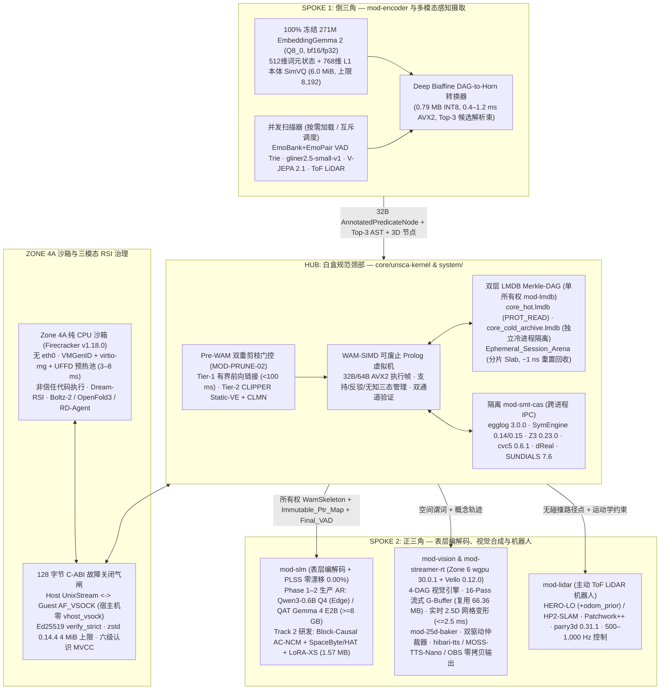

#### 六大可互操作子系统

1. **编译型可废止 Prolog 内核（`core/unsca-kernel`）：** 基于 SIMD 对齐的 `WAM-SIMD` 虚拟机，处理 32 字节谓词节点与 64 字节执行帧。分阶段从 Phase 1A 分层 Horn/Datalog 演进至 Phase 1B Rust 原生制表与约束包含，配合 64 位 `SpecTemp` SimHash 语境指纹、双模式 Pre-WAM 剪枝门控，并将经验规律发现（`EGG-SR`）与四查询 SMT 验证交由独立进程完成。
2. **双层内容寻址 LMDB Merkle-DAG（`modules/mod-lmdb`）：** 通过 `heed 0.23.1` 单所有权管理持久化只读内存映射 `Core_Axiom_LMDB`（拆分热库 `core_hot.lmdb` 与独立冷进程映射的 `core_cold_archive.lmdb`），配合会话级 `Ephemeral_Session_Arena` 实现未选中分支 ~1 ns 瞬时回收。
3. **解耦编码器（`mod-encoder`）与表层编解码器（`mod-slm`）：** 固定 100% 冻结的 271M `EmbeddingGemma 2`（`Q8_0`，经 `llama.cpp` PR `#30054` 补丁或双输出 ONNX 导出 512 维词元状态 + 768 维 L1 Ontology SimVQ，`MAX_NCM_CONCEPT_ID = 8191`）及 0.79 MB INT8 Deep Biaffine 头；Phase 1–2 生产生成采用紧凑 AR（Edge: `Qwen3-0.6B Q4` / Workstation-Server >= 8 GB: `QAT Gemma 4 E2B`）+ 类型化 AST 美化器 + `PLSS` 零拷贝拼接，而 `Block-Causal AC-NCM` + `SpaceByte/HAT` + `LoRA-XS` (1.57 MB) 作为独立 Track 2 研发分支推进。
4. **双路径 2D/2.5D/3D 视觉合成、VTuber 2.5D 与主动 LiDAR 机器人（`mod-vision`, `mod-streamer-rt`, `mod-lidar`）：** 整合 4-DAG 视觉工具引擎、`V-JEPA 2.1` + CIELAB 边缘吸附 + 有界 `Windfoil` + 局部 `MI-GAN` (MIT)、`mod-25d-baker`（单视角 *Unleashed* / 六视角 *Strict* + 52 ARKit 表情基 + `VirtualProxyRig3D`）、实时直播引擎（`ALGORITHM 3B` + `mod-streamer-io` + 双驱动仲裁器 + OBS 零拷贝输出 + 无 eSpeak 的 Apache-2.0 TTS）、原生 `wgpu 30.0.1` + `vello 0.12.0` 16-Pass 流式 G-Buffer（复用 66.36 MB）以及 500–1,000 Hz 主动 LiDAR 机器人控制。
5. **白盒 MIT 沙箱运行时与三模态 RSI（`modules/mod-rsi-sandbox`）：** 在纯 CPU Firecracker v1.18.0（Zone 4A）中隔离非信任代码，经由 128 字节气闸协同 `RSI-1`（离线梦境 + `E-Stitch`/`GrowLibm`/`Propper`）、`RSI-2`（本地边缘 `<5 MB` 偏好覆盖层 vs. 中心训练端四门控结晶）和 `RSI-3`（宿主正交 DeLP 裁判 + `Boltz-2`/`OpenFold3`/`GROMACS` RPC + 六级认识治理）。
6. **混合微批生产服务架构与分阶段门控路线图：** 结合零批处理符号会话隔离（<5 us/会话，共享只读 `mmap`）与共享基底神经不规则微批处理，执行 Linux `cgroup v2` 分离内存治理、六项生产基础设施加固规则，并提供零 Rust 代码改写的 **Gemma 5** 即插即用入口。

---

### 4. 端到端执行与核心子系统流水线

#### 4.1 端到端多模态认知执行流水线（`POST /v1/cognitive/execute`）

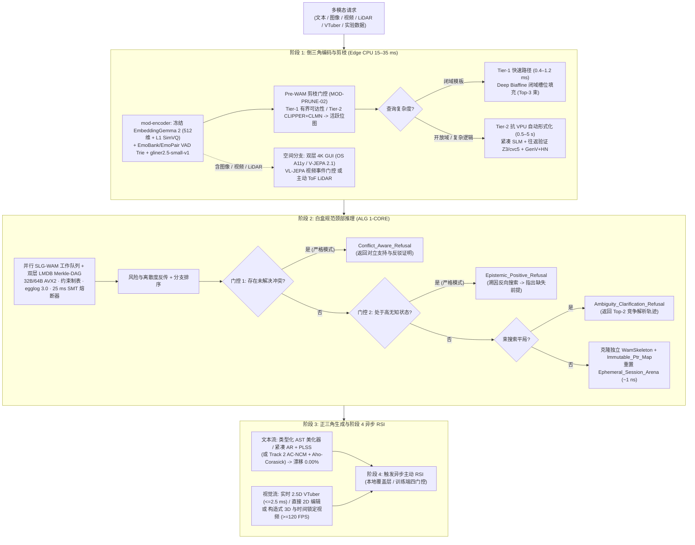

#### 4.2 双路径视觉合成与主动 LiDAR 机器人流水线

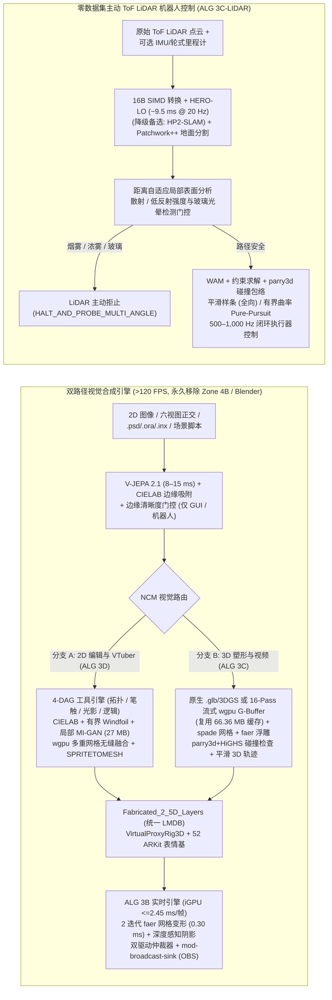

#### 4.3 三模态递归自我改进（`Tri-Modal RSI`）与 128 字节气闸流水线


---

### 5. 边缘内存预算（`cgroup v2`）、二进制不变量与目标规格

#### 5.1 边缘模式 `cgroup v2` 分离内存审计（`anon <= 1,536 MiB`，`memory.high = 3,072 MiB`，`memory.max = 4,096 MiB`）

| 边缘模式组件 | `anon` (MiB) | `file` (MiB) | 分配机制与加固策略 |
| :--- | ---: | ---: | :--- |
| **HUB (`WAM-SIMD` + Arena + `egglog`)** | 350 | 0 | 分片 Slab、`TableSlots`、`egglog`（上限 10k e-nodes） |
| **`Qwen3-0.6B Q4` KV + 计算暂存** | 159 | 0 | 锁定 `-c 2048 -ctk q8_0 -ctv q8_0 -fa on`（119 MiB KV + 40 MiB） |
| **`mod-encoder` / `ort` / VAD Trie** | 220 | 40 | 冻结 bf16/fp32、`gliner2.5-small-v1`（`disable_prepacking=1`）、`canonical_ontology.bin` |
| **`mod-streamer-rt` (实时 2.5D + TTS)** | 285 | 0 | `wgpu 30.0.1` + ARAP + 面部追踪 + `hibari`/`MOSS-TTS-Nano` ONNX（100% 并发常驻） |
| **运行时栈、分配器与 IPC** | 150 | 0 | Rayon 工作线程栈、`UnixStream` 缓冲区、`io_uring` 槽位 |
| **`EmbeddingGemma 2` (`Q8_0 .gguf`)** | 0 | 296 | 只读 `mmap` 页缓存（禁止 `POSIX_FADV_DONTNEED`） |
| **`Qwen3-0.6B Q4` (`.gguf`)** | 0 | 500 | 只读 `mmap` 页缓存（禁止 `POSIX_FADV_DONTNEED`） |
| **已编译 `.wamb` 字节码** | 0 | 150 | `0_bootstrap_seed` + `1_logic_math_core` 直接 `mmap` |
| **`core_hot.lmdb` 热工作集** | 0 | 600 | `MADV_RANDOM`；`core_cold_archive.lmdb` 隔离于独立冷进程 |
| **边缘模式总计** | **1,164** | **1,586** | **总计 `anon+file` ~2,750 MiB**（`anon` 余量 ~372 MiB；Z3 独立进程上限 <= 300 MiB） |

> **硬件对齐的 Rust C-ABI 不变量（`const _: () = assert!(...)`）：** `AnnotatedPredicateNode` = **32 B**（1 个 AVX2 YMM 寄存器）· `ArenaBranchStateHeader` = **48 B** · `WamBranchExecutionFrame` = **64 B**（1 条 L1 缓存行）· `UnifiedDagNodeHeader` = **128 B** · `AirlockEpistemicFrame` = **128 B**（2 条 L1 缓存行）· `NcmConceptHyperGraphRecord` = **1,568 B**。

#### 5.2 目标系统规格表（`Takuma-1 / TNS-1`）

| 规格指标 | 标准化设计目标 | 底层工程保证 |
| :--- | :--- | :--- |
| **最小核心存储** | `1.8 GB`（极限压缩嵌入式 `0.4 GB` + 第 0 日种子 `25 MB`） | 编译态 `WAM-SIMD` 字节码 + Zstd `Core_Axiom_LMDB`（Windows NTFS 稀疏文件支持）+ BLAKE3 去重 |
| **扩展卸载资源库** | `10 GB–50 GB` NVMe SSD（`4096 B` LBA `O_DIRECT`） | 3D 风格 PatchBank 与 WGSL LUT 按需流式加载；`LoRA-XS` (1.57 MB) 常驻内存 |
| **单用户会话隔离（服务端）** | `< 5 us` / 会话（`Ephemeral_Session_Arena`） | 共享只读 `mmap` 上的多核 Rayon 并发；Zone 4A Firecracker 隔离非信任代码 |
| **查询延迟 SLA** | Tier-1: `P99 < 100 ms`（8 核 AVX2 `8–45 ms`）· Tier-2: `0.5–5 s` | 32B/64B AVX2 执行帧 + Tier-1 有界可达性 + `egglog 3.0` + 25 ms SMT 熔断器 |
| **表层文本吞吐量** | Phase 1–2 AR: `34–86 tok/s` · Track 2 AC-NCM 目标: `470–750 BPE-equiv tok/s` | `Qwen3-0.6B` (边缘) / `QAT Gemma 4 E2B` (>= 8 GB) + `PLSS`；Track 2 需通过 CPU PPL < 45 |
| **视觉与机器人帧率** | `120–408+ FPS`（1080p/2K <= 2.45 ms/帧）· 机器人 `500–1,000 Hz` | `faer` Cholesky + 2 迭代网格变形 (`0.30 ms`) + 深度感知 Porter-Duff 合成 + `parry3d` |
| **闭域事实漂移率** | **`0.00%`**（指针锁定实体与数值 `<PTR_ID_k>`） | `WamSkeleton` + Aho-Corasick 校验 + `PLSS` 零拷贝字节拼接 |
| **高无知 / 冲突行为** | **`100%` 确定性** 冲突感知拒答 / 构造式主动拒答 / 歧义澄清 | 冲突优先门控先于双重空虚溯因搜索与束搜索平局澄清执行 |

---

### 6. 宿主机环境、生产加固规则与发布包

发布包目录结构见[附录 A](#appendix-a-release-package-layout)。

**宿主机环境要求（Linux `x86_64`，AVX2 + FMA + AVX-VNNI）：**

- **内核：** Ubuntu 24.04 / Linux Mint 22.x（`USN-9022-1`，`>= 6.8.0-149-generic`，`kernel.io_uring_disabled=0`）或 LMDE 7 / Debian 13（`>= 6.12.113-1`，修复 `CVE-2026-99999`）。在宿主机将 `vhost_vsock` 加入黑名单以消除 `CVE-2026-53365`（*VsockDrop*）攻击面；Firecracker 客户机内核需 `>= 6.18.34` 且 `kernel.io_uring_disabled=2`。
- **工具链：** 通过 `rustup` 安装 Rust Edition 2024（`MSRV 1.96`，推荐 `1.100`；在根 `Cargo.toml` 中锁定 `[profile.release] panic = "unwind"`，保障 `spade 2.15.1` 安全回退至 `earcutr`）。
- **存储与 KVM：** 使用未加密 `ext4`/`xfs`（或全盘 LUKS；禁用 `eCryptfs`）以支持 `O_DIRECT`；注册固定 `io_uring` 缓冲区 >8 MB 时需加入 `kvm` 组并提高 `RLIMIT_MEMLOCK`。

**六项生产基础设施加固规则：**

1. **对齐 I/O 与专用环线程：** 为 `O_DIRECT` 在堆上分配 4096 字节对齐 DMA 缓冲区，在专用绑定 I/O 线程运行 `io_uring`（跨平台封装 Windows DirectStorage 与 macOS `dispatch_io`）。
2. **数据库隔离与稀疏存储：** `core_hot.lmdb` 为每个工作线程分配独立 `RoTxn`（`max_readers = 4096`, `MDB_NOTLS`），`core_cold_archive.lmdb` 隔离至独立冷进程，每 50 ms 刷新 Dream-RSI 快照，Windows NTFS 启用 `FSCTL_SET_SPARSE`。
3. **无锁 WAM 分发表更新：** 使用 `crossbeam-epoch >= 0.9.20` 与 `compare_exchange_weak` 重试循环在表外更新谓词链，避免并发 RSI 写入与读线程竞争。
4. **边缘分离内存与页缓存卫生：** 分别管控 `cgroup v2` 的 `anon` 与容器总上限，对 LMDB 启用 `MADV_RANDOM`，仅在空闲批处理回收冷页（绝不回收 `.gguf`），并互斥调度 `mod-vision-heavy` 与 `mod-smt-cas`。
5. **主 ABI 码本冻结：** 冻结 Level-1 概念索引 `0..4095` 为不可变主 ABI，OTA 新增概念仅追加至 `4096..8191`。
6. **可观测性与 25 ms SMT 熔断器：** 导出 OpenTelemetry/Prometheus 指标，在线 Z3/cvc5 调用超过 25 ms 或内存上限时立即熔断并转入离线 Dream-RSI 队列。

---

### 7. 分阶段门控路线图与评估协议

| 阶段 | 周期 | 研发范围与出闸门控标准 |
| :--- | :--- | :--- |
| **Phase 1A-Alpha** | 第 1–6 周 | 纯符号核心：Rust 分层 Horn/Datalog + 三态认识虚拟机 + `heed 0.23.1` Merkle-DAG + `egglog 3.0.0` + `z3`/`cvc5` + `Qwen3-0.6B` PLSS + 强制形式探针门控（`cargo check/clippy/proptest`）。 |
| **Phase 1A-Beta** | 第 7–12 周 | 神经闭环：`EmbeddingGemma 2` 512 维补丁 + `SpecTemp` SimHash + Tier-1 Biaffine + Tier-2 往返验证/`GenV+HN`。边缘端通过 **AbstentionBench / PlanBench**；工作站/服务端通过 **VeriBench / SWE-bench Verified**。 |
| **Phase 1B (+ Track 3A)** | 第 13–20 周 | Rust 原生左递归结果表 + 约束包含 + 非单调验证 + Tier-2 `CLIPPER` static-VE。第 2 个月起并行启动独立 **Track 3A**（2.5D/VTuber Rust 引擎）。 |
| **Phase 2** | 第 6–8 月 | 五家族商用开源教师蒸馏（`Qwen3.8-27B` + `Qwen3.6-35B-A3B`、`MiMo-V2.6`、`GLM-5.3-Flash`、`DeepSeek-V4.1-Flash-1017`、`Gemma 4`）+ 解耦 **Track 2 AC-NCM 研发**（要求 OpenWebText PPL < 45 且 `<PTR_ID_k>` 完整率 >= 99.9%）。 |
| **Phase 3** | 第 9–11 月 | 集成独立模块仓库（`mod-vision`、`mod-streamer-rt`、`mod-lidar`、Firecracker v1.18.0 `mod-rsi-sandbox` 及 `egg-stitch` 移植），完成 `Harness^2` 第二轮调优，并开放**零 Rust 代码改写的 Gemma 5 即插即用入口**（主 ABI `0..4095` 冻结）。 |

**五套受控基准与三项必做消融实验：**

1. *组合式内存与子 DAG 去重：* `SWE-bench Verified`、`PlanBench`、`VeriBench`（100 至 5,000 条并发推理分支）。
2. *认知性主动拒答与抗幻觉：* `AbstentionBench`（>35,000 项）、`FalseQA`（TAR、FAR、燃料耗尽拒答率、抗 VPU 检测 AUROC）。
3. *长程 4K GUI 与科学工作流：* `ScreenSpot-Pro`、`OSWorld 2.0`、`OSWorld-Science`。
4. *双路径视觉合成与主动 LiDAR：* `BlenderGym` / `BlenderBench`、受控模糊消歧样本对、烟雾/浓雾/玻璃场景 LiDAR 障碍赛道。
5. *并行 AC-NCM 吞吐与事实保真度：* 双通道 DDR5 CPU 的 tok/s、OpenWebText PPL、`<PTR_ID_k>` 精确匹配率。

*消融实验：* (1) 关闭 BLAKE3 规范去重与 `Ephemeral_Session_Arena`；(2) 以单一置信度标量替换三态认识追踪与祖先谱系 Bloom 掩码；(3) 在在线 RSI 中移除正交宿主裁判、128B 气闸、衰减波动率追踪与 `cvc5` 形式验证。

---

### 8. 使用语言、许可与引用

**使用的语言与格式：**

| 语言 / 格式 | 在系统中的作用 |
| :--- | :--- |
| **Rust**（Edition 2024，`MSRV 1.96`） | 主要语言：`core/unsca-kernel`、`system/`、`modules/mod-*`（WAM-SIMD、LMDB、编码器、SLM、视觉、流媒体、LiDAR、RSI 沙箱） |
| **Prolog / Datalog**（可废止） | 内核推理规则语言，编译为 `.wamb` 字节码 |
| **WGSL** | `wgpu 30.0.1` / `vello 0.12.0` 的 GPU 着色器（程序化材质、LUT、16-Pass G-Buffer） |
| **SMT-LIB 2.6** | 由 `z3` / `cvc5` / `dReal` 验证的约束与规律形式表示 |
| **DeLP** | 宿主正交裁判的独立审计规则（`judge_eafs_rules.delp`） |
| **C++** | `llama.cpp` PR `#30054` 词元状态补丁，以及通过 FFI 调用的原生库（`cvc5`、`Z3`、`SymEngine`、`SUNDIALS`） |
| **Python**（第三方） | 隔离于 Zone 4A 内运行的离线科学工具（`RD-Agent`、`aideml`、`Boltz-2`、`OpenFold3`）；不属于核心运行时 |

**许可与法律隔离：**

- **核心运行时：** [MIT License](https://www.google.com/search?q=LICENSE)（`core/unsca-kernel`、`system/`、Rust 模块）。
- **第三方与知识产权隔离：** `cvc5`（`--poly` GMP/LibPoly，LGPLv3）与 `Opengrep` CLI（LGPL-2.1，仅使用 MIT 规则集）通过 IPC/CLI 严格跨进程运行；`EmoBank`/`EmoPair` VAD 字典树数据（CC BY-SA 4.0）与 MIT 许可的 Rust 二进制分开打包；`ZERO_VISUAL_STYLE_RSI` 与独立封装 `mod-c2pa-export`（`c2pa 0.92.2`）用于保护创作者知识产权，并支持满足欧盟《人工智能法案》第 50 条（内容凭证）要求。

**引用：** 见[附录 B](#appendix-b-citation)。

---

## Appendix A: Release Package Layout

Planned directory layout of the production release package. The master specification names the root directory `unsca-v2-p-release/`.

```text
tns-1-release/                          # Standardized release layout (spec: unsca-v2-p-release/)
├── manifest.json                       # SemVer metadata, Codebook ABI version, Ed25519 Merkle Root
├── 0_bootstrap_seed_axioms.wamb        # Day-0 Cold-Start Seed (~25 MB: foundational axioms, 7 SI units, 5,000 NSM primitives)
├── 1_logic_math_core.wamb              # Compiled WAM-SIMD Bytecode (~150 MB, unencrypted direct mmap)
├── 2_unified_knowledge.lmdb            # Core_Axiom_LMDB #[repr(C, align(32))] Merkle-DAG (~1.5 GB / ~0.4 GB)
├── 3_decision_scanners/                # Zone 1 Scanner Footprint (~280–295 MB Edge Mode)
│   ├── gliner2_5_small_v1_int4.onnx    # 74M DeBERTa-v3-xsmall INT4 (ort 2.0.0-rc.15)
│   ├── vad_mwe_trie.bin                # EmoBank + EmoPair VAD Trie (CC BY-SA 4.0 separated from MIT Rust)
│   ├── vjepa2_1_dense_vit_int8.onnx    # V-JEPA 2.1 Edge ViT-B/L (~180 MB, lazy-loaded / mutual-exclusion)
│   ├── migan_mit.onnx                  # MI-GAN 2D Disocclusion Inpainting (~27 MB, pure MIT)
│   ├── facelandmarker_rt.onnx          # MediaPipe FaceLandmarker / OpenSeeFace (~15–30 MB)
│   ├── anime_part_parser_int8.onnx     # Anime-Face-Segmentation MobileNetV2 UNet (MIT)
│   └── canonical_ontology.bin          # Bijective surface -> u32 predicate_id & u16 ncm_concept_id (~40 MB)
├── User_Avatar_Store/                  # Persistent 2.5D avatars (isolated by ZERO_VISUAL_STYLE_RSI)
├── 4_disk_offloaded_banks/             # NVMe SSD (4096 B LBA O_DIRECT on ext4/xfs; never eCryptfs)
│   ├── mod_encoder_gemma2.gguf         # 100% Frozen EmbeddingGemma 2 Text-Only (271M, Q8_0) + L1 SimVQ
│   ├── qwen3_0_6b_int4.gguf            # Phase 1–2 Edge AR backbone (Gemma 4 E2B for Workstation >=8 GB)
│   ├── ac_ncm_slm_int4.gguf            # [Track 2 R&D Branch] Block-Causal AC-NCM Decoder
│   ├── hibari_or_moss_tts_nano.onnx    # Apache-2.0 eSpeak-free TTS (hibari-tts EN / MOSS-TTS-Nano CJK/multi)
│   ├── visual_style_patchbank_index.lmdb
│   └── visual_style_patchbank_3d.pak   # High-res style patches + WGSL Shader Graphs + Lit-Sphere LUTs
└── 5_sandbox_runtime/
    ├── vmlinux-firecracker-6.18.bin    # Zone 4A Zero-Network Pure-CPU Kernel (>=6.18.34, io_uring_disabled=2)
    └── judge_eafs_rules.delp           # Orthogonal DeLP auditing rulebase (Host Judge only)
```

## Appendix B: Citation

```bibtex
@techreport{gosisvn2026takuma1,
  title       = {Transformation Is All You Need: Takuma-1 (Trinity Symbolic / TNS-1) — A White-Box Neuro-Symbolic Cognitive Architecture (U-NSCA v2 (P))},
  author      = {{GOSIS VN}},
  institution = {GOSIS VN Research},
  year        = {2026},
  number      = {SPEC-UNSCA-V2-P-UNIFIED v1.0.9.3-FREEZE},
  note        = {Master Engineering Design Document \& System Architecture RFC (Pre-Implementation)}
}
```

## License

The core runtime (`core/unsca-kernel`, `system/`, and the Rust spokes) is released under the [MIT License](https://www.google.com/search?q=LICENSE). Third-party components (`cvc5`, `Opengrep`, `EmoBank`/`EmoPair` data, and offline scientific tools) keep their respective upstream licenses and remain isolated, as described in Section 8 of each language.

---

**GOSIS VN** · **Takuma-1 (Trinity Symbolic)** · `TNS-1` — pre-implementation specification, not measured results.

Specification basis: `U-NSCA v2 (P)` (`SPEC-UNSCA-V2-P-UNIFIED v1.0.9.3-FREEZE`)

[↑ Table of Contents](#table-of-contents) · [English](#english-en) · [日本語](#japanese-ja) · [Tiếng Việt](#vietnamese-vi) · [中文](#chinese-zh)
